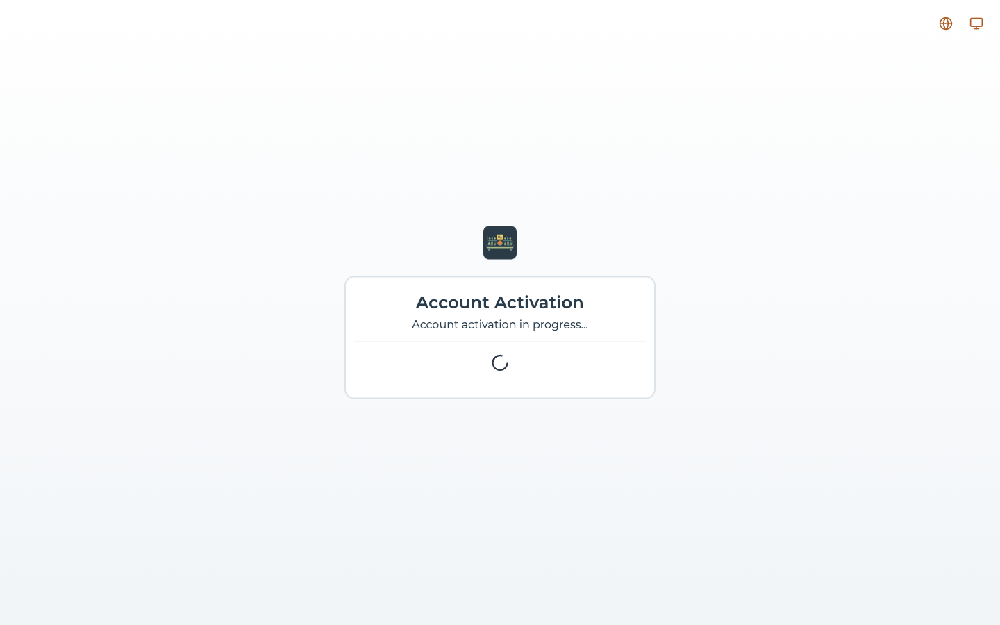
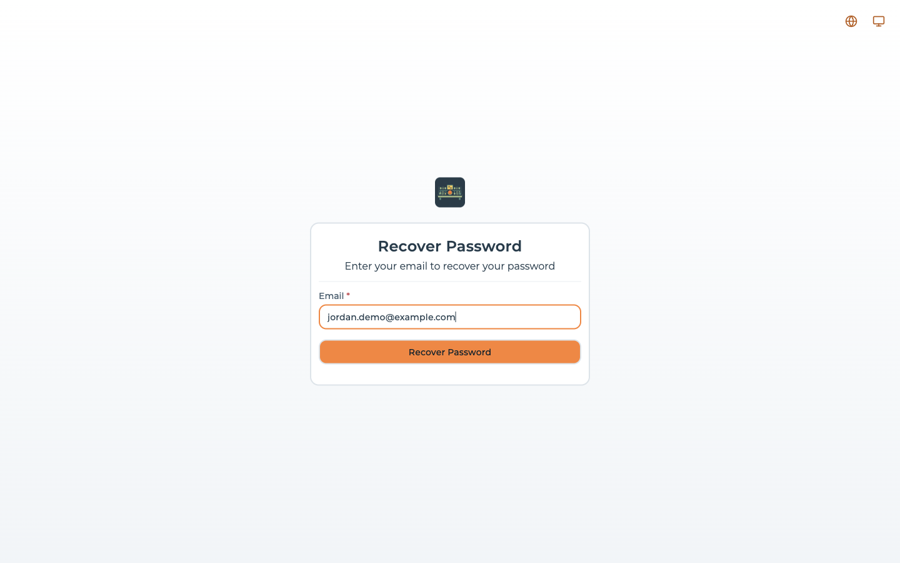
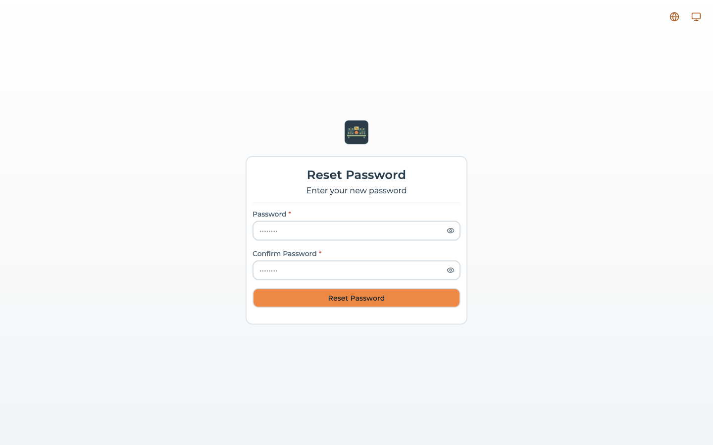
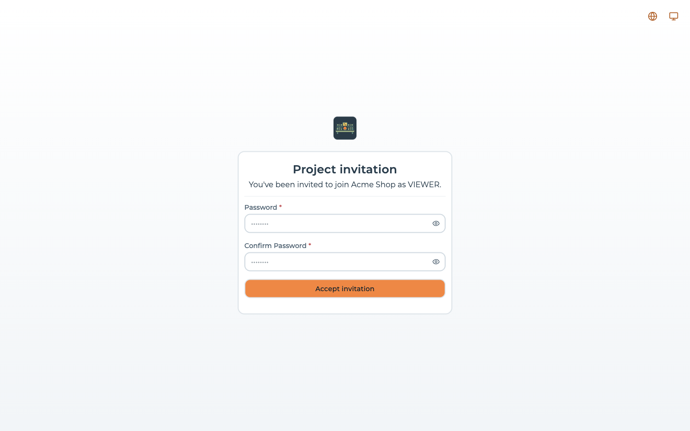
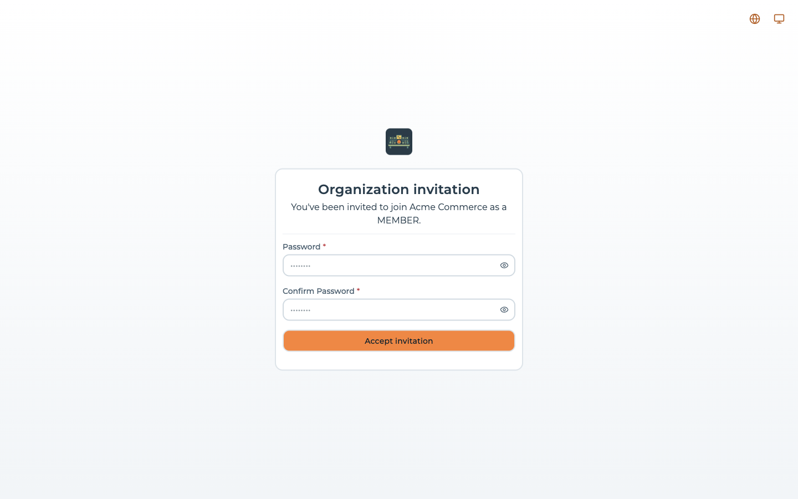
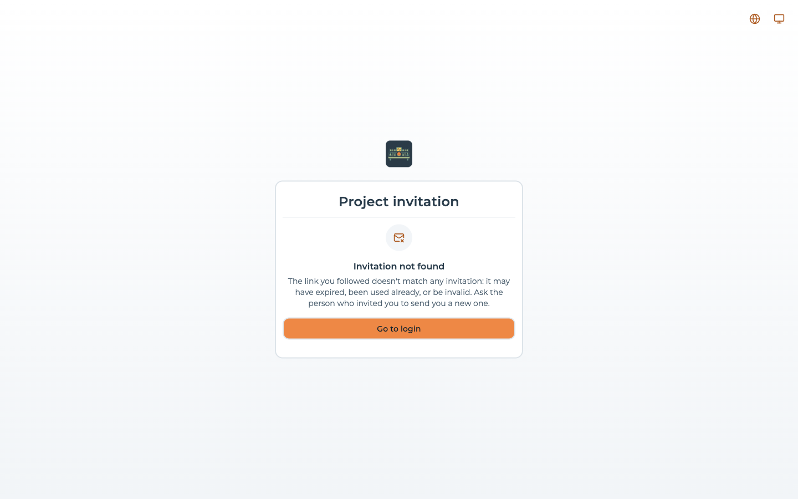

# Activation, password reset and invitations

Five routes of the console answer without a session, because each of them is the destination of a
link somebody received by email:

| Route | Reached from | The link lives |
| --- | --- | --- |
| `/account-activation/:token` | The email sent after [registering](#registration-and-activation) | 24 hours |
| `/reset-password-request` | The **Forgot your password?** link under the login form | — (it is a form, not a link) |
| `/reset-password/:token` | The email sent by that form | 1 hour |
| `/project-invitation/:token` | The email sent by [inviting somebody to a project](../project-settings/users-and-roles.md#inviting-a-member) | 5 days |
| `/organization-invitation/:token` | The email sent by [inviting somebody to an organization](../organizations/managing-an-organization.md#inviting-a-member) | 5 days |

The token is the whole of the authentication: whoever holds the link is whoever the email was sent
to, so it is worth treating one like a password until it is used.

:::danger[Without SMTP an installation cannot do any of this]
Every one of those tokens is delivered by email and by no other means. There is no screen that
prints a link, no CLI that generates one, and no way to read one back out of the console. An
installation with no `EMAIL_SMTP_HOST` therefore **cannot activate an account, cannot reset a
password and cannot confirm an invitation** — and it does not tell you so during installation.

What it does instead differs per flow:

| Flow | On an installation with no SMTP |
| --- | --- |
| Registration | Silently skipped. No activation token is created, no email is attempted, and the new account is usable straight away — nothing gates it. |
| Invitations | Silently degraded. No token, no email: the address is added as an **already active member**, with nothing having proved the person owns it. |
| Password reset | **Refused.** The recovery form answers that the installation has no email server and that resetting the password is not available; nothing is written to the account. |

Configure SMTP before you let anybody else near the console. See
[`EMAIL_SMTP_HOST` and its siblings](../self-hosting/environment-variables.md).
:::

## Registration and activation

Registering at `/register` creates the account and sends an activation email carrying a link to
`/account-activation/:token`. The screen does its work as it mounts and leaves for the login as soon
as the API answers, so what a person actually reads is the moment in between:

There is nothing to fill in and nothing to confirm. On success a toast says *"Account activated,
redirecting you to login"* and the console goes back to the login form; on a token that is unknown
or more than 24 hours old the card shows the error instead, and the account stays unactivated.

:::caution[Until the link is followed, the account cannot be used]
When the installation has SMTP, a newly registered account carries an activation token, and the API
refuses **every authenticated request** from an account that still has one. The login form itself
accepts the password — signing in succeeds — but every call the console makes after it is answered
with *401 "User not verified, please verify your email"*, so the person lands straight back on the
login form. Once the 24 hours have passed the message becomes *"User not verified and the invitation
is expired, please reset your password"*. The [MCP server](../build-with-ai/mcp-server.md) refuses
such an account in the same way.

What gates access is the activation token, not the account status: an account is stored as `ACTIVE`
from the moment it is created either way. Two kinds of account never carry a token, and are
therefore never gated:

- accounts registered on an installation **without SMTP** — there is nothing to deliver the link with;
- accounts **provisioned automatically** the first time somebody signs in through a federated
  provider such as Auth0 or Google.

Note too that `REGISTRATION_ALLOWED=false` is not a barrier either: it hides the *Register* link
without closing the route behind it, as [The first startup](../self-hosting/first-startup.md#the-endpoint-stays-open)
sets out. A self-hosted installation that must not accept accounts has to be closed off in front of
the console — a private network, an ingress rule, an authenticating proxy.
:::

Where SMTP is not configured the flow is shortened rather than broken: no activation token is
generated at all, no email is attempted, and the registration screen sends the person to the login
form with "log in to access your account" instead of "we have sent you an email".

### Locked out of an unactivated account

An activation link that expired unused is a dead end, and none of the obvious ways out works:

- following the link answers *"Activation token expired"*, and there is **no way to request a new
  activation email** — the console has no screen for it and the API no endpoint;
- [resetting the password](#recovering-a-password) changes the password but leaves the activation
  token in place, so the account is refused exactly as before — despite what the error message
  suggests;
- registering again with the same address fails, because the account already exists.

The only recovery is on the database: an operator removes `activateEmailToken` and
`activateEmailExpires` from the user's document, after which the account signs in normally. Tell
people who register to follow the link within the day.

## Recovering a password

**Forgot your password?** under the login form leads to `/reset-password-request`, which asks for one
thing:

Submitting it ends in one of three ways:

| What happened | What the screen shows |
| --- | --- |
| The address belongs to an account, and the email was sent | *"If an account exists with this email, you will receive a password reset link"*, and back to the login form |
| The address belongs to no account | An error toast — *"The password reset link could not be sent. Please try again."* — and the form stays where it is |
| The installation has no SMTP | *"This installation has no email server configured: resetting the password is not available. Contact an administrator."* Nothing is written to the account. |

The confirmation is shown only once the API has answered with success.

:::note[The screen reveals whether an account exists]
Despite the wording of the confirmation, the form is not non-committal: an address the API has
never seen is answered with an error, and the console shows that error rather than the
confirmation. Anybody who can reach the form can therefore test whether an address has an account
on the installation — worth knowing if you expose the console publicly, put it behind a WAF or read
its access logs.
:::

The email carries a link to `/reset-password/:token`, good for **one hour** and for one use — the
token is cleared from the account the moment a password is set through it.

The new password must be at least 8 characters and the second field must match the first. Both rules
are checked in the browser; the confirmation field exists only there, and the API is sent the
password alone.

## Accepting an invitation

Both invitation links land on the same shape of screen, one naming a project and one naming an
organization, each stating the role that was chosen:

The two password fields are **conditional**: they appear only when the invitee has no password yet,
which is the case for somebody the invitation itself created. Somebody who already had an account on
this installation sees the same card with nothing but **Accept invitation** on it.

Accepting does three things at once: it sets the password when one was asked for, it marks the
account active, and it signs the person in — the response carries an access token, so they land in
the console already authenticated rather than at the login form.

An invitation link is good for **five days**. The date is shown to whoever sent it, under
**Expires on** in the [pending invitations](../project-settings/users-and-roles.md#managing-invitations)
table.

### When the link does not work

A token that matches no invitation — because it was already accepted, or revoked, or mistyped — gets
a screen that says so and offers the way back:

:::caution[An expired invitation does not say "expired"]
The screen above is shown when the API answers *not found*. An invitation that exists but is past
its five days answers with a different status, and the console has no case for it: it falls back to
**"Something went wrong — We couldn't load the invitation. Please try again in a moment."**

Trying again in a moment will never help, and the person has no way to tell an expired link from a
console having a bad minute. If somebody reports that message, check the invitation's **Expires on**
date and [resend](../project-settings/users-and-roles.md#managing-invitations) it.

Both cases also raise a toast carrying the raw HTTP message — *"Request failed with status code
404"* — which is not addressed to the person reading it. Ignore it; the card underneath is the real
answer.
:::

### The route that needs no email

Somebody who is already registered and signed in does not need the emailed link at all. Invitations
addressed to them are listed inside the console, and can be accepted or declined from there — which
is also the only way an invitation can be answered on an installation where email does not leave the
building. See [Switching organization](../organizations/managing-an-organization.md#switching-organization).

## What the platform sends, and when

Four emails exist in the product. There is no fifth, no digest, and nothing periodic:

| Email | Sent when | Subject | Link expires |
| --- | --- | --- | --- |
| Account activation | An account registers, and SMTP is configured | 🎉 Activate Your Account | 24 hours |
| Password reset | The recovery form is submitted for an existing account, and SMTP is configured | 🔑 Reset Your Password | 1 hour |
| Project invitation | Somebody is invited to a project, or the invitation is resent | 🎉 You're invited to join *project* | 5 days |
| Organization invitation | Somebody is invited to an organization, or the invitation is resent | 🎉 You're invited to join *organization* | 5 days |

The origin of every link in them comes from `FRONTEND_URL` on the backend, not from the host the
browser used: set it to the address people actually reach the console at, or the links will point
somewhere they cannot follow.

Nothing here is marketing. The platform records a
[marketing consent](./profile.md#marketing-communications) where an operator turns that on, and never
sends a commercial email of its own.
