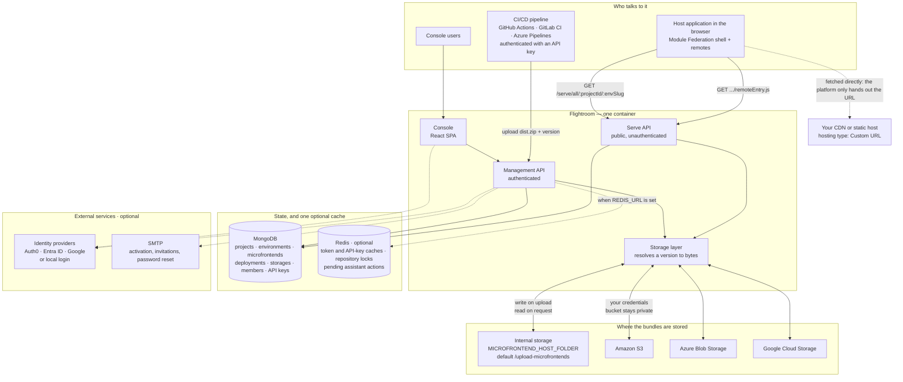
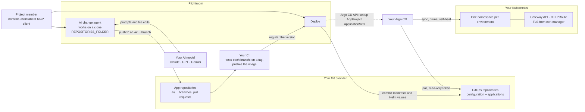
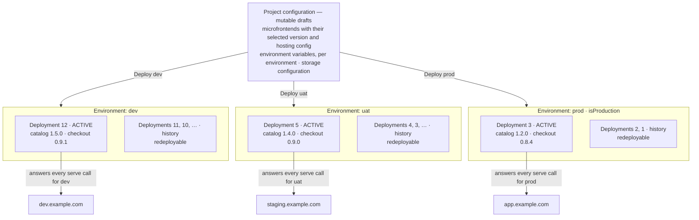
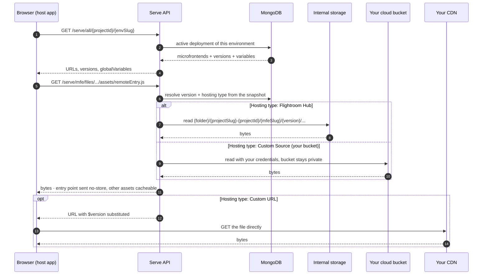
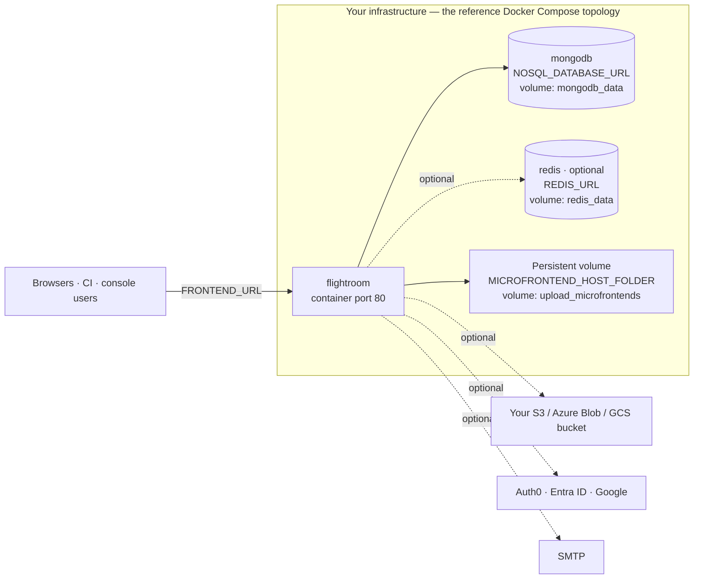

# Architecture

Flightroom is a **control plane**. It never runs your apps itself: the AI writes their code into
your Git repositories, a deploy is a commit to your GitOps repositories, and your Argo CD runs them
on your Kubernetes. For microfrontends served by Flightroom, it also stores which versions belong
to which environment and where their files live — then answers, at runtime, the single question
the host application asks: *what should I load?*

This page draws that out. If you have not read [Core concepts](./core-concepts.md) yet, start
there: the boxes below are the objects described on that page.

## The system at a glance

The orchestrator ships as **one container**, listening on port 80. Inside it there are two
processes: nginx serves the console as static files and proxies `/api/` to a Node process on
localhost:3000, which is the authenticated management API and the public serve API together. All of
it therefore arrives on one port, from one image. State lives in MongoDB — Redis is optional and
holds only short-lived caches and locks, see below. Artifacts — the actual microfrontend bundles — live outside the database,
either on the orchestrator's own storage or in a cloud bucket you own.



A few things worth reading off the diagram:

- **The browser never talks to your bucket.** For internal storage and for
  [Custom Source](./microfrontends/hosting-options.md#custom-source-your-own-bucket) buckets, the
  serve API reads the bytes server-side with your credentials and streams them back. Your bucket
  stays private and needs no CORS configuration.
  [Custom URL](./microfrontends/hosting-options.md#custom-url) is the exception *in the manifest*:
  the platform returns the URL and the browser fetches it itself — though `/serve/mfe/files/...`,
  called directly for a Custom URL microfrontend, proxies those bytes server-side like any other.
- **The serve API is public and unauthenticated** by design — it is called from browsers. The
  management API is the authenticated surface, used by the console and by CI with an
  [API key](./ci-cd/api-keys.md).
- **Artifacts are not in the database.** MongoDB holds configuration and deployment snapshots;
  bundles live on disk or in object storage.
- **Redis is optional, and has four consumers.** Without `REDIS_URL` the plugin logs a warning and
  returns, and the platform runs without it. What uses it when it is there:

  | Consumer | What it keeps | For how long | Without Redis |
  | --- | --- | --- | --- |
  | Token cache | The answer of Auth0 `/userinfo`, keyed by a SHA-256 of the token, and of Google `tokeninfo`, keyed by the token | Auth0: one hour, never past the token's own expiry. Google: one hour | Every request asks the provider again |
  | MCP API-key cache | Which API keys were just found valid by the [MCP server](./build-with-ai/mcp-server.md), keyed by a SHA-256 of the key | 60 seconds, never past the key's expiry | Kept in memory, per process |
  | Repository locks | One lock per working copy, so two [AI changes](./build-with-ai/ai-changes.md) never share a checkout | 60 seconds, renewed while the change runs | Kept in memory, per process |
  | Pending assistant actions | The destructive actions the [console assistant](./build-with-ai/console-assistant.md#confirming-actions) is waiting for you to confirm | 15 minutes | Kept in memory, per process |

  Local and Entra ID logins never touch it, the rate limiter keeps its counters in memory, and
  nothing on the serve path reads it at all. With a **single replica** Redis only saves calls to the
  identity provider. With **more than one** it matters: the in-memory fallbacks are per process, so
  without Redis two replicas can run AI changes on the same checkout at once, a confirmation can land
  on a replica that never saw the action it confirms, and an API key revoked on one replica can keep
  working on another for up to a minute.
- **Git providers are reached from the management API**, not shown above to keep the picture
  readable: with a [repository](./repositories/connect/github.md) connected, the platform scaffolds
  a repo from a template, injects a build pipeline and creates the deploy secret that pipeline
  needs.

## From a request to a running app

Building with AI and deploying to Kubernetes add three outside systems to the picture: the AI model
your organization chose, your Git provider, and your Argo CD. The orchestrator talks to each of them
over HTTPS, with credentials stored in MongoDB — encrypted when `SECRETS_ENCRYPTION_KEY` is set.



- **The agent never runs code.** It reads and writes files on a clone and pushes a branch. Your CI
  tests that branch like any other; on a tag, the template pipeline builds and pushes the image and
  registers the version with Flightroom, ready to deploy. See [Guardrails](./build-with-ai/guardrails.md).
- **The console holds no cluster credentials.** It calls the Argo CD API to set up the project, and
  commits to Git to deploy. Argo CD pulls the commit and applies it to its own cluster. See
  [Argo CD](./kubernetes/argo-cd.md).
- **No commit, no deploy.** Flightroom commits before it records a deployment; if the commit fails,
  nothing is deployed. The history of an environment is the history of its repositories. See
  [GitOps](./kubernetes/gitops.md).

## Deployments across environments

A project's configuration is mutable — versions, variables and storage settings are drafts. A
**deployment** freezes them into an immutable snapshot for **one environment**, and exactly one
snapshot is active per environment at any moment. That is what lets `prod` keep serving `1.2.0`
while you stage `1.4.0` in `uat` from the same project.



The snapshot is a **copy**, not a set of references — editing a microfrontend afterwards does not
reach back into it. Two consequences:

- **Rollback is activation, not rebuild.** Redeploying `#2` in `prod` re-activates an older
  snapshot; the artifacts it points at were never deleted.
- **Promotion is just a deployment.** Select the version live in `uat`, deploy `prod`. The bundle
  is not rebuilt or copied — both environments point at the same stored files, and what differs is
  the [environment variables](./environments/environment-variables.md) each snapshot carries.

Which environment a request belongs to can be given explicitly, or resolved from the browser's
`Referer` against the environment's [allowed domains](./environments/domains.md) — the arrows on
the right of the diagram. That is what lets one build run unchanged in every environment.

See [Deployments](./deployments/overview.md) for the full behaviour.

## How a request for a bundle is answered

The hosting type of each microfrontend decides where the bytes come from. The host application's
URL does not change between the three cases — only what the orchestrator does behind it.



The entry point is always served with `Cache-Control: no-cache, no-store, must-revalidate`, while
the hashed assets around it stay cacheable — which is why a deployment takes effect immediately
without stale chunks. All served files carry `Cross-Origin-Resource-Policy: cross-origin` so a
host on a different origin can load them.

Details: [Serve API reference](./integration/serve-api.md),
[Hosting options](./microfrontends/hosting-options.md), [Buckets](./buckets/overview.md).

### Artifact path layout

Both internal storage and your own bucket use the same deterministic layout, with the project id
in the prefix so several projects — and several installations — can share one bucket:

```
<root>/<projectSlug>-<projectId>/<microfrontendSlug>/<version>/…
```

Versions sit side by side and nothing is overwritten on release. That is what makes rollback
instant, and why you may want a lifecycle rule on old objects — see
[Housekeeping](./buckets/overview.md#housekeeping).

## Running the orchestrator itself

The same control plane runs either as the hosted console or on your own infrastructure. Only the
API base URL differs. Self-hosted, the reference `docker-compose.yaml` is the container plus
MongoDB, a persistent volume and an optional Redis:



:::caution[Mount the artifact folder]
`MICROFRONTEND_HOST_FOLDER` must sit on a persistent volume. Without it, every container restart
loses the builds uploaded to the internal storage — in the reference `docker-compose.yaml` that is
the `upload_microfrontends` volume.
:::

That diagram is the Compose topology. The Helm chart is deliberately thinner: it ships the
deployment, a service, an ingress, a persistent volume claim and the environment variables, and no
database of its own — `NOSQL_DATABASE_URL` has to point at a MongoDB you run, and `REDIS_URL`
defaults to empty, which is the supported way to run without Redis at all.

MongoDB can be replaced by a managed service, and so can Redis where you run one; the identity
providers, SMTP and cloud buckets are all optional. See
[Docker Compose](./self-hosting/docker-compose.md),
[Terraform](./self-hosting/terraform.md),
[Use external resources](./self-hosting/use-external-resources.md) and the full
[environment variable reference](./self-hosting/environment-variables.md).
