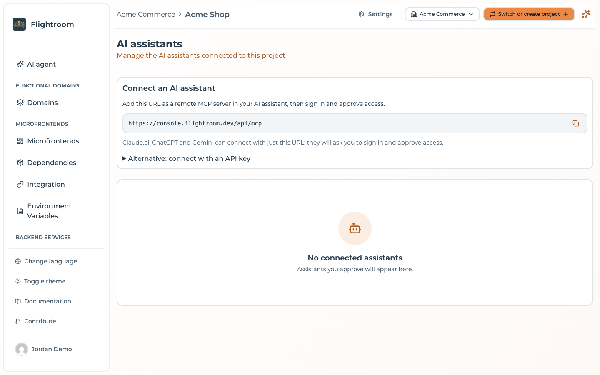
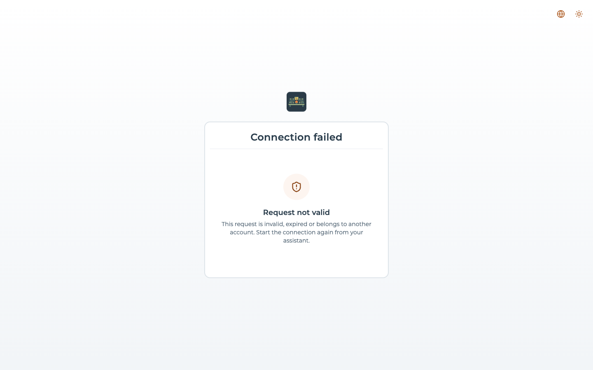

# MCP server

Flightroom can expose its features to AI clients that speak the
[Model Context Protocol](https://modelcontextprotocol.io): Claude, ChatGPT, Gemini, Claude Code, Cursor
and others. You sign in to the console from the client, pick the projects to share and whether the
client may change things, and the client then works only inside those projects, with your role.

:::info[Self-hosted installations]
The MCP server is **off by default**. It is available on self-hosted installations where an
administrator turns it on. When it is off, the **AI assistants** page of the project settings reads
*AI assistants are not enabled*.
:::

## Turning it on

Set these on the backend:

| Variable | Default | What it does |
| --- | --- | --- |
| `MCP_ENABLED` | `false` | Mounts the MCP server, the OAuth endpoints and the discovery documents |
| `FRONTEND_URL` | required | Public URL of the console: the consent page lives there |
| `JWT_SECRET` | required | Your own secret, at least 32 bytes (`openssl rand -hex 32`). With MCP on, the backend refuses to start on a missing, placeholder or short one |
| `MCP_API_KEY_ENABLED` | `true` | Lets clients that cannot do OAuth use a project API key (see below) |
| `MCP_RATE_LIMIT_MAX` | `120` | MCP requests per minute for each grant or API key, on top of the per-IP `RATE_LIMIT_MAX` (default `100`) |
| `MCP_DCR_ENABLED` | `true` | Dynamic client registration, what most clients use today |
| `MCP_CIMD_ENABLED` | `true` | Client ID metadata documents: the client is identified by the URL of a document it publishes |
| `CIMD_ALLOWED_HOSTS` | empty | Comma-separated hosts allowed to publish a client metadata document. Empty accepts any host. A client from a listed host is not flagged *Unverified application* on the consent page |
| `OAUTH_ISSUER_URL` | derived | Public URL of the OAuth authorization server, when it cannot be derived from `BACKEND_URL` or `FRONTEND_URL` (`<FRONTEND_URL>/api`) |
| `MCP_RESOURCE_URL` | derived | Public URL of the MCP server, when it is not `<issuer>/mcp` |

The discovery documents live at the origin root, outside `/api`
(`/.well-known/oauth-protected-resource`, `/.well-known/oauth-authorization-server`,
`/.well-known/openid-configuration`). The bundled nginx already routes them; if you put another proxy
in front, route them to the backend with the path untouched, and serve `/api/mcp` without buffering.

## Connecting a client

In the project, open **Settings → Access**, then **Manage** on **AI assistants**, and use **Copy MCP
server URL**. With the default layout it is `https://<your console>/api/mcp`.

- **Claude.ai, ChatGPT and Gemini** connect with just this URL: add it as a remote MCP server, and
  they ask you to sign in and approve access.
- **Claude Code**:

  ```bash
  claude mcp add --transport http flightroom https://<your console>/api/mcp
  ```



### The consent page

The client sends you to the console, where you sign in as usual and see **Connect *client***:

1. **Choose the projects to share**: one or more, at most 50, grouped by organization. The checkbox
   next to each organization (**Select all**) selects all its projects. With more than 8 projects
   the list gets a **Search projects** box.
2. **Allow changes**, or leave it off for read-only access. With it, the client can also change the
   projects, deploy, and create new projects in the organizations of the shared projects you
   administer.
3. **Approve** or **Deny**.

The page warns when something deserves a second look: *Unverified application* (the client's name is
self-asserted), *Redirect address differs from publisher*, *Local application*, *Custom link scheme*.

### When the connection fails

If the request cannot go on, the console shows **Connection failed** with the reason:

| Code | Shown as | Means |
| --- | --- | --- |
| `invalid_client` | **Unknown application** | The application that started the request is not recognized |
| `invalid_redirect_uri` | **Invalid redirect address** | The application asked to be sent to an address that is not allowed |
| `invalid_request` | **Request not valid** | The request is invalid, expired or belongs to another account. Start the connection again from your assistant |
| `server_error` | **Something went wrong** | An unexpected error. Also shown for any other code |



## What a client can do

| Scope | Granted by | Allows |
| --- | --- | --- |
| `mfe:read` | Always | Reading the project: microfrontends, services, domains with their links and their deployed versions, environments, deployments, canary users, variables, config maps, secrets (values masked), build status, storages, databases and repository connections (credentials masked), dependency and integration plans |
| `mfe:write` | **Allow changes** | Everything the console does inside a project, **deploy and rollback included**, plus creating projects and creating a microfrontend or a service with its repository from a template (`microfrontend_scaffold`, `service_scaffold`). Rollback re-activates a snapshot and does not touch Kubernetes: see [Rolling back a Kubernetes deploy](../kubernetes/rollback.md) |

The role caps each project separately and is read again on every call. On a project where you are a
**Viewer**, every write is refused whatever the grant says, and the consent page tells you which
selected projects stay read-only. Demoting a member takes write access away from their clients
immediately.

Left out on purpose:

- API keys, and listing or revoking MCP clients;
- creating or editing storages, databases, secrets and repository connections (their input is a
  secret);
- organization settings, creating an organization, deleting projects, organizations, members and
  invitations;
- the GitOps and pipeline templates settings of a project;
- bulk creation and deletion, and the layout of the canvas;
- the user profile, bundle upload, and Flightroom's own AI code changes.

These stay in the console, where some of them are available to [Maestro](./console-assistant.md).
One connection creates at most 10 projects.

## Changing code from your own coding agent

Flightroom's AI change jobs run only in the console. A coding agent on your machine (Claude Code,
Cursor…) gets two tools instead, so it can do the work locally and still hand it back as a pull
request:

1. `repository_checkout_get` (read) returns where to clone the repository of a microfrontend or a
   service (an HTTPS URL without credentials: clone it with your own Git access), its default branch,
   and the AI context the team wrote for it, its domain and the project.
2. The agent edits the clone, following that context.
3. `code_change_submit` (write) pushes the files to a new branch, `mcp/<slug>-<timestamp>`, and opens
   a pull request against the base branch. The base branch itself is never written.

`code_change_submit` takes the commit the clone started from: if the base branch moved since and one
of the submitted files changed there too, the change is refused, so pull and submit again. The same
protected paths as the console agent apply: CI configuration, lockfiles and registry configuration
cannot be changed this way (see [Guardrails](./guardrails.md#what-the-agent-cannot-write)). One
submission carries at most 100 files and 768 KB.

## Fallback: a project API key

For a client that cannot do OAuth (a script, a CI job, a client without browser login), the MCP server
also accepts a [project API key](../ci-cd/api-keys.md), as `Authorization: Bearer <key>` or as an
`api-key: <key>` header.

- The key reaches its own project and nothing else; organization-level operations are denied.
- A `VIEWER` key reads only. A `MANAGER` key, which is what the console creates, also writes, deploy
  and rollback included, but cannot create projects.
- Whoever holds the key acts as the project, not as a person. Prefer OAuth whenever the client
  supports it, and set `MCP_API_KEY_ENABLED=false` to turn the fallback off.

The **Alternative: connect with an API key** box on the AI assistants page has ready snippets:

```bash
# Claude Code
claude mcp add --transport http flightroom https://<your console>/api/mcp \
  --header "Authorization: Bearer <api key>"
```

```json
// Gemini CLI: ~/.gemini/settings.json
{
  "mcpServers": {
    "flightroom": {
      "httpUrl": "https://<your console>/api/mcp",
      "headers": { "Authorization": "Bearer <api key>" }
    }
  }
}
```

```json
// Cursor: ~/.cursor/mcp.json (or .cursor/mcp.json in the project)
{
  "mcpServers": {
    "flightroom": {
      "url": "https://<your console>/api/mcp",
      "headers": { "Authorization": "Bearer ${env:FLIGHTROOM_API_KEY}" }
    }
  }
}
```

## Managing connections

The **AI assistants** page (`/mcp-clients`, also reached from **Settings → Access → AI assistants**)
lists the connected clients that include the current project: **Assistant**, **Projects**, **User**,
**Access** (*Read only* or *Read and write*), **Connected on** and **Last used**. A project owner or an
organization admin sees and can revoke everyone's connections that include the project; other
members see and revoke their own.

To revoke one, press the trash icon on its row and confirm in the **Revoke access** dialog. It removes
the whole grant, with all its projects, and takes effect on the client's next request.

A grant also ends by itself:

- when you lose access to all its projects;
- after **30 days** without use;
- in any case after **90 days**.

## How it works

- **Authorization**: OAuth 2.1 authorization code with PKCE (S256 only), public clients and resource
  indicators. The authorization code is single use and lives 60 seconds.
- **Tokens**: access tokens are valid 15 minutes and are distinct from console sessions: a console
  session token is refused by the MCP server, and an MCP token cannot open a console session. Refresh
  tokens rotate on every use, and a replayed one revokes the whole grant.
- **Transport**: Streamable HTTP, stateless.
- **Audit**: the log line of every tool call names the grant (OAuth) or the API key.
