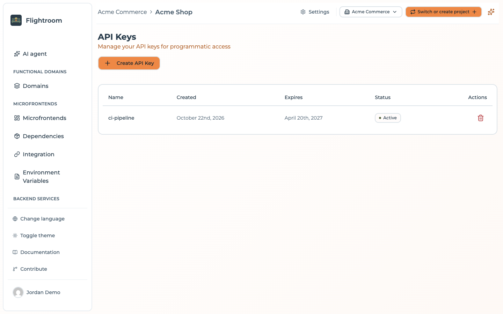
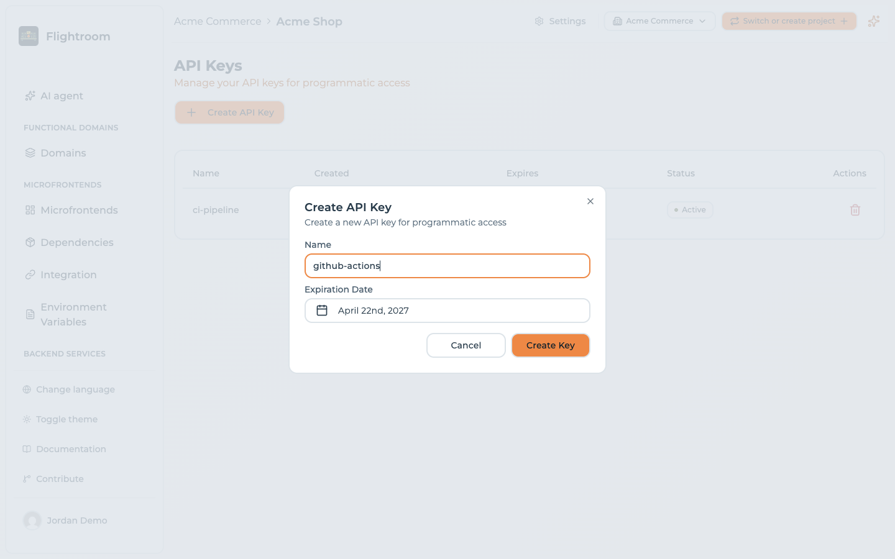

# API keys for CI/CD

An API key authenticates a machine — a CI pipeline, a deploy script, an automation job — against a
single project. Keys live on the project's **API Keys** page, reached from **Settings → Access →
API Keys**.

## Creating a key

1. Go to **Settings → Access → API Keys** and click **Create API Key**.

   

2. Give it a **Name** describing where it will be used, e.g. *catalog GitHub Actions*.
3. Pick an **Expiration Date**. The dialog proposes one six months from now. A day you pick
   yourself is sent as the *start* of that day — midnight in your browser's time zone, not UTC — so
   pick the day after the last one you want the key to work on.
4. Click **Create Key**.

   

The key is displayed once, in a dialog with a **Copy & Close** button.

:::caution[Shown exactly once]
The key is stored hashed and can never be retrieved again — the list view has no key column at all.
If you lose it, delete the key and create a new one.
:::

## Expiry

Every key carries an expiry date and the list marks it **Active**, **Expiring soon** or **Expired**
from that date. The date is enforced: from the moment it passes, a request with the key is refused
with *API key expired on …*. There is no way to create a non-expiring key.

:::tip
Put the expiry date in whatever calendar your team actually reads. Rotate before it: create the new
key first, update the consumer, then delete the old one.
:::

## What a key can call

Exactly these endpoints accept a key — `<API_BASE>` is the API URL, e.g.
`https://console.example.com/api`:

| Endpoint | What it does | Body | Role |
| --- | --- | --- | --- |
| `POST <API_BASE>/frontends/by-slug/:slug/upload/:version` | [Uploads](./manual-upload.md) the bundle of a frontend version | multipart, field `file` (a ZIP) | any |
| `POST <API_BASE>/frontends/by-slug/:slug/versions/:version` | Registers the image of a version of a frontend served by its own Docker container | JSON: `image` (required), `digest`, `commitSha` | `MANAGER` |
| `POST <API_BASE>/frontends/by-slug/:slug/environments/:envSlug/deployments` | Reports that a version of that Docker frontend now runs in an environment | JSON: `version` (required), `image`, `commitSha` | `MANAGER` |
| `POST <API_BASE>/services/by-slug/:slug/versions/:version` | Registers the image of a [service](../kubernetes/services.md) version | JSON: `image` (required), `digest`, `commitSha` | `MANAGER` |
| `POST <API_BASE>/services/by-slug/:slug/environments/:envSlug/deployments` | Reports that a service version now runs in an environment | JSON: `version` (required), `image`, `commitSha` | `MANAGER` |

The two `frontends/…/versions` and `…/deployments` routes refuse a frontend served by
Flightroom — its CI uploads a bundle instead — and the upload refuses a Docker one. The template
pipelines call the right ones for you.

Plus the [MCP server](../build-with-ai/mcp-server.md) at `<API_BASE>/mcp`, where a key stands in for
clients that cannot sign in with OAuth. There it goes in `Authorization: Bearer <key>` (or the
`api-key` header); the `?apiKey=` query parameter is **not** accepted on `/mcp`. An operator can turn
this fallback off with `MCP_API_KEY_ENABLED=false` — see
[environment variables](../self-hosting/environment-variables.md#mcp-server-and-oauth).

Everything else on the API — creating a deployment, editing a frontend, reading the build
status — is authenticated with the token of a signed-in user and answers an API key with an
authentication error. So a pipeline can *publish* a version, and it cannot *deploy* it; see
[publishing does not deploy](./manual-upload.md#publishing-does-not-deploy).

## Roles

A key carries a role in the database — `MANAGER` or `VIEWER` — and neither the console nor the API
gives you anything to do with it.

- **You cannot choose it in the console.** The create dialog asks for a name and an expiry date,
  nothing else, and every key it produces is a `MANAGER`. `POST /api-keys` accepts an optional
  `role` in its body and defaults to `MANAGER` when it is missing. Keys created automatically for a
  scaffolded repository are `MANAGER` too.
- **It is checked where it matters for CI and AI clients.** Registering the version of a service or
  a Docker frontend, and reporting where it was deployed, require a `MANAGER` key. The
  [MCP server](../build-with-ai/mcp-server.md) gives a `VIEWER` key read-only tools. Uploading a
  frontend bundle does not read the role. A `VIEWER` key can be created through the
  [console assistant](../build-with-ai/console-assistant.md), not from the create dialog.

Treat the *key itself* as the credential to protect. Anywhere the
CI pages ask for a key, any key the console gives you is the right one.

## Keys created for you

You often do not need to create a key at all. Connecting a code repository — or editing an existing
connection — creates a key and writes it into your Git provider under the name the generated
pipelines read, `FLIGHTROOM_API_KEY`. It happens once per connection, not once per
frontend, and is skipped when a secret of that name already exists.

| Provider | Where the key is written | Scope |
| --- | --- | --- |
| GitHub | Organization secret, visible to all repositories | The organization on the connection |
| GitLab | Group CI/CD variable | The group you selected on the connection |
| Azure DevOps | Variable group `MFE_ORCHESTRATOR_SECRETS` | The Azure DevOps project |

:::caution[A personal GitHub account gets no organization secret]
Each injector needs an organization or group id and returns without doing anything when there is
none. A GitHub connection to a personal account has no organization, so no secret is written and a
pipeline in an existing repository cannot authenticate — the publish step fails with an
authentication error on its first run and nothing in the console says why.

For repositories the console creates itself under a personal connection it falls back to a
**repository** secret of the same name, so those work. Repositories you connected by hand need the
secret added by hand: create an [API key](#creating-a-key) and add it as a repository secret named
`FLIGHTROOM_API_KEY`.
:::

:::caution[Connections made before the rename have the old name]
Older versions wrote the key as `MICROFRONTEND_ORCHESTRATOR_API_KEY`. Pipelines already in your
repositories read that name and keep working. A frontend or backend created from a template now gets
pipelines that read `FLIGHTROOM_API_KEY`, which a connection made before the rename does not have:
edit the connection and save it once, and the secret is written under the new name. A secret you
added by hand has to be added again under the new name.
:::

You will find these keys in the API Keys list named
`MFE_ORCHESTRATOR_DEPLOY_SECRET - <provider> - <repository>`. Do not delete them unless you intend
to break the corresponding pipeline.

:::caution[Older keys expire after 15 days]
An automatically created key now expires after a year. Older versions of the platform computed 365
*hours* instead, about 15 days, and expiry is enforced: a pipeline whose key was created that way
fails with *API key expired*. Create a new key and update the pipeline secret.
:::

## Using a key

Send it in the `api-key` header:

```bash
curl -X POST \
  -H "api-key: $FLIGHTROOM_API_KEY" \
  -F "file=@dist.zip" \
  "<API_BASE>/frontends/by-slug/catalog/upload/1.4.0"
```

On every endpoint except `/mcp`, a query parameter is also accepted, for clients that cannot set
headers:

```
<API_BASE>/frontends/by-slug/catalog/upload/1.4.0?apiKey=…
```

:::caution[Prefer the header]
Query strings end up in access logs, browser history and proxy logs. Use `?apiKey=` only when
setting a header is genuinely impossible.
:::

The project is derived from the key, so requests authenticated this way do not need a `project-id`
header.

## Stopping a key

In the console there is one action: **Delete**, the trash button on the key's row in the list.

A key can also be **revoked**: it stays in the list, and every request with it is refused with
*API key revoked*. The console has no Revoke button; the API (`PUT /api-keys/:id/revoke`) and the
[console assistant](../build-with-ai/console-assistant.md) can do it. Revoke when you want to keep the
record for the audit trail, delete when you do not.

## Good practice

**One key per consumer.** A key per pipeline, not one shared across the organisation. Rotating or
revoking then affects one thing, and the name tells you what breaks.

**Never commit a key.** Use your CI's secret store. Keys are UUIDs and match no distinctive pattern,
so secret scanners will not catch one you paste into a repository.

**Scope by project.** A key grants access to its project only. Cross-project automation needs one
key per project — which is the correct blast radius, not an inconvenience to work around.

**Treat a leaked key as a live incident.** Any key can publish arbitrary JavaScript to your
production frontends. **Delete it first, investigate second** — deleting is the only thing that
stops it, and nothing else you can do in the console reduces its access at all. Then create a
replacement and update the consumer.
