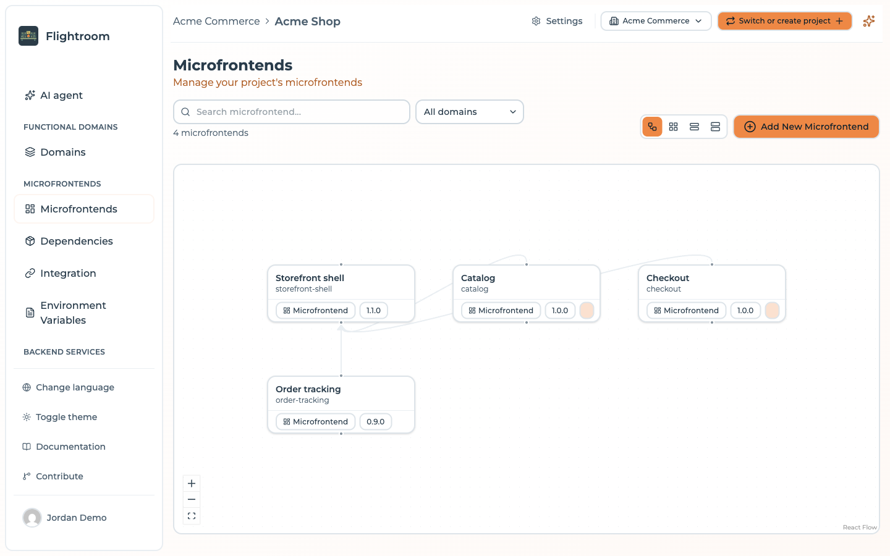

# Core concepts and object model

Before diving into the individual features, it helps to understand the handful of objects
Flightroom is built around. Everything you do in the console — and every call you make
to the API — maps onto one of them.

:::info[Apps and agents, in the console's words]
The site talks about *apps* and *AI agents*. The console names what they are made of: a web
interface is a **microfrontend**, a backend is a **service**, and an agent is a service that calls
the AI model your organization chose. A **functional domain** groups the microfrontends and
services of one business capability. There is no separate agent runtime: an agent is built,
reviewed and deployed like any other service.
:::

:::tip[Prefer a picture?]
[Architecture](./architecture.md) draws the same objects as running components: the orchestrator,
its database, the storage options and how a deployment reaches each environment.
:::

## The object model

```
Organization
├── Members (Owner, Admin, Member)
├── AI (the models the organization may use)
└── Project
    ├── Functional domain (groups microfrontends and services)
    ├── Microfrontend (web interface: served by Flightroom, or as a Docker container)
    │   └── Built version (one record per bundle or image)
    ├── Service (backend or agent, runs as a Docker container)
    │   └── Config maps and Secrets (one value per environment)
    ├── Environment (dev, uat, prod, …; a Kubernetes namespace each)
    │   ├── Environment Variables (key/value, read by the browser)
    │   └── Deployment #1, #2, #3 …  (immutable snapshots)
    ├── Code Repository (GitHub, GitLab, Azure DevOps)
    ├── Database (registered connections, tested from the console)
    ├── Storage / Bucket (S3, Azure Blob, GCS)
    ├── API Key (for CI/CD, automation and MCP clients)
    └── Members (Admin, Editor, Viewer)
```

One line in that tree is worth expanding, because the console does not spell it out. A
microfrontend carries a single `version` field: the version *currently selected*, the one the next
deployment would freeze. The versions you can select are separate records, one per bundle that has
reached the platform, keyed by microfrontend and version string. That is why the version of a
microfrontend is a list you pick from rather than free text, and why a version stays selectable long
after another has been deployed over it.

### Organization

An **organization** is the tenant that owns projects. A project belongs to exactly one organization,
and a user can belong to any number of them with a different role in each. It is the level that
decides *which projects a person can reach at all*: whoever administers the organization
(`OWNER`, `ADMIN`) reaches every project inside it, while a plain `MEMBER` reaches only the projects
they were explicitly invited to.

The organization is selected in the console header, and it scopes everything below it — the project
switcher only offers projects of the organization you are in. See
[Organizations](./organizations/overview.md).

### AI

An **AI** is a model the organization allows Flightroom to use, with the organization's own
credentials: Claude through Anthropic, Azure AI Foundry or AWS Bedrock, GPT through Azure OpenAI,
or Gemini. Organization owners and admins add them under **Organization settings → AI**, and can
restrict a project to some of them or turn AI off for it. A self-hosted installation can also
provide a read-only **System AI** from its configuration. See
[AI models](./build-with-ai/ai-models.md).

### Project

A **project** is the container every configuration object belongs to, and the boundary the project
roles are written against: microfrontends, environments, storages, repositories and API keys belong
to exactly one project. A project has a `name`, a `slug` and an `id` — all three, plus its free-text
`description`, live under **Settings → Project Information**. Two more fields are not editable
there: the `organizationId` of the organization that owns it, fixed at creation, and an `isActive`
flag.

Access to a project is granted either by an explicit project membership or by administering the
organization that owns it — see
[Organization roles and project visibility](./organizations/roles-and-visibility.md).

When you call the API directly, the project is selected with the `project-id` HTTP header.

### Environment

An **environment** is a deployment stage inside a project — typically `dev`, `uat` and `prod`,
but you can define as many as you like. Each environment has:

| Field | Purpose |
| --- | --- |
| `name` | Display name, e.g. *Production* |
| `description` | Free text |
| `slug` | URL-friendly identifier used in the public serve API, e.g. `prod` |
| `color` | Colour used to tag the environment throughout the console |
| `isProduction` | Marks the environment as a production stage |
| `domains` | The domains your application is served from — used to resolve which environment a browser request belongs to |
| `order` | Sort order in the environment selector |

The `slug` is unique within a project. When you deploy to Kubernetes, each environment also
maps to a **Kubernetes namespace** (by default its slug) and can carry a **subdomain** its apps
answer on — see [Deploy to Kubernetes](./kubernetes/overview.md).

:::info[Why domains matter]
Some public endpoints resolve the environment automatically from the browser's `Referer`
header, by matching it against the environment's **Allowed Domains**. This is what lets a
single microfrontend URL serve the right version to `app.example.com` and to
`staging.example.com`. See [Environments → Allowed domains](./environments/domains.md).
:::

### Functional domain

A **functional domain** groups the microfrontends and services that work on the same business
capability, such as *Payments* or *Onboarding*. It is the natural unit for building with AI: on an
empty domain, one request makes the AI propose the components it needs and create their
repositories, and a single AI job can change every repository of the domain at once. A domain can
also be deployed on its own. See [Generate a domain with AI](./build-with-ai/generate-a-domain.md).

### Service

A **service** is a backend that runs as a Docker container: an API, a worker, or an agent that
reasons with your AI model and calls your systems. New services start from a template — Node.js &
Fastify, Python & FastAPI, Spring Boot or Quarkus — with health checks and an OpenAPI description
already in place. Its configuration comes from **config maps** and **secrets**, one value per
environment, delivered as environment variables. See
[Deploy to Kubernetes](./kubernetes/overview.md).

### Microfrontend

A **microfrontend** is a web interface registered in a project. Its **kind** says how it is
served: as a static bundle served by Flightroom, or as its own Docker container deployed to
Kubernetes like a service. A microfrontend served by Flightroom is either:

- a **host** — the shell application that loads other microfrontends, or
- a **remote** — a microfrontend consumed by a host.

Hosts and remotes are wired together by declaring parent/child relations in the console, and
Flightroom turns those relations into the `remotes` block of your Module Federation
configuration.



Each microfrontend has a `slug` (unique per project), a `version`, and a **hosting type** that
tells the platform where its files actually live. See
[Microfrontends → Hosting options](./microfrontends/hosting-options.md).

### Environment variable

An **environment variable** (also called a *global variable*) is a `key`/`value` pair scoped to
a single environment. Unlike build-time variables baked into your bundle, these are read at
runtime by the browser, which means the same artifact can be promoted from `uat` to `prod`
without a rebuild. See [Runtime configuration](./integration/runtime-configuration.md).

### Storage (bucket)

A **storage** is a connection to an object storage bucket you own — Amazon S3, Azure Blob
Storage or Google Cloud Storage. Microfrontend builds can be uploaded to your own bucket
instead of to the hub, which keeps your artifacts inside your own cloud account. See
[Buckets](./buckets/overview.md).

### Code repository

A **code repository** is a connection to GitHub, GitLab or Azure DevOps. With one connected,
Flightroom can scaffold a new repository from a template, inject a build pipeline, and
create the deploy secret the pipeline needs. It is also where the AI writes: every AI change is
pushed to a branch of one of these repositories. See [Code Repositories](./repositories/connect/github.md).

### Deployment

A **deployment** is an immutable snapshot of everything an environment needs at a point in
time: the full list of microfrontends with their versions and hosting configuration, the
environment's variables, and the storage configuration.

This is the single most important idea in Flightroom:

:::tip[Editing is not deploying]
Changing a microfrontend's version, adding a variable, or connecting a bucket does **not**
affect what your users see. Those changes sit in the project configuration until you press
**Deploy**, which freezes them into a new snapshot and activates it.
:::

Deployments are numbered per environment (`#1`, `#2`, `#3` …) and exactly one of them is
**active** at any time. Because a snapshot is immutable, rolling back is just a matter of
re-activating an older one. See [Deployments](./deployments/overview.md).


### API key

An **API key** authenticates machines rather than people — CI pipelines, scripts, deploy jobs.
Keys are project-scoped, and they are shown once at creation and stored hashed. They also carry a
role and an expiry date. The console creates `MANAGER` keys; the role is read by the
[MCP server](./build-with-ai/mcp-server.md) and when CI registers the version of a service or a
Docker frontend. An expired or revoked key is refused. Treat a key as access to its project until it
expires, and see
[API Keys](./ci-cd/api-keys.md).

### Members and roles

Membership is recorded at two levels, and both are checked.

At **organization** level, the role decides which projects a person reaches:

| Role | In the API | Reaches |
| --- | --- | --- |
| Owner | `OWNER` | Every project of the organization; can also delete it and hand over ownership |
| Admin | `ADMIN` | Every project of the organization; can manage members and create projects |
| Member | `MEMBER` | Only the projects they were invited to |

At **project** level, the role decides what they can do inside one:

| Role | In the API | Can do |
| --- | --- | --- |
| Admin | `OWNER` | Everything, including managing members and the GitOps and Argo CD settings |
| Editor | `MEMBER` | Build with AI, manage microfrontends, services, variables and storages, and deploy |
| Viewer | `VIEWER` | Cannot use the AI, create repositories, change storages or databases, or deploy with GitOps on. Other project settings are not role-checked |

See [Roles and project visibility](./organizations/roles-and-visibility.md) and
[Members and roles](./project-settings/users-and-roles.md).

## The lifecycle of a change

Putting it together, this is the path a change takes from a request to a running app on
Kubernetes:

```
1. Describe              A project member asks for an app, an agent or a
      │                  change, on a domain, microfrontend or service
      │
2. Propose               The AI writes it on an ai/… branch of your
      │                  repositories; your CI checks the branch
      │
3. Review                Open a pull request, or apply it where branch
      │                  protection allows; or discard it
      │
4. Deploy                One click commits manifests and Helm values to
      │                  your GitOps repositories
      │
5. Sync                  Argo CD applies the commit; the app answers on its
                         URL in that environment, with TLS
```

Steps 1 to 3 are described in [Build with AI](./build-with-ai/overview.md), steps 4 and 5 in
[Deploy to Kubernetes](./kubernetes/overview.md).

For a microfrontend served by Flightroom, the path from commit to browser is different:

```
1. Commit                Your microfrontend repository
      │
2. Build & upload        CI builds the bundle and uploads it to
      │                  Flightroom (hub or your own bucket),
      │                  tagged with a version
      │
3. Register version      The version becomes selectable on the
      │                  microfrontend in the console
      │
4. Deploy                You create a deployment for an environment,
      │                  snapshotting versions + variables
      │
5. Serve                 The host application asks the public serve API
                         which URLs to load; the active deployment answers
```

Steps 2 and 3 are automated by the pipelines Flightroom injects into your repository —
see [CI/CD](./ci-cd/api-keys.md). Step 5 is described in
[Integration](./integration/overview.md).

## Two ways to run the platform

Everything above applies identically whether you use the hosted console at
[console.flightroom.dev](https://console.flightroom.dev) or run the container
yourself. The only difference is the base URL of the API:

| Setup | API base URL |
| --- | --- |
| Hosted console | `https://console.flightroom.dev/api` |
| Self-hosted | `<FRONTEND_URL>/api`, or `BACKEND_URL` if you set it explicitly |

Throughout this documentation, `<API_BASE>` refers to whichever of the two applies to you.
