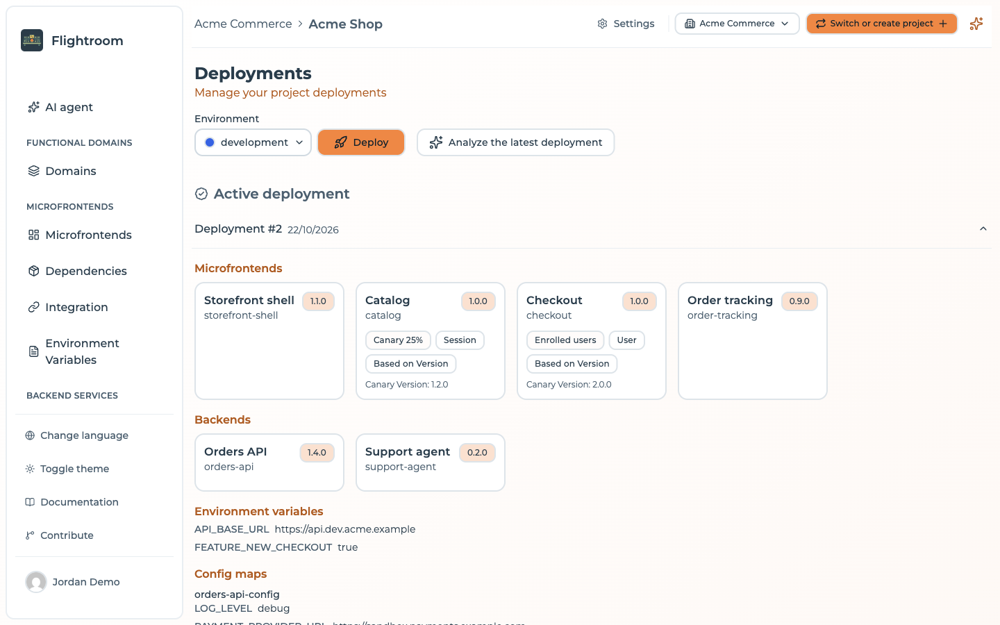

# Deployments overview

A **deployment** is an immutable snapshot of everything an environment needs, taken at the moment
you press **Deploy** and activated for your users.

This is the mechanism that makes the rest of the platform safe to use. Understanding it is worth
five minutes.

## What gets captured

When you deploy an environment, Flightroom copies into the snapshot:

- **Every frontend** in the project — its selected version, hosting configuration, entry
  point, canary settings and relation graph
- **Every backend service** of the project — its name, slug, domain, image and the version its CI
  registered last
- **Every config map and secret** of the project, as they apply to that environment: the keys set
  for it, with their values for a config map and **key names only** for a secret
- **Every environment variable** of that environment
- **Every storage configuration** of the project

The snapshot is a copy, not a set of references. Editing a frontend afterwards does not
reach back into it.

### Deploying one domain

A deploy limited to a [functional domain](../core-concepts.md#functional-domain) — and any deploy by
a member whose access is limited to specific domains — ships only the frontends and services of
those domains. Everything else the environment serves, environment variables and storages included,
is carried over unchanged from the deployment it is serving now, so one team's deploy never ships
what another domain has not released yet. Config maps and secrets are still recorded for the whole
project.

## Editing is not deploying

The single most important consequence:

:::tip
Changes you make in the console — a version bump, a new variable, a rewired remote, a bucket
swap — are **drafts**. They sit in the project configuration and affect nothing until you deploy
the environment you want them in.
:::

This is why the same project can serve `1.2.0` to production while you stage `1.4.0` for UAT: the
production snapshot was taken when `1.2.0` was selected, and it does not change under you.

## Creating a deployment

Open **Deployments** in the sidebar, select an environment in the selector, and press **Deploy**.
When the project has an AI provider, **Analyze the latest deployment** next to it asks the
[console assistant](../build-with-ai/console-assistant.md) to compare the latest deployment of the
selected environment with the previous one.
The action applies to the environment currently selected — moving `dev` and `uat` together is two
deployments, one after the other. (The API behind it, `POST /api/deployment`, takes a list of
environment ids and creates them in one transaction.)

Each deployment is numbered per environment: `#1`, `#2`, `#3` … The new deployment becomes
**active**, and any previously active deployment for that environment is deactivated. Exactly one
deployment is active per environment at any moment. The endpoints that answer *what should I load*
resolve against that flag; the ones that stream the files themselves resolve the deployment
differently, which only diverges after a rollback — see
[Serving from the active deployment](#serving-from-the-active-deployment) below.

:::caution[With GitOps on, the commit comes first]
When the project has [GitOps](../kubernetes/gitops.md) enabled, a deploy first commits what it ships
to the GitOps repositories. If that commit does not go through, nothing is deployed: the environment
keeps serving its current deployment and the deploy fails with the error the commit returned. A **Viewer**
cannot deploy a project with GitOps on.
:::

One thing travels with the new deployment without being part of your draft configuration: the
**canary enrolment** of the deployment being replaced is copied into the new one, inside the same
transaction, so deploying never silently drops the users you enrolled. See
[canary users](../frontends/canary-releases.md#canary-users).

## Reading the deployments page

The page has two parts:

**Active deployment** — the snapshot currently serving this environment, expandable to show:

- **Frontends** — one card each, with the version frozen in this snapshot and, when a canary
  is configured, the share of traffic it takes — or *Enrolled users*, for a
  [*User* canary](../frontends/canary-releases.md#who--the-canary-type), which splits nothing
  — next to its canary type, its deployment type and its target version or URL
- **Backends** — one card per backend service, with the version frozen in this snapshot
- **Environment variables** — the values frozen in this snapshot
- **Config maps** and **Secrets** — the keys each map sets in this environment; config maps with
  their values, secrets with key names only, since secret values are not kept in the deployment
- **View canary users** — the enrolment list of this deployment

Each section appears only when the snapshot has something in it.

**History** — every previous deployment of this environment, newest first, with the same detail
plus a **Redeploy** action.

**Redeploy** and changes to the canary users both need access to the **whole project**: re-activating
an older snapshot rolls back every domain at once, so a member limited to specific domains can read
the history but not redeploy from it.

Inspecting an old deployment answers "what exactly was live last Tuesday?" without archaeology
through Git.

:::tip[Which version is where]
The deployments page answers the question one environment at a time. For the whole project at a
glance — every frontend, the version each environment serves, and whether its last CI run
passed — use [Build status](./build-status.md).
:::

## Promoting between environments

There is no dedicated "promote" button, because promotion is just a deployment:

1. Note the version live in the source environment (visible in its active deployment).
2. Select that version on the frontend.
3. Deploy the target environment.

The artifact is not rebuilt or copied — both environments point at the same stored files. What
differs is the environment variables each snapshot carries, which is exactly the difference you
want between stages.

## Serving from the active deployment

Most of the public serve API resolves against the active deployment:

| Question from your app | Answered from |
| --- | --- |
| Which remotes do I load, and from where? | Active deployment's frontends |
| What is my runtime configuration? | Active deployment's variables |
| Give me this frontend's files | The **newest** deployment of the environment, which is not always the active one |

The third row is not a slip. The queries behind the manifest, the per-frontend configuration
and the variables filter on the `active` flag. The three routes that stream files do not: each takes
the newest deployment of the environment, and they do not agree on what "newest" means.

| File route | Newest by | After a rollback |
| --- | --- | --- |
| `/serve/mfe/files/:projectId/:envSlug/:mfeSlug/*` | Deployment time | Follows the rollback |
| `/serve/mfe/files/auto/:projectId/:mfeSlug/*` | Creation time | Does not follow the rollback |
| `/serve/mfe/files/:mfeId/*` | Creation time | Does not follow the rollback |

A **Deploy** stamps both times at once, so as long as you only ever deploy forwards the newest
deployment is the active one on either ordering and all three routes agree. A **Redeploy** bumps the
deployment time only, which is where they part company — described in full, with the mitigation, in
[Rollback and redeploy](./rollback-and-redeploy.md#the-file-routes-do-not-all-follow-a-rollback).
The routes themselves are listed in [Serve API](../integration/serve-api.md).

If an environment has never been deployed, these endpoints return an *Active deployment not
found* error, and the console's Integration page tells you to deploy first.

## Where to go next

- [Rollback and redeploy](./rollback-and-redeploy.md)
- [Build status](./build-status.md) — what is built, and what each environment serves
- [Integration](../integration/overview.md) — consuming a deployment from your application
