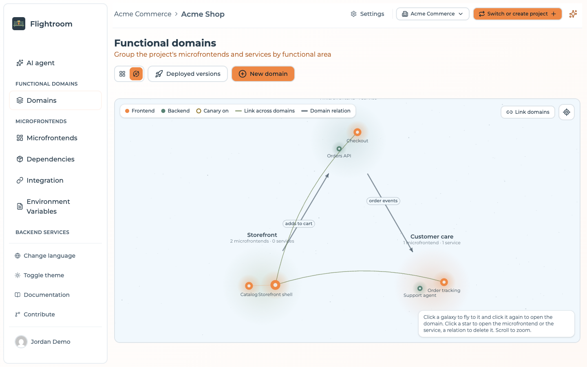
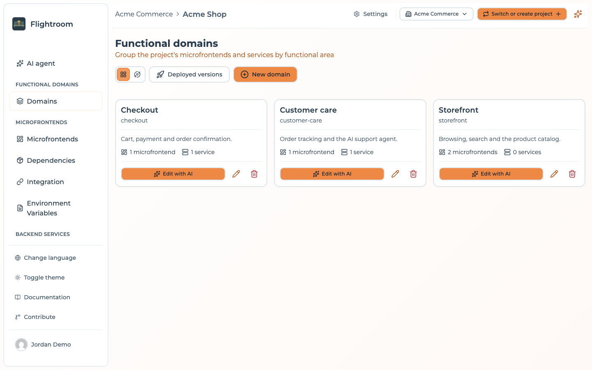
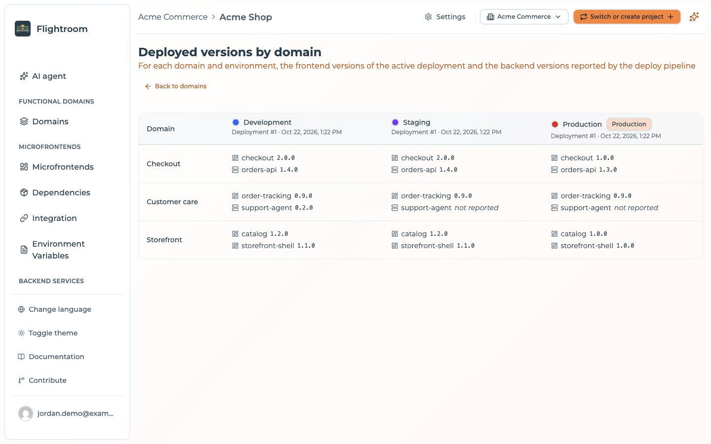

# Functional domains

A **functional domain** groups the frontends and services of one business capability, for
example *Payments* or *Catalog*: the screens and the backends that call each other. A frontend or
a service belongs to one domain at most, and can belong to none.

A domain is what you hand to the AI to change a whole capability in one request, what you deploy on
its own without touching the rest of the project, and what you can limit a member to.

## The domains of a project

Open **Domains** in the sidebar (`/domains`). The page header has a view switcher, **Deployed
versions** and **New domain**. An empty project shows *No functional domains* with a **New domain**
button instead.

### Galaxy view

The default view is a map of the project: every domain is a galaxy, and its frontends and services
are the stars.

- Click a galaxy to fly to it, and click it again to open the domain.
- Click a star to open the frontend or the service.
- Scroll to zoom; **Show everything** zooms back out to the whole project.
- The legend tells apart the stars with a canary on (**Canary on**), the links between frontends
  or services of two different domains (**Link across domains**), and the relations you drew between
  domains (**Domain relation**).

To relate two domains, press **Link domains**, click the galaxy the relation starts from, then the one
it goes to (Esc cancels). The **New domain relation** dialog takes an optional **Label**, such as
*uses* or *publishes events to*. A relation goes one way: a relation back is a relation of its own.
Click a relation to delete it; the domains and their members stay.

### Cards view

One card per domain, with its name, slug, description and the number of frontends and services.
Each card has:

- **Edit with AI**, which opens the domain;
- the pencil, to edit its **Name**, **Description** and **AI context**;
- the trash icon, to delete it. Its frontends and services stay, without a domain, and its
  relations are deleted with it.

### Creating a domain

**New domain** asks for a **Name** (required, and unique in the project), a **Description** and an
**AI context**: notes for the AI agents about this domain only, in Markdown, up to 20,000 characters.
What applies to the whole project belongs in the project context, in **Settings**.

## Deployed versions

**Deployed versions** opens `/domains/deployments`, a matrix of which version of each frontend
and service runs in each environment:

- **Rows** are the domains, then **No domain** for the frontends and services in none (shown only
  when there are some).
- **Columns** are the environments, in their order, each with its colour, a **Production** badge where
  it applies, and the deployment it serves with its date, or *Never deployed*.
- Each cell lists the members of the domain as `slug version`.

Where the versions come from is not the same for the two halves:

| Member | Version shown | When there is none |
| --- | --- | --- |
| Frontend of kind **Bundle** | The one in the deployment the environment serves (the active one), with its canary if one is on, for example `1.2.0 · canary 1.3.0 (10%)` | *not deployed* |
| Frontend of kind [**Docker**](../frontends/create-a-frontend.md#bundle-or-docker) | The latest version its deploy pipeline reported for that environment, through `POST /api/frontends/by-slug/:slug/environments/:environmentSlug/deployments` | *not deployed* |
| Service | The latest version a deploy pipeline **reported** for that environment, through `POST /api/services/by-slug/:serviceSlug/environments/:environmentSlug/deployments` | *not reported* |

:::info[A GitOps deploy alone shows "not reported"]
The backend versions come **only** from that call. A **Deploy** through
[GitOps](../kubernetes/gitops.md) does not write it, so a project that deploys its services with
GitOps and nothing else shows *not reported* in every backend cell. Add the call to your deploy
pipeline: see [Reporting where a version runs](../kubernetes/services.md#reporting-where-a-version-runs).
:::

## A domain's page

A domain opens on **Edit with AI**, with **Create version**, **Build and deploy** and **Deploy**
buttons in its header. Its name, description
and AI context are changed from **Edit** on its card in the **Domains** page.

### Edit with AI

`/domain/:id` (also `/domain/:id/ai`) is where you ask the AI for a change across the whole domain: one
agent works on every frontend and service of the domain that has a code repository, at most 10,
and proposes one change per repository. See
[Change a whole domain](../build-with-ai/ai-changes.md#change-a-whole-domain).

The page is there even without an AI: then it reads *AI editing is not available in this project: the
organization has no AI it can use.* A domain with no member, or none with a repository, is handled by
[Generate a domain](../build-with-ai/generate-a-domain.md), which creates them first.

### Deploying a domain

**Deploy** opens **Deploy *domain***: pick the environment and press **Deploy**. Only the
frontends and services of this domain are deployed; the other domains keep the versions the
environment serves now. Config maps and secrets are still deployed as they are now. The button is
hidden while the project has no environment. See [Deployments](../deployments/overview.md) and
[Deploy to Kubernetes](../kubernetes/overview.md).

### Build and deploy

**Build and deploy** releases the domain in one go. Enter the version (letters, digits, dots, dashes
and underscores, at most 128), the branch (`main` when left empty) and the environment, then press
**Build and deploy**. The console then:

1. **Build**: tags the repository of every frontend and service of the domain with the version, as
   **Create version** does. Every repository is checked first; if one fails, none is tagged and the
   dialog lists the outcome of each repository.
2. **CI**: waits for the pipeline of every tagged repository to register the version. The release
   fails if a version is still missing after 60 minutes, or as soon as every run of the tag failed or
   was canceled.
3. **Versions**: sets the version on every frontend and service that was built, even when the one
   they had looks newer. Members without a code repository are left out and keep their version.
4. **Deploy**: deploys the domain to the environment, as **Deploy** does.

The steps after the build run in the console, so the release goes on if you close the dialog or the
browser. Opening **Build and deploy** again while it runs shows its progress, member by member, and
the error if it fails. A domain runs one release at a time. Each step acts with the rights of the
member who started it: a viewer does not see the button, and it is hidden while the project has no
environment.

## Members limited to some domains

A project member can be given access to the **Whole project** or to **Specific domains** only (see
[Changing a role](../project-settings/users-and-roles.md#changing-a-role)). A member limited to some
domains:

- sees only those domains, their frontends and services, and the relations between two of them.
  The **No domain** row of the matrix never shows for them;
- cannot create, edit or delete domains, relate them, or move members into them;
- sees and starts only the AI jobs on their domains. See
  [Guardrails](../build-with-ai/guardrails.md#who-can-do-what).
