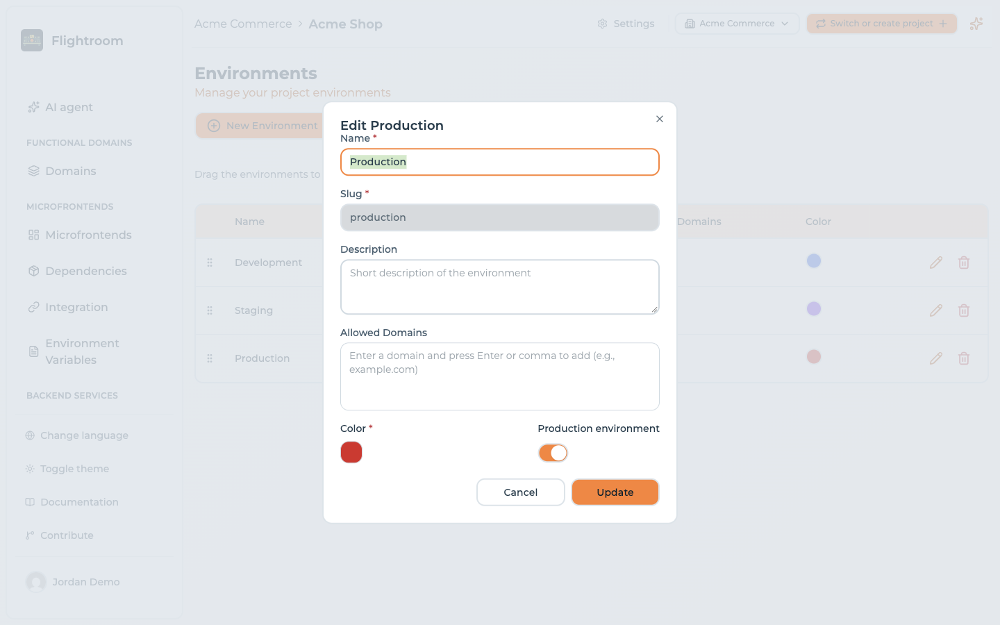
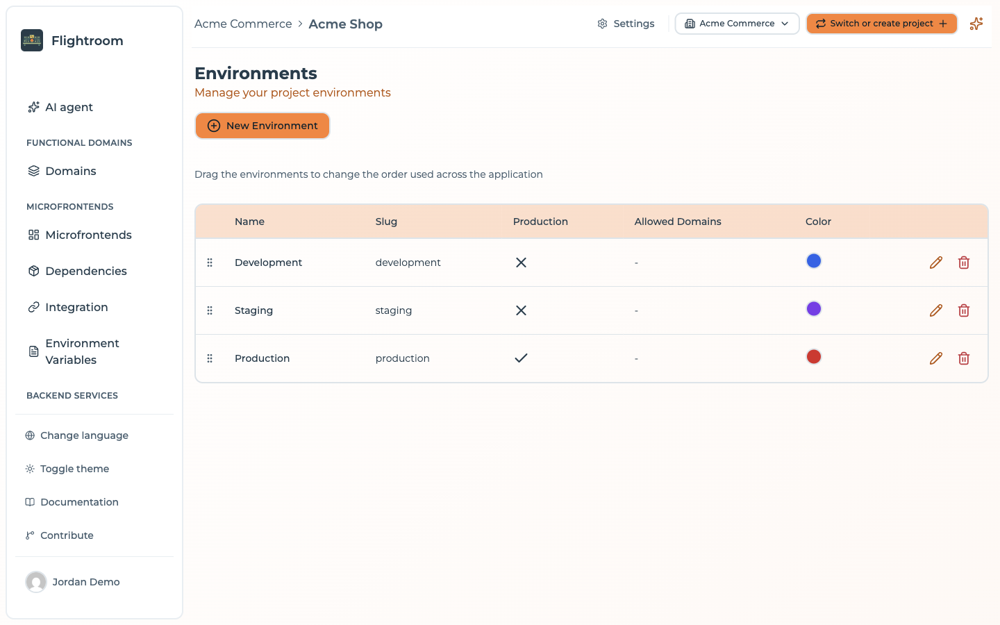

# Environments overview

An **environment** is a deployment stage of your project: `dev`, `uat`, `prod`, or whatever your
release process calls them. Environments are where versions and configuration diverge — the same
frontend can be at `1.2.0` in production and `1.4.0-rc1` in UAT at the same time.

Environments live under **Settings → Resources → Environments**.

## Creating an environment

Click **New Environment** and fill in:

| Field | Notes |
| --- | --- |
| **Name** | Display name, e.g. *Production* |
| **Slug** | URL-friendly identifier, e.g. `prod`. Unique within the project, part of your public serve URLs, and read-only once the environment exists |
| **Kubernetes namespace** | Only while [GitOps](../kubernetes/gitops.md) is on. The namespace the environment is deployed to: up to 63 lowercase letters, digits and dashes. Left empty, the slug in lowercase |
| **Subdomain** | Only while GitOps is on. The host of the environment under the project's [exposure](../kubernetes/exposure.md) domain. Left empty, the domain itself for a production environment, the slug in lowercase for the others |
| **Log level** | Only while GitOps is on. `trace`, `debug`, `info`, `warn`, `error` or `fatal`: every container of the environment gets it as `LOG_LEVEL` from its next deploy. `info` until you change it — see [Variables every container gets](../kubernetes/overview.md#variables-every-container-gets) |
| **JSON logs** | Only while GitOps is on. Every container gets it as `LOG_JSON`: `true` for one JSON object per line, `false` (the default) for plain text |
| **Description** | Free text |
| **Allowed Domains** | The domains your app is served from — see [Allowed domains](./domains.md) |
| **Color** | Used to tag the environment throughout the console |
| **Production environment** | Marks this as a production stage |

The environments of a project are listed together, with their slug, production flag, allowed
domains and colour. With GitOps on, the list also shows the **Host** of each environment, a link to
it, or its **Subdomain** while the project has no exposure domain yet. Drag a row to change the order
they appear in throughout the console:

When you set up a project through the wizard you are offered a set of **default environments**
to start from, and you can add your own alongside them.

:::caution[Slugs are public]
The environment slug appears in serve URLs such as
`<API_BASE>/serve/all/<projectId>/<environmentSlug>`. The console will not let you rename it — the
field is disabled when you edit an existing environment — precisely because renaming it breaks any
consumer using that form of the URL. `PUT /api/environments/:id` does accept a new slug, so through
the API the breakage is yours to manage.
:::

## The environment selector

Most pages in the console are scoped to one environment, chosen from the selector in the page
header. Environment Variables, Deployments and Integration all follow it — if you are wondering
why a page shows nothing, check which environment is selected.

The order of environments in the selector is configurable, so you can list them in the order
they appear in your release flow rather than alphabetically.

## What is environment-specific and what is not

This distinction matters, and it is not obvious at first:

| Object | Scope |
| --- | --- |
| Frontends | **Project** — one definition, shared by all environments |
| Services | **Project** — one definition, shared by all environments |
| Environment variables | **Environment** |
| Config maps and secrets | **Project** — but each key holds a value per environment |
| Deployments | **Environment** — each has its own numbering and history |
| Kubernetes namespace and subdomain | **Environment** |
| Storages / buckets | **Project** |
| Databases | **Project** |
| Code repositories | **Project** |
| API keys | **Project** |
| Members | **Project** |

So a frontend exists once, but the **version that is live** is a property of each
environment's active deployment. That is the mechanism by which one definition serves many
stages.

## Deleting an environment

Deleting an environment removes it together with everything that belongs to it, in a single
transaction: either all of it goes, or nothing does. A confirmation dialog names the environment you
are about to delete — you do not have to type the name — and there is no undo.

| Object | What happens to it |
| --- | --- |
| Deployments of that environment | Deleted, with their history |
| Canary users enrolled in those deployments | Deleted |
| Environment variables of that environment | Deleted |
| Service deployments reported for that environment by your pipelines | Deleted |

Recreating an environment with the same slug starts from scratch: a new environment gets a new id,
and nothing of the old one comes back.

With [GitOps](../kubernetes/gitops.md) on, the folder of the deleted environment is removed from the
configuration repository on the next deploy of the project.

## Who can change environments

Environments belong to every functional domain of the project. A member scoped to a functional domain
can see them but cannot create, edit, reorder or delete them.

## Where to go next

- [Allowed domains](./domains.md) — how the platform resolves an environment from a browser request
- [Environment variables](./environment-variables.md) — per-environment runtime configuration
- [Deployments](../deployments/overview.md) — activating configuration in an environment
