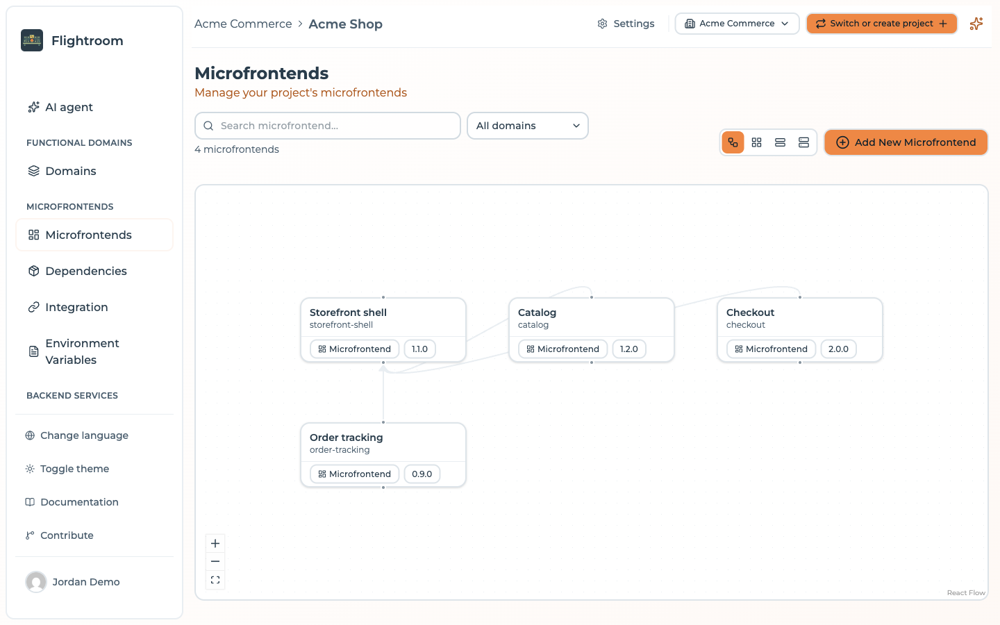
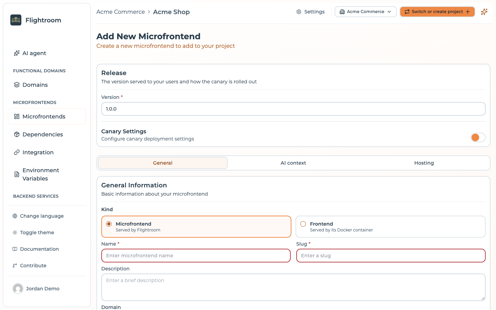

# Create a frontend

There are two ways to add a frontend to a project: start from a **template**, which
scaffolds a working repository and a build pipeline for you, or register a frontend whose
code already exists somewhere else.

## From a template (recommended)

This is the fastest path from nothing to a deployable frontend. Flightroom creates
the repository in your Git provider, fills it with a working Module Federation project, adds a
build-and-deploy pipeline, and injects the API key the pipeline needs to upload artifacts back
to the platform.

### Prerequisites

A connected code repository. If you have not connected one yet, follow
[GitHub](../repositories/connect/github.md), [GitLab](../repositories/connect/gitlab.md) or
[Azure DevOps](../repositories/connect/azure.dev-ops.md) first.

### Steps

1. From the **Frontends** page, click **Add New Frontend**. Next to it,
   **Import from repository** takes the other route, starting from code you already have.

   

   Both depend on a connected code repository. Without one, **Import from repository** is hidden and
   **Add New Frontend** skips the templates library and opens the empty form directly — the
   [from scratch](#from-scratch) route.

2. Choose a template from the [templates library](../templates/templates-library.md), which opens
   as a page of its own. Templates are grouped by framework and filtered by framework, compiler
   and host type, so you can narrow down to, for example, *Vite + React + remote*. **Create From
   Scratch**, the first card, skips the template.

   

3. Fill in the frontend details. The form is the same one you get when editing later, minus
   the danger zone, and it has the tabs of a [service](../kubernetes/services.md): only the
   **Kind** changes what they hold.

   **General** — three cards:

   - **General information**
     - **Kind** — **Bundle** (served by Flightroom, the default) or **Docker** (served by
       its Docker container). See [Bundle or Docker](#bundle-or-docker)
     - **Name** — the display name, 3 to 100 characters
     - **Slug** — 3 to 50 characters. While you type the name, the slug is derived from it: lowercase,
       with every character other than a letter or a digit turned into `-`. You can still edit it
       before saving. It ends up in your public URLs, so choose carefully
     - **Description** — optional
   - **Domain** — optional, the [functional domain](../core-concepts.md#functional-domain) the
     frontend belongs to
   - **Release**
     - **Version** — the version this frontend starts on. A Bundle requires one, pre-filled with
       `1.0.0`. A Docker frontend starts without: its version is the tag of its image, typed here
       or set by its pipeline when it registers one
     - **Canary Settings** — Bundle only, off by default, and there is no reason to turn it on
       while creating. When you do, the type starts on **Session** and the deployment type on
       **Based on Version**. See [canary releases](./canary-releases.md)

   

   **AI context** — optional Markdown notes for the AI agents that work on this frontend, at
   most 20,000 characters, and the design system it builds with. What applies to every frontend
   belongs in the project context, in **Settings**.

   **Hosting** — see [hosting options](./hosting-options.md). A **Docker** frontend has the
   **Runtime** and **Variables** tabs of a service here instead.

   **Repository** — only shown when the project has a code repository connection. Created from a
   template, its **Code Repository** switch is already on:

   - **Source Code Provider** — which connected repository the new repo is created in
   - **GitLab Group** — on a GitLab connection that can see more than one group, the group to
     create it under
   - **Repository Name** — the name of the repository to create, pre-filled from the slug.
     Availability is checked as you type
   - **Private Repository** — a switch, on GitHub. Off creates a public repository

4. Click **Save**.

### What happens behind the scenes

Creating from a template is not just a `git init`. Flightroom:

1. **Creates the repository** in the selected provider, under the user account, organization or
   group you chose.
2. **Downloads the template** archive and pushes its contents as the initial commit.
3. **Injects a build pipeline** matching your provider and compiler — a GitHub Actions workflow
   (`.github/workflows/build-and-deploy.yml`), a GitLab CI file (`.gitlab-ci.yml`) or an Azure
   DevOps pipeline (`azure-pipelines.yml`). The pipeline is pre-filled with your frontend's
   slug and the API base URL of this installation.
4. **Registers the frontend** in the project, linked to the new repository, with the
   template's entry point and stack.

The pipeline authenticates its upload with the secret `FLIGHTROOM_API_KEY`. Most of
the time that secret already exists before you create anything: an API key with the `MANAGER` role,
valid for one year, is created when the code repository **connection** is made, and stored where
every repository of the connection can read it — an organization secret on a GitHub organization, a
CI/CD variable of the group on GitLab, the variable group `MFE_ORCHESTRATOR_SECRETS` on Azure
DevOps. Scaffolding adds a key of its own, as a secret of the new repository, only on a **personal
GitHub account**, where there is no organization to hold one. See
[keys created for you](../ci-cd/api-keys.md#keys-created-for-you).

:::info
Because the deploy secret is in place, the generated pipeline works on its first run — you do not
have to copy any key by hand. Keys expire after a year: when the pipeline's upload starts failing
with an authentication error, that is the first thing to check.
:::

## From scratch

Pick **Create From Scratch** in the templates library — or click **Add New Frontend** in a
project with no code repository connection — when the code already exists, or when you want to
bring your own project layout. You fill in the same release and general information, plus the
hosting configuration:

- **Flightroom Hub** — you will upload builds to the platform
- **Custom Source** — you will upload builds to your own bucket
- **Custom URL** — the files are already served from a URL you control

See [Hosting options](./hosting-options.md) for the details of each, and
[Versions and builds](./versions-and-builds.md) for how to get artifacts in.

The **Code Repository** switch of the **Repository** tab starts off. Turned on at creation, it
creates a **new, empty** repository; there is no template to push and no pipeline to add. To link a
repository that already exists, save first and pick it under **Select Repository** when editing, or
use **Import from repository** on the Frontends page, which creates one frontend for each
repository you tick among those of a connection — repositories already linked to a frontend or
a service are skipped. A linked repository enables the
**Build** action on the frontend card, but Flightroom will not add a pipeline to a repository
it did not create. To use the same automation, copy the relevant pipeline from the
[template-pipelines repository](https://github.com/mfe-orchestrator/template-pipelines); the API key
it needs is usually already there from the connection (see above), and otherwise you
[create one](../ci-cd/api-keys.md) yourself.

## Bundle or Docker

The **Kind** at the top of the **General** tab decides who serves the code:

| | Bundle | Docker |
| --- | --- | --- |
| Served by | Flightroom, from the hub, your bucket or a custom URL | Its own Docker container |
| Configured in | **Hosting** tab | **Runtime** tab (port, probes, image, endpoints, exposure) and **Variables** tab (environment, config maps and secrets), as for a [service](../kubernetes/services.md) |
| Version | Chosen in **Release** from the uploaded bundles | The tag of its image: typed in **Release**, or set by the pipeline each time it registers an image version |
| Canary | Available | None: Flightroom cannot split the traffic of a container |
| Parents | Any | None. It cannot be the remote of a host, so in the Diagram view no link can end on it |
| Bundle upload | Accepted | Refused with `DOCKER_FRONTEND_UPLOAD_NOT_ALLOWED`: its pipeline registers the image of each version instead |

A frontend created under a parent — from a link dropped on empty canvas in the Diagram view —
is always a **Bundle**, and one that already has parents cannot be switched to **Docker**.
The templates scaffold a pipeline that uploads a bundle: pick **Docker** on a template and the
form warns you to change the pipeline so it builds the Docker image and registers its version.

A Docker frontend never appears in the manifest of [`/serve/all`](../integration/serve-api.md): no host
loads it as a remote.

## Editing a frontend

A frontend has the screens of a service: **Edit with AI** (when the project has an AI provider and
the frontend a repository), **Overview** and **Settings**. **Settings** is the same form in edit mode,
with the tabs of a [service](../kubernetes/services.md): only the Bundle or Docker kind changes them.
Saving opens the frontend.

| Tab | Contains |
| --- | --- |
| General | **General information** (kind, name, slug read-only, description), **Domain**, and **Release**: the version and, for a Bundle, **Canary Settings** — progressive rollout, see [Canary releases](./canary-releases.md) |
| AI context | Markdown notes for AI agents, at most 20,000 characters, and the design system it builds with |
| Hosting | Bundle only: hosting type, storage or URL, entry point |
| Runtime | Docker only: port, probes, image, endpoints and exposure path, as for a service |
| Variables | Docker only: environment variables, config maps and secrets, as for a service |
| Repository | The linked repository — only when the project has a code repository connection |
| Danger Zone | Delete this frontend |

A link to the old **Container** tab of a Docker frontend opens **Runtime**.

In **Repository**, **Select Repository** lists the repositories of the chosen connection, so you can
link one or change it. Once a repository is linked and saved, **Rename repository** renames it at the
provider; local clones then have to update their remote URL — GitHub and GitLab redirect the old one,
Azure DevOps does not. The card of a frontend with a linked repository also carries **Clone
repo**, with the HTTPS and SSH clone commands and shortcuts to clone in VS Code or IntelliJ IDEA.

Switching tab keeps what you typed: every panel stays mounted, so a value entered under **Hosting**
survives a detour through **General**. A tab whose fields failed validation is marked with a dot,
and submitting an invalid form jumps to the first one — an error is never hidden behind an inactive
tab.

Remember that edits take effect for your users only after the next
[deployment](../deployments/overview.md).
