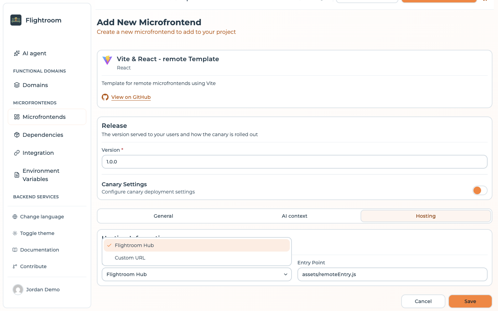

# Frontend hosting options

Every frontend declares **where its files live**. This is the *hosting type*, set under
**Hosting Information** in the **Hosting** tab of the frontend form. It determines how
Flightroom resolves a request for `remoteEntry.js` into actual bytes.

There are three options. They apply to the **Bundle** kind only: a **Docker** frontend is served by
its own Docker container and has a **Container** tab in place of **Hosting** — see
[Bundle or Docker](./create-a-frontend.md#bundle-or-docker).



:::note
**Custom Source** only appears in the list once the project has at least one
[storage](../buckets/overview.md) configured.
:::

## Flightroom Hub

The platform stores the build itself. You upload a ZIP of your `dist` folder and MFE
Orchestrator extracts and serves it.

- **Best for**: getting started, internal tools, self-hosted installations where you already
  own the disk.
- **Where files land**: on the server filesystem, under
  `<MICROFRONTEND_HOST_FOLDER>/<projectSlug>-<projectId>/<frontendSlug>/<version>/`.
  `MICROFRONTEND_HOST_FOLDER` defaults to `/upload-microfrontends` — see
  [Environment Variables](../self-hosting/environment-variables.md).
- **Upload with**: the [upload endpoint](../ci-cd/manual-upload.md), used by the generated
  pipelines.

:::caution[Self-hosting and persistence]
When self-hosting, mount `MICROFRONTEND_HOST_FOLDER` on a persistent volume. In the reference
`docker-compose.yaml` this is the `upload_microfrontends` volume. Without it, every container
restart loses your uploaded builds.
:::

## Custom Source (your own bucket)

The platform stores the build in an object storage bucket **you** own — Amazon S3, Azure Blob
Storage or Google Cloud Storage — and streams files from there on request.

- **Best for**: production, compliance requirements, keeping artifacts inside your own cloud
  account.
- **Requires**: a configured [storage](../buckets/overview.md), selected on the frontend.
- **Where files land**: inside the bucket, under
  `<storage path>/<projectSlug>-<projectId>/<frontendSlug>/<version>/`. The optional
  storage-level `path` lets several projects share one bucket without colliding.
- **Upload with**: the same [upload endpoint](../ci-cd/manual-upload.md) — the platform routes
  the artifact to your bucket for you.

Your bucket does **not** need to be public. Files are fetched server-side with the credentials
you configured and streamed to the browser through the serve API.

## Custom URL

The files are already published somewhere — a CDN, an existing static host, another team's
infrastructure — and you just want Flightroom to keep track of versions and hand the
right URL to your host application.

- **Best for**: frontends you do not build, or an existing CDN setup you do not want to
  change.
- **Requires**: the URL of the entry file.
- **Upload**: not supported. Uploading to a Custom URL frontend is rejected; publishing is
  entirely your responsibility.

### The URL and its placeholder

The URL is the address of the **entry file itself**, not a base folder: it is handed to your host as
it is, and the **Entry Point** field is not appended to it. It may contain one placeholder,
substituted when the URL is handed out:

| Placeholder | Replaced with |
| --- | --- |
| `$version` | The version this caller resolves to: the version of the active deployment, or the canary version for a caller drawn into a version-based canary |

For example:

```
https://cdn.example.com/mfe/catalog/$version/remoteEntry.js
```

Only the first `$version` in the URL is replaced. `$microfrontendSlug`, `$projectId` and
`$projectSlug` are **not** substituted in the URL handed to your host, so a URL using them reaches
the browser with the placeholder still in it: write the slug and the project into the URL
literally.

`$version` is what makes this option useful: switching a version in the console and deploying
is enough to point your users at different files on your CDN, with no rebuild of the host.

## Choosing between them

| | Hub | Custom Source | Custom URL |
| --- | --- | --- | --- |
| Who stores the files | Flightroom | You (bucket) | You (anywhere) |
| Upload via API/CI | ✅ | ✅ | ❌ |
| Artifacts stay in your cloud | ❌ (unless self-hosted) | ✅ | ✅ |
| Setup effort | None | Bucket + credentials | Publish pipeline of your own |
| Version switching | ✅ | ✅ | ✅ (via `$version`) |

## Entry point

For the Flightroom Hub and Custom Source, the **Entry Point** field names the file consumers load,
inside the uploaded build. The form pre-fills `assets/remoteEntry.js`, the Vite Module Federation
layout; a frontend created from a template gets the entry point that template declares instead.
Only when the field is left empty does the platform fall back to `index.js`. Check it against your
build output:

| Build setup | Typical entry point |
| --- | --- |
| Vite + `@originjs/vite-plugin-federation` | `assets/remoteEntry.js` |
| Webpack Module Federation | `remoteEntry.js` |
| single-spa application (Vite library build) | `index.js` |
| micro-lc parcel (Vite UMD build) | `parcel.js` |

A frontend created from a template starts with the entry point the template declares in the
marketplace, unless you typed a different one in the form before saving.

The entry point gets special cache treatment: it is always served with
`Cache-Control: no-cache, no-store, must-revalidate`, while the hashed assets around it are
cacheable. That is what allows a deployment to take effect immediately without stale chunks.

All served files also carry `Cross-Origin-Resource-Policy: cross-origin`, so a host on a
different origin can load them.
