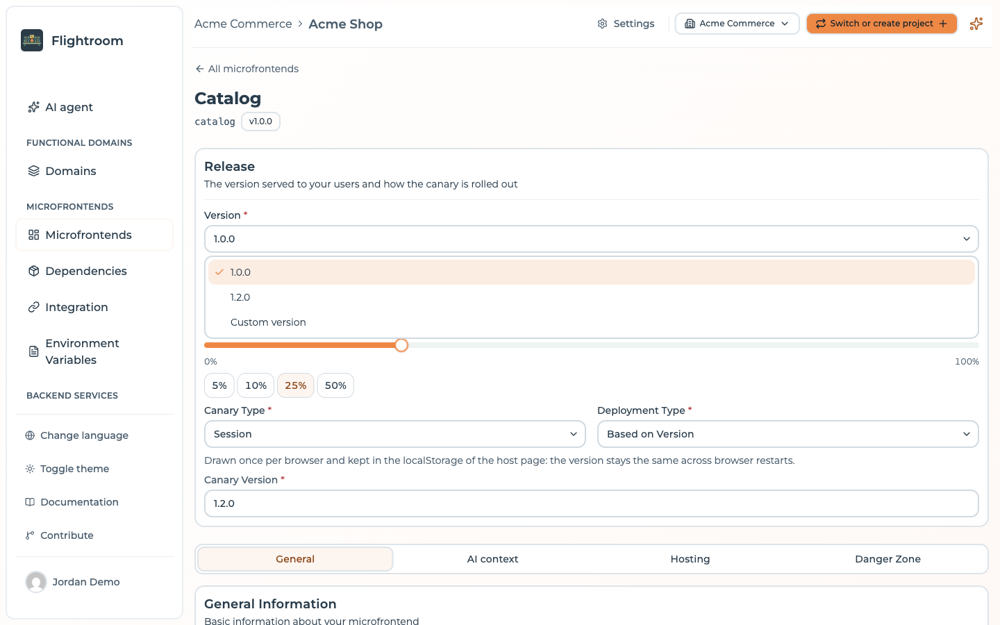

# Frontend versions and builds

A frontend is only useful once there are artifacts to serve. This page describes how a
version comes into existence, and the two ways to trigger one.

## What a version is

A version is a string you choose — `1.0.0`, `2026.02.14`, `1.4.0-rc1` — under which a set of
built files is stored. Flightroom does not parse or order versions; it uses them as
folder names and as the value it hands to your host application.

Each frontend has one **selected version** in the project configuration, plus the history
of every version that has ever been uploaded. What your users actually load is the version
captured in the [active deployment](../deployments/overview.md), not the one selected in the
form.

## Triggering a build from the console

If the frontend is linked to a code repository, its card shows a **Build** action. It opens
a dialog asking for:

- **Branch** — the branch to build. The list is read live from your provider, with the default
  branch pre-selected.
- **Version** — the version to publish.

Pressing **Start Build** does one thing: it **creates a Git tag** named after the version, on the
head commit of the selected branch, in your repository.

Everything after that happens in your CI:

```
Console: "Build 1.4.0 from main"
      │
      ▼
Flightroom creates tag "1.4.0" on main's HEAD
      │
      ▼
Your pipeline triggers on tag push
      │
      ├── install dependencies
      ├── build
      └── upload dist/ to Flightroom as version 1.4.0
      │
      ▼
Version 1.4.0 becomes selectable in the console
```

The generated pipelines are all tag-triggered, which is why this works out of the box. If you
brought your own pipeline, make sure it triggers on tags — otherwise the **Build** button will
create tags that nothing acts on.

:::info
The **Build** action requires a linked code repository: on a frontend without one the card
does not show the button at all.
:::

You do not have to leave the console to know how that run went: the
[Build status](../deployments/build-status.md) page lists the latest run of every frontend of
the project, reading it from GitHub Actions, GitLab pipelines or Azure DevOps, and updates while
you watch.

## Uploading from CI

The upload itself is a single authenticated call that takes a ZIP of your build output. The
generated pipelines wrap it in a provider-specific task:

| Provider | Mechanism |
| --- | --- |
| GitHub Actions | `mfe-orchestrator-hub/github-action` |
| Azure DevOps | `mfe-orchestrator-upload` task |
| GitLab CI | Direct call to the upload endpoint |

All of them read the API key from the secret
`MICROFRONTEND_ORCHESTRATOR_API_KEY`, which Flightroom creates for you when you connect the code
repository provider — or, on a personal GitHub account, when it scaffolds a repository. See
[keys created for you](../ci-cd/api-keys.md#keys-created-for-you).

See [CI/CD](../ci-cd/github-actions.md) for the full pipeline examples, and
[Manual upload](../ci-cd/manual-upload.md) for the raw HTTP call.

:::caution[Custom URL frontends cannot be uploaded to]
Upload only works for frontends hosted on the **Flightroom Hub** or on a
**Custom Source** bucket. For **Custom URL**, publishing is handled entirely by your own
infrastructure — Flightroom only records which version to point at.

A frontend of the **Docker** kind takes no upload either — it is refused with
`DOCKER_FRONTEND_UPLOAD_NOT_ALLOWED`. Its pipeline builds a Docker image and registers the version of each
image instead, and that registration is what sets the version shown, read-only, in its form. See
[Bundle or Docker](./create-a-frontend.md#bundle-or-docker).
:::

## Selecting a version

Once a version exists, open the frontend's form and pick it in the **Version** field, at the top
of the form in **Release**. The field offers the versions known to the platform, plus a
**Custom version** option, which reveals a second box for typing one in directly — useful for Custom
URL frontends, where the platform has no upload history to list.



That list only appears when editing a frontend that already has uploads. On the creation form,
and on any frontend nothing has been uploaded for, there is nothing to list, so the field is a
plain text box.

Then [deploy](../deployments/overview.md) the environments you want to move.

## Continuous deployment

The `continuousDeployment` flag marks a frontend as continuously deployed. It is stored on the
frontend and published to consumers as `continuousDeployment` on the
[serve API](../integration/serve-api.md) payload.

The frontend form no longer has a switch for it. Set it through the API, or ask an
[MCP client](../build-with-ai/mcp-server.md) to update the frontend; saving the form keeps the
value already stored, and a frontend created from the form starts with it off.

:::info[It is a marker, not an automation]
The platform does not currently change version resolution based on this flag — it does not skip the
deployment step or auto-select new versions. It is metadata your own tooling can act on: a host that
reads `/serve/all/...` can, for example, choose to poll for updates on continuously deployed remotes
and not on the others.

If you want builds to reach an environment without a manual step, the call to automate is
`POST <API_BASE>/deployment` after a successful upload — but it is authenticated with a signed-in
user's token, not with the CI API key, which only authorizes the upload. See
[Uploading a build](../ci-cd/manual-upload.md#publishing-does-not-deploy).
:::
