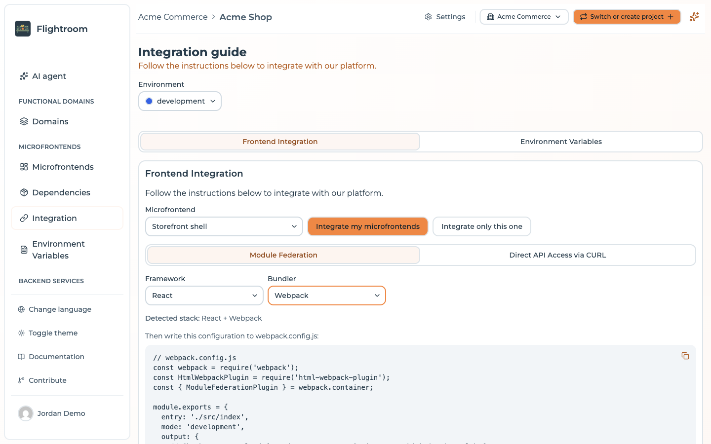

# Module Federation with Webpack

Flightroom generates configuration for Webpack 5's built-in
`ModuleFederationPlugin`. No extra dependency is needed — Module Federation ships with Webpack 5.

## Configure a remote

A remote declares what it exposes; this is plain Module Federation with no Flightroom
involvement:

```js
// webpack.config.js
const { ModuleFederationPlugin } = require('webpack').container;

module.exports = {
  // ... other webpack config
  plugins: [
    new ModuleFederationPlugin({
      name: 'catalog',
      filename: 'remoteEntry.js',
      exposes: {
        './App': './src/App',
        './Button': './src/components/Button'
      },
      shared: {
        react: { singleton: true, requiredVersion: '^18.2.0' },
        'react-dom': { singleton: true, requiredVersion: '^18.2.0' }
      },
    }),
  ],
};
```

Webpack writes `remoteEntry.js` to the root of your output directory, so the microfrontend's
**Entry Point** in Flightroom should read `remoteEntry.js` — unless you have customised
`output.publicPath` or the filename.

:::caution[`remoteEntry.js` is not a default you can rely on]
The form pre-fills the **Entry Point** with `assets/remoteEntry.js` — the *Vite* output layout, wrong
for a Webpack build — and only falls back to **`index.js`** when the field is left empty. Where
`remoteEntry.js` appears without you typing it, it came from the marketplace entry of the Webpack
template the microfrontend was created from. Create the microfrontend with **Create From Scratch**
and you have to change the field yourself. Check it rather than assuming it.
:::

## Configure the host

Open **Integration → Frontend Integration**, select your host, set **Bundler** to Webpack (or leave
it on Automatic if that is the microfrontend's stored stack) and copy the **Module Federation** tab:



```js
// webpack.config.js
const webpack = require('webpack');
const HtmlWebpackPlugin = require('html-webpack-plugin');
const { ModuleFederationPlugin } = webpack.container;

module.exports = {
  entry: './src/index',
  mode: 'development',
  output: {
    // Chunks are resolved from document.currentScript.src, which is the url before any
    // redirect. Leave this on 'auto' so a version pinned entry keeps loading its own chunks
    // and two builds never mix on one page.
    publicPath: 'auto',
    clean: true
  },
  resolve: {
    extensions: ['.ts', '.tsx', '.js', '.jsx']
  },
  module: {
    rules: [
      { test: /\.(ts|tsx)$/, exclude: /node_modules/, use: { loader: 'ts-loader' } },
      { test: /\.css$/, use: ['style-loader', 'css-loader'] }
    ]
  },
  plugins: [
    new HtmlWebpackPlugin({ template: './public/index.html' }),
    new webpack.DefinePlugin({
      'process.env.MFE_BACKEND_URL': JSON.stringify("https://console.flightroom.dev/api"),
      'process.env.MFE_PROJECT_ID': JSON.stringify("68f1a2..."),
      // DefinePlugin pastes the text on the right into the bundle verbatim, so the bare
      // identifier `undefined` is what an unset environment looks like: the SDK then resolves
      // it from the domain the page is served on. Pin this build to one environment by
      // replacing it with a quoted slug, ex. JSON.stringify('DEV').
      'process.env.MFE_ENVIRONMENT': 'undefined'
    }),
    new ModuleFederationPlugin({
      // The global the remote entry defines its container under, which is what a host passes
      // to loadWebpackRemote(): an identifier, so it never holds a dash or a slash.
      name: 'shell',
      filename: 'remoteEntry.js',
      exposes: {
        './App': './src/App'
      },
      remotes: {
        // One entry per microfrontend this host consumes. The key is the name you import
        // from ("catalog/Button"), the string passed to loadWebpackRemote() is the slug in
        // the orchestrator. Never write a url here: the backend resolves the version.
        // The second one is the name the remote gives its own ModuleFederationPlugin.
        catalog: "promise globalThis.__MFE_ORCHESTRATOR__.loadWebpackRemote('catalog', 'catalog')",
        cart: "promise globalThis.__MFE_ORCHESTRATOR__.loadWebpackRemote('cart', 'cart')"
      },
      shared: {
        'react': { singleton: true },
        'react-dom': { singleton: true }
      }
    })
  ]
};

// ---------------------------------------------------------------------------
// Host bootstrap: paste this at the very top of your entry point (src/main.tsx).
// The remotes above ask the SDK for their url, so configure() has to run before
// anything imports one of them.
// The backend url and the project id are already in the config above, written into
// the bundle by DefinePlugin: there is no .env to fill in. Only the environment is
// left to read, and it is optional.
// ---------------------------------------------------------------------------
/*
import { configure } from '@mfe-orchestrator-hub/client'

// Optional: leave it unset and the environment is resolved from the domain this
// page is served on, so the same build can run on every environment.
const environment = process.env.MFE_ENVIRONMENT

configure({
  backendUrl: process.env.MFE_BACKEND_URL,
  projectId: process.env.MFE_PROJECT_ID,
  // Only a canary targeted on users reads this, and nothing else can supply it.
  // A getter is resolved right before the request, so an auth round trip is in
  // time; later than that, use setUserId(). Without it those microfrontends
  // serve everyone the stable version.
  // userId: () => auth.currentUser?.id,
  ...(environment ? { environment } : {})
})
*/
```

This is a whole `webpack.config.js`, not a fragment to merge: loaders, `resolve.extensions` and
`HtmlWebpackPlugin` are there for the detected framework (`vue-loader` and `VueLoaderPlugin` for Vue,
`@ngtools/webpack` and `AngularWebpackPlugin` for Angular), and a microfrontend registered as a
**host** also gets an `exposes` block with its root component. Two things in it you will want to
review before relying on it:

- **`mode: 'development'` is hard-coded.** Switch it to `'production'` — or drive it from your
  build script — for the bundle you deploy.
- **`entry` is `./src/index`, while the bootstrap comment names the framework's `src/main.*`** —
  `src/main.tsx` for React, `src/main.js` for Vue, `src/main.ts` for Angular. What matters is the
  file webpack actually starts from: put `configure()` at the top of whatever `entry` points to.

`promise <expression>` is how `ModuleFederationPlugin` declares a remote whose URL is only known at
runtime: the expression is pasted into your host bundle verbatim and awaited before the remote is
used, and it has to resolve to the remote's container, not to its URL. Being pasted outside of any
module, it cannot import the [client SDK](./client-sdk.md): a bare
`import('@mfe-orchestrator-hub/client')` there reaches the browser unresolved and fails with "Failed
to resolve module specifier". So it calls the loader the SDK publishes on
`globalThis.__MFE_ORCHESTRATOR__`, which resolves the URL, injects the remote entry once and returns
the container defined under the second argument (`loadWebpackRemote` ships with
`@mfe-orchestrator-hub/client` 0.3.0). That argument is the `name` the remote gives its own
`ModuleFederationPlugin`; the console generates it from the slug, without dashes, so it matches the
key.

Keep the usual webpack bootstrap: `configure()` at the top of the entry file, the rest of the app
behind `import('./bootstrap')`. A remote requested before `configure()` waits for it, but one imported
by the very chunk that calls `configure()` is loaded before that chunk runs, and fails after ten
seconds with the "not configured" error.

So the generated configuration contains **no URL** — no version, no environment, no CDN path. That is
what keeps the resolution server-side and lets a
[canary release](../microfrontends/canary-releases.md) decide which version this browser receives.
See [Allowed domains](../environments/domains.md) for how the environment is resolved.

Two things you have to do yourself:

```bash
npm install @mfe-orchestrator-hub/client
```

and uncomment the bootstrap block at the bottom into your entry point, before anything imports a
remote. The console emits it commented out precisely because it does not belong in
`webpack.config.js`.

### There is no `.env` to fill in

`MFE_BACKEND_URL` and `MFE_PROJECT_ID` are **not** variables you set, and you do not need
`webpack.EnvironmentPlugin` to expose them. The console writes their values into the `DefinePlugin`
call of the generated config, which is the file you commit, so a fresh clone builds a bundle that
already knows which console to ask and which project to ask about — and no unset variable can turn
into a build that fails only once it is running in a browser.

They are defined as `process.env.*` names rather than inlined into `configure()` so that the
bootstrap snippet reads the same names a real environment would have populated: moving the values
into the config changes where they come from, not the code that consumes them. If you would rather
feed them from the environment, replace those two entries with your own plugin — but do it
deliberately, because while they are there nothing else is read.

`MFE_ENVIRONMENT` is defined too, as the bare identifier `undefined`. That third entry is not
cosmetic: webpack leaves `process.env.X` untouched when nothing defines it, `process` does not exist
in a browser, and the optional variable the bootstrap snippet reads would therefore throw instead of
being undefined. To pin the build to one environment, replace `'undefined'` with
`JSON.stringify('DEV')`.

Left as `undefined`, `environment` is spread out of the `configure()` call entirely and the SDK asks
the serve API without a slug, leaving the choice to the
[allowed domains](../environments/domains.md) registered on your environments — one build, correct on
every stage. In exchange, each stage's domain has to be registered on the right environment, or the
manifest request fails rather than falling back to anything. See
[leaving the environment out](./client-sdk.md#leaving-the-environment-out).

:::caution[Do not turn the spread into a plain field]
`environment: process.env.MFE_ENVIRONMENT` reads more simply, and it is the shape that makes people
believe the value is required. It is also fragile: swap the generated `DefinePlugin` entry for
`webpack.EnvironmentPlugin` and an `MFE_ENVIRONMENT=` line, and the field becomes `''`, which the
core accepts, warns about, and then ignores in favour of the `auto` routes anyway. Spreading the key
in only when it holds something is correct under either plugin.
:::

:::note[If you pin a remote by hand]
Webpack's static remote syntax is `name@url`, not a bare URL as Vite uses. You will not see it in
the generated configuration any more, but it is what you need if you ever hard-code a remote —
along with the understanding that you have just frozen one version into your host.
:::

## Remote names

The remote name is derived from the slug by replacing every `/` with `_` and removing every `-`:

| Slug | Key to import from |
| --- | --- |
| `catalog` | `catalog` |
| `product-catalog` | `productcatalog` |
| `shop/catalog` | `shop_catalog` |

## Consume a remote

```jsx
import React, { Suspense, lazy } from 'react'

const CatalogApp = lazy(() => import('catalog/App'))

export default function App() {
  return (
    <Suspense fallback={<div>Loading…</div>}>
      <CatalogApp />
    </Suspense>
  )
}
```

## Shared dependencies and the async boundary

The generated host configuration shares the framework core only — `react` and `react-dom` for React,
`vue` for Vue, `@angular/core`, `@angular/common`, `@angular/platform-browser` and `rxjs` for Angular
— each as `{ singleton: true }` and nothing more: no `requiredVersion`, so webpack reads the range
from your own `package.json`, and no `eager`. If you share other libraries — a router, a state
manager, a design system — add them to the `shared` block of every microfrontend in the graph.

Because nothing is eager, shared modules are loaded asynchronously, and your entry point needs an
async boundary before the first import that uses them:

```js
// index.js
import('./bootstrap')
```

```js
// bootstrap.js
import React from 'react'
import { createRoot } from 'react-dom/client'
import App from './App'

createRoot(document.getElementById('root')).render(<App />)
```

This is the standard Module Federation pattern, and it keeps the initial bundle small. The
alternative is to add `eager: true` to the shared entries, which bundles them into the host's initial
chunk and removes the need for the boundary, at the cost of a larger first download.

## Version mismatches

The generated config pins no `requiredVersion`, so webpack takes the range from each microfrontend's
own `package.json`; with `singleton: true` it warns at runtime when a remote wants a different major
version of a shared library than the host provides. Those warnings are worth taking seriously — a
satisfied-but-mismatched React is the source of most confusing microfrontend bugs. Keep shared
library versions aligned across the graph, and upgrade hosts and remotes together.
