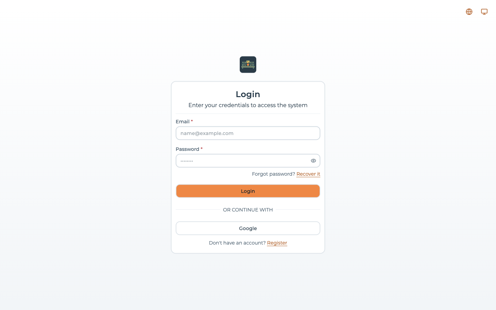
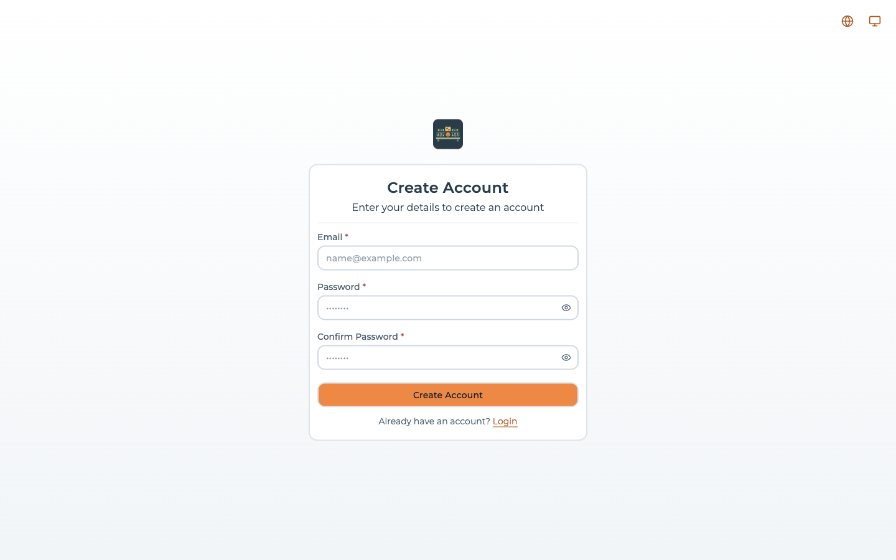
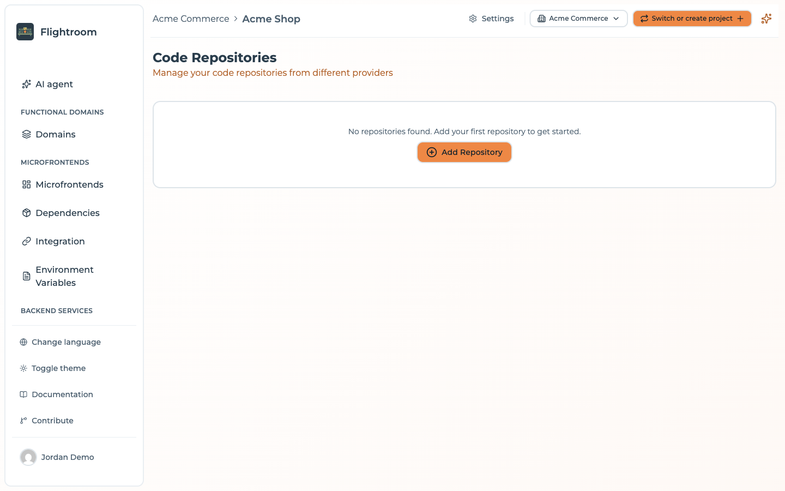
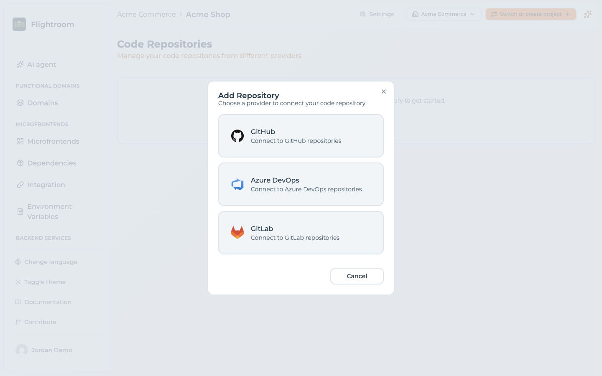
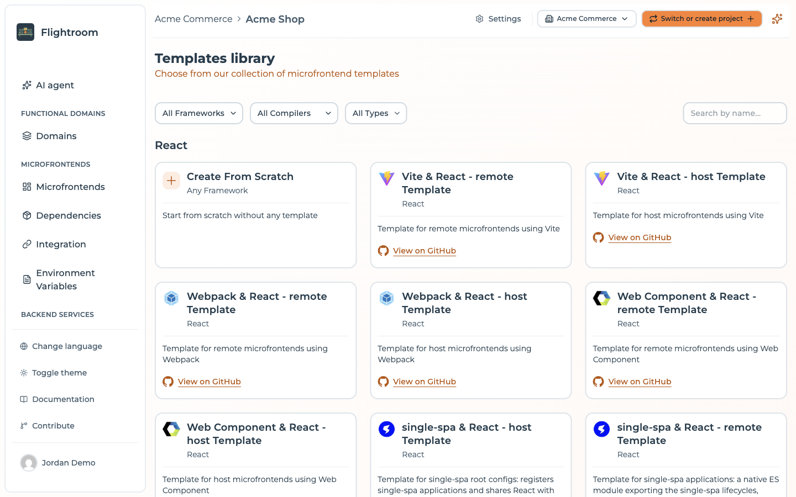
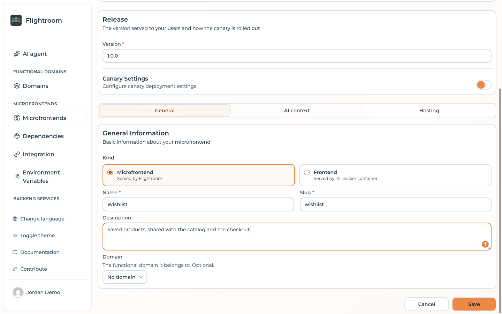

import Link from '@docusaurus/Link';

# Get started with Flightroom

Flightroom is an open-source enterprise platform where anyone can build applications and AI
agents by describing them in plain language. The AI writes the code in your own Git repositories,
your engineers review it, and one click deploys it to your Kubernetes through GitOps and Argo CD,
with your single sign-on, your roles and your AI models.

This tutorial guides you through your first steps with the platform.

:::tip[In a hurry?]
The **[quick start](./quick-start.mdx)** is the condensed version of this page: describe an app,
review it, deploy it.
:::

**Flightroom can be used in two ways:**

  

    

      

        <h3>🌐 Online Console</h3>
        Recommended for Tutorial
      

      

        
Use our hosted version - no installation required!

        <ul>
          <li>✅ No setup needed</li>
          <li>✅ Always up to date</li>
          <li>✅ Perfect for getting started</li>
        </ul>
      

      

        <Link
          className="button button--primary button--block"
          to="https://console.flightroom.dev" target="_blank">
          Go to console
        </Link>
      

    

  

  

    

      

        <h3>🔧 Self-Hosted</h3>
      

      

        
Deploy on your own infrastructure for full control.

        <ul>
          <li>✅ Complete control</li>
          <li>✅ Custom configuration</li>
          <li>✅ Production ready</li>
        </ul>
      

      

        <Link
          className="button button--secondary button--block"
          to="/docs/category/self-hosting">
          View Installation Options
        </Link>
      

    

  

In this tutorial, we'll use the **online console** available at [https://console.flightroom.dev](https://console.flightroom.dev) to explore Flightroom's features.

## Step 1: Access the Console & Register

Open your browser and navigate to:

**[https://console.flightroom.dev](https://console.flightroom.dev)**

To get started, you need to create an account. You have two options:

**Option 1: Register with Email**
1. Click on **"Register"** or **"Sign Up"**
2. Enter your email address and create a password
3. Verify your email — on the hosted console, and on any self-hosted instance with SMTP configured;
   without SMTP there is no verification step at all
4. Sign in with your credentials
5. Create your organization. The [five-step project wizard](./project-settings/projects.md#creating-a-project)
   then opens inside it: name, environments, storage, repositories, collaborators

**Option 2: Sign in with Google SSO**
1. Click on **"Sign in with Google"**
2. Select your Google account
3. Authorize Flightroom to access your basic profile
4. You'll be automatically signed in
5. Create your organization. The [five-step project wizard](./project-settings/projects.md#creating-a-project)
   then opens inside it: name, environments, storage, repositories, collaborators

:::tip[Recommended]
Using Google SSO is faster and you don't need to remember another password!
:::

If you already have an account, simply sign in with your email or Google account.

## Step 2: Connect Your Code Repository

The AI writes your apps into repositories Flightroom creates in your Git provider, so the first thing to connect is that provider.

1. Navigate to **[Code Repositories](https://console.flightroom.dev/code-repositories)** or open **Settings → Resources → Code Repositories**

   

2. Click the **Add Repository** button and pick your provider

   

Flightroom supports multiple repository providers:

- **[GitHub](https://github.com)** - Most commonly used for public and private repositories
  - [See detailed setup guide →](/docs/repositories/connect/github)
- **[GitLab](https://gitlab.com)** - Self-hosted or GitLab.com
  - [See detailed setup guide →](/docs/repositories/connect/gitlab)
- **[Azure DevOps](https://dev.azure.com)** - Microsoft Azure Repos
  - [See detailed setup guide →](/docs/repositories/connect/azure.dev-ops)

:::tip[Quick Start]
For most users, we recommend starting with GitHub as it has the simplest setup process.
:::

## Step 3: Add an AI to Your Organization

Flightroom uses the AI model your organization chooses, with your own credentials.

1. Open the organization menu in the header and choose **Organization settings**
2. Open the **AI** tab and choose **Add AI**
3. Pick a provider — Claude through Anthropic, Azure AI Foundry or AWS Bedrock, GPT through Azure
   OpenAI, or Gemini — and enter its credentials

Only organization owners and admins can add an AI. Once one exists, every project of the
organization can use it, unless an admin restricts a project to some models or turns AI off for
it. See [AI models](./build-with-ai/ai-models.md).

## Step 4: Build Your First App with AI

1. Open **Domains** in the sidebar and create a **New domain**. A domain groups the web interfaces
   and services of one business capability, for example *Expenses* or *Onboarding*
2. On the domain's **Edit with AI** tab, describe what the team needs and press
   **Generate proposal**
3. The AI proposes the components the request needs: up to three **microfrontends** (web
   interfaces) and three **services** (backends and agents). Adjust names, repositories and
   templates, then confirm
4. Flightroom creates each repository from its template, CI pipeline included, and the AI writes
   a first version on an `ai/…` branch
5. Keep refining through chat, then **Open a pull request**, apply the change, or discard it

Your base branch is untouched until someone acts on the proposal. See
[Generate a domain with AI](./build-with-ai/generate-a-domain.md) and
[AI changes](./build-with-ai/ai-changes.md).

**Congratulations!** 🎉 You have your first app in your own repositories. To put it in front of
users, [deploy it to Kubernetes](./kubernetes/overview.md).

## Alternative: Create a Microfrontend by Hand

If you would rather start from a template without the AI — for example a web interface served by
Flightroom and composed into a host with Module Federation — create a microfrontend directly.

1. Return to the **[Home page](https://console.flightroom.dev)** by clicking on the home icon or logo in the navigation menu
2. Click the **Add New Microfrontend** box at the center of the screen

3. Choose a template from the list

4. Fill in the required information. The form is split into tabs — **General**, **Hosting** and
   **Repository** — and what the template needs is spread over two of them:
 * **General → name**: A descriptive name for your microfrontend
 * **General → slug**: A URL-friendly identifier (e.g., "my-app"). It is filled in from the name as
   you type, and cannot be changed after creation
 * **Repository → source code provider**: The repository connection to create the new repository in.
   Already selected when the project has only one, or when one of them is the default
 * **Repository → repository name**: The name of the repository to create. Also pre-filled from the
   name, so you only touch it if you want a different one

Because you came from a template, the **Repository** tab arrives with its switch already on. If the
tab is missing entirely, the project has no repository connection yet — go back to Step 2.

5. Click **Save** to finalize the setup

:::info[Automatic Setup]
Flightroom will automatically:
- ✅ **Create the repository** in your selected source code provider with the chosen template
- ✅ **Initialize the microfrontend** with all necessary configurations
- ✅ **Set up the deployment pipeline** ready for your first deployment

This process usually takes a few seconds. You'll see a success message once everything is ready!
:::

Your microfrontend now exists. The [microfrontend quick start](./microfrontends/quick-start.mdx) takes it from here to a deployed version and a rollback.

## Next steps

1. **[Understand the model](./core-concepts.md)** — organizations, projects, domains,
   environments and deployments, and how they relate.
2. **[Set up your environments](./environments/overview.md)** — dev, UAT, production or your own
   stages, each its own Kubernetes namespace.
3. **[Deploy to Kubernetes](./kubernetes/overview.md)** — connect a GitOps repository and your
   Argo CD once, then ship with one click.
4. **[Keep improving with AI](./build-with-ai/ai-changes.md)** — ask for the next change on any
   microfrontend, service or domain.

### Going further

- **[Guardrails](./build-with-ai/guardrails.md)** — what the AI can and cannot touch, and how
  review and roles keep it in check
- **[Console assistant](./build-with-ai/console-assistant.md)** — ask the console to act for you,
  with a confirmation before anything destructive
- **[Microfrontends](./microfrontends/overview.md)** — versions, hosting options, canary releases
  and generated [Module Federation configuration](./integration/overview.md)
- **[Organizations](./organizations/overview.md)** — the tenant that owns your projects, and who
  reaches which one
- **[Members and roles](./project-settings/users-and-roles.md)** — invite your team
- **[Self hosting](./self-hosting/helm.md)** — run the platform on your own infrastructure
