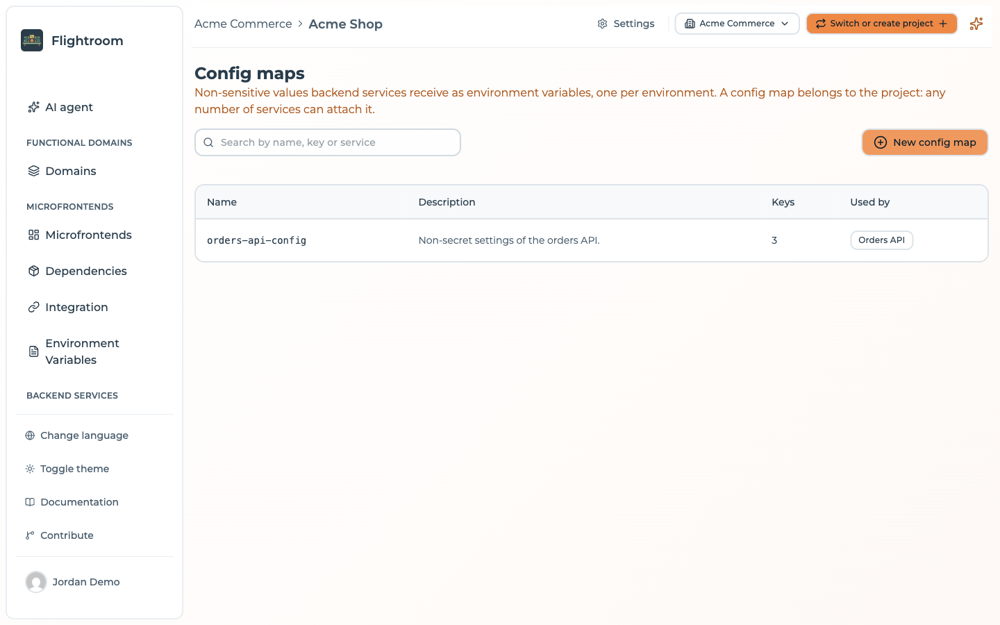
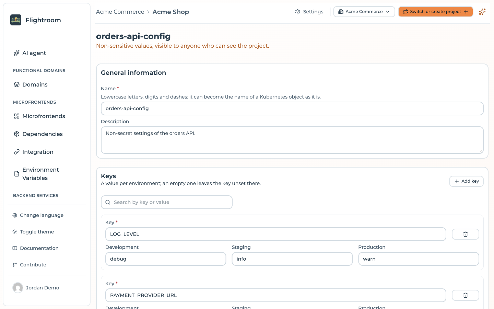
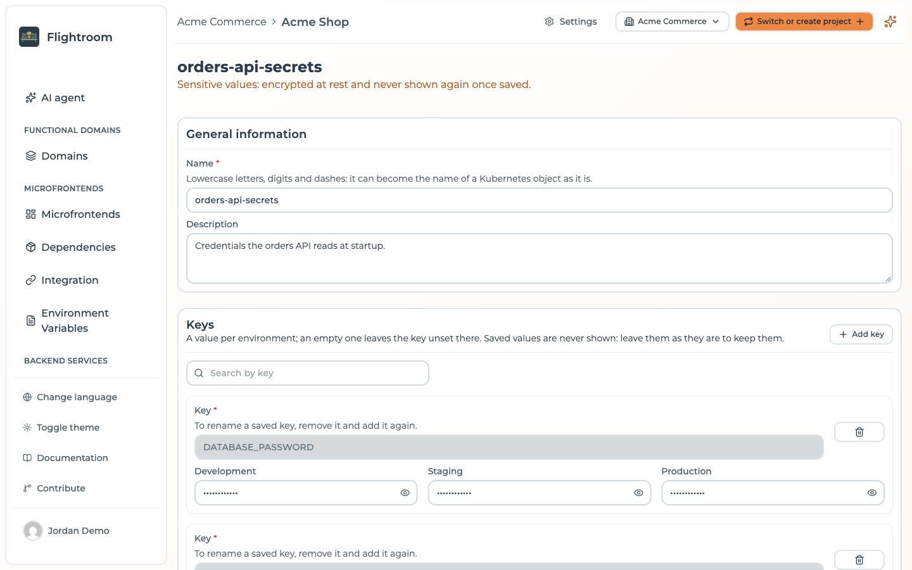

# Config maps and secrets

Config maps and secrets hold the configuration of your services, with a value per environment. They
reach the container as environment variables, through Kubernetes ConfigMaps and Secrets that every
deploy commits to the configuration repository.

| | Config maps | Secrets |
| --- | --- | --- |
| For | Non-sensitive values: URLs, feature flags, log levels | Sensitive values: API keys, passwords, tokens |
| In the console | Visible to anyone who can see the project | Encrypted at rest and never shown again once saved |
| In Kubernetes | A ConfigMap per environment | A Secret per environment, values base64 encoded |

:::info[Not the same as frontend environment variables]
These values are for containers running in Kubernetes. The variables a frontend reads in the
browser are [runtime environment variables](../environments/environment-variables.md), served by
Flightroom and never committed to Git.
:::

## Creating one

Open **Config maps** or **Secrets** in the **Backend services** section of the sidebar, and press
**New config map** or **New secret**. The form opens at `/config-map/new` or `/secret/new`.

| Field | Notes |
| --- | --- |
| **Name** | At most 63 lowercase letters, digits or dashes, starting and ending with a letter or digit: it becomes the name of the Kubernetes object as it is. Unique in the project |
| **Description** | What these values are for, at most 2000 characters |
| **Keys** | Each **Key** with a value per environment. Keys take letters, digits and underscores, and do not start with a digit |

| Limit | Value |
| --- | --- |
| Keys per map | 200 |
| Length of one value | 32,768 characters (32 KiB) |
| Maps attached to one service | 50 config maps, and 50 secrets |

A secret value cannot start with `enc:v1:`, the prefix the console gives to the values it encrypts.

The list of maps can be searched by name, key or service using the map. Inside a map, the keys can be
searched too: a config map by key or value, a secret by key only, since its saved values are never
shown.

A key left empty in an environment is not set there: the container in that environment does not get
it.

A saved secret value is never shown again: leave it as it is to keep it. To rename a saved key of a
secret, remove it and add it again, then type its values again.

## Attaching them to a service

A config map or a secret belongs to the project, and any number of services can attach it. Attach
them in the settings of the service, under **Config maps and secrets**, or in the **Container** tab
of a Docker frontend. The page of each map lists the services that use it, under **Used by**.

No key may be set by two of the maps a service attaches: the console refuses the pair.

Every key of every attached map reaches the container as an environment variable of the same name,
through `envFrom` in the chart. A service's own **Environment variables** list documents which names
the container expects; it holds names only, never values.

To delete a map, detach it from every service first, then confirm by typing its name.

## Who can change them

A member scoped to a functional domain sees only the maps attached exclusively to services and
Docker frontends of their own domains. A map shared with a component of another domain, or of no
domain, or attached to nothing, is hidden from them. They can edit the maps they see and attach them
to their components, but cannot attach any other map, and cannot create or delete maps.

Every other member of the project can create, edit and delete config maps and secrets, a **Viewer**
included: the console does not refuse a viewer here as it does for [databases](./databases.md) and
GitOps deploys.

## When the values reach the cluster

Saving a map commits nothing. The values reach the cluster on the next **Deploy** of each
environment, when the console commits:

- `<environment>/configMaps/<name>.yaml` for each config map
- `<environment>/secrets/<name>.yaml` for each secret

to the configuration repository, in the namespace of the environment. Argo CD applies them, and a
map you deleted disappears from the repository on that same deploy.

A **Deploy &lt;domain&gt;** of one functional domain still commits every config map and secret of the
environment as they are now.

The deployments page shows, for each deployment, the **Config maps** and **Secrets** it shipped.
Secret values are not kept in the deployment.

## How secrets are protected

**In the console**, the values of every secret are encrypted at rest in the database when the
installation sets `SECRETS_ENCRYPTION_KEY`. See
[Encryption at rest](../self-hosting/encryption-at-rest.md).

**In Git**, they are not. A Kubernetes Secret manifest stores its values base64 encoded, which is an
encoding, not encryption.

:::danger[Keep the configuration repository private]
Anyone who can read the configuration repository, or its history, can decode every secret in it.
Use a private repository with restricted access. The console warns about this in the GitOps
settings, and creates new GitOps repositories private.
:::

The console deletes its working copy of the repository after each deploy, so the plaintext values
do not stay on the Flightroom server.

## An agent's model key

An agent calls a model, and the model's API key is a secret like any other. Create a secret, say
`support-agent-model`, with a key such as `MODEL_API_KEY`, give it a value in each environment, and
attach it to the agent's service. With a different key per environment, a test in `dev` never spends
the production key, and a key leaked from one environment can be revoked without touching the others.

## Where to go next

- [GitOps repositories](./gitops.md): what else each deploy commits
- [Databases](./databases.md): registering the databases your services work with
