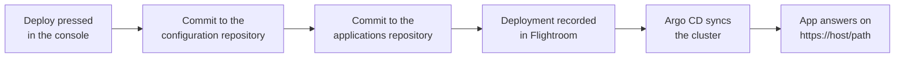

# Deploy to Kubernetes

Flightroom deploys the backends of a project to your Kubernetes cluster with the same **Deploy**
button that activates frontends. Behind the button, every deploy is a Git commit, and the Argo
CD you already run applies that commit to the cluster.

An **agent** is deployed exactly like any other backend: it is a **service** that happens to call a
model. Everything on this page applies to both. How a service is created and configured in the
console is covered in [Services](./services.md). How apps and agents get written in the first place
is covered in [Build with AI](../build-with-ai/overview.md).

## What one click does

1. **A member of the project presses Deploy.** Open **Deployments** in the **DevOps** section of the
   sidebar, pick the environment in the selector and press **Deploy**. A functional domain can be
   deployed on its own with **Deploy &lt;domain&gt;**. The console assistant can deploy too, after you
   confirm the action it proposes.
2. **Flightroom commits to Git.** The manifests of the environment go to the configuration
   repository, and the Helm values of each service to the applications repository. See
   [GitOps repositories](./gitops.md).
3. **Flightroom records the deployment**, only once the commits are pushed. If a commit fails,
   nothing is deployed.
4. **Argo CD syncs the cluster.** It watches the repositories through the objects Flightroom set up
   in it. See [Argo CD](./argo-cd.md).
5. **The app answers on its URL**, `https://<environment host><exposure path>`, with a certificate
   from cert-manager. See [Exposure](./exposure.md).

The console never connects to your cluster. It talks to the Argo CD API over HTTPS, and Argo CD
deploys to the cluster it runs in.

## What runs in Kubernetes, and what does not

| In the console | Kind | Where it runs |
| --- | --- | --- |
| Backend service, or agent | Service | A container in Kubernetes, deployed through GitOps |
| Web interface served by its container | Frontend of kind **Docker** | A container in Kubernetes, deployed like a service |
| Web interface served by Flightroom | Frontend of kind **Bundle** | A static bundle served by Flightroom from your bucket, as described in [Deployments](../deployments/overview.md) |

A service or a Docker frontend is deployed once it has an **Image repository** and a version
registered by its CI pipeline. One without either is left out of the deploy. The first version the
pipeline registers also fills the **Image repository** when it is still blank. See
[Services](./services.md#image-versions).

The same **Deploy** moves both worlds at once: the frontends are snapshotted and activated as
before, and the containers are committed to Git. The deployments page shows each deployment with its
**Frontends**, **Backends**, **Config maps** and **Secrets**.

## What each app gets in each environment

| Object | Comes from |
| --- | --- |
| A **Namespace** per environment | The **Kubernetes namespace** field of the environment, or its slug in lowercase when left empty |
| A **Deployment** and a ClusterIP **Service** | The Helm chart in the applications repository, with the image and version of the service |
| **Liveness and readiness probes** | The **Liveness probe path** and **Readiness probe path** of the service |
| **ConfigMaps and Secrets** as environment variables | The [config maps and secrets](./config-maps-and-secrets.md) attached to the service |
| An **HTTPRoute** on the environment's Gateway, with TLS | The **Exposure path** of the service and the project's [exposure](./exposure.md) settings |

The values file sets one replica and the container port of the service, `8080` unless you change
**Port**. The chart passes that port to the container as `HTTP_PORT`.

### Health checks from the templates

The backend templates preset the probe paths, so Kubernetes knows when the app is up from its first
deploy:

| Template | Liveness | Readiness |
| --- | --- | --- |
| Node.js & Fastify | `/health/live` | `/health/ready` |
| Python & FastAPI | `/health/live` | `/health/ready` |
| Spring Boot | `/actuator/health/liveness` | `/actuator/health/readiness` |
| Quarkus | `/q/health/live` | `/q/health/ready` |

A service created without a template starts from `/health/live` and `/health/ready`. Change them
under **Runtime and image** in the service settings. See [Templates library](../templates/templates-library.md).

## What the cluster needs

| Requirement | What for |
| --- | --- |
| A Git provider: GitHub, GitLab or Azure DevOps | The configuration and applications repositories, through a [code repository connection](../repositories/connect/github.md) of the project |
| Argo CD 2.8 or later, reachable over HTTPS | Syncing the repositories to the cluster. See [Argo CD](./argo-cd.md) |
| The ApplicationSet policy override in Argo CD | Keeping applications from being deleted when a values file goes missing |
| Gateway API CRDs and Traefik v3 with its Gateway provider | Exposing apps on a URL. Only needed for exposure |
| cert-manager and a ClusterIssuer | TLS certificates. Without one, environments answer in plain HTTP |

## Who can do what

| Action | Who |
| --- | --- |
| Turn GitOps on, pick the repositories | An owner of the project (**Admin** in the console) or an administrator of its organization |
| Initialize or re-align Argo CD | An owner of the project or an administrator of its organization. Other members see the status |
| Deploy | Any member of the project except a **Viewer**: with GitOps on, a viewer's deploy is refused |

A member scoped to a functional domain commits the Helm values of their own domain's applications
only.

## What Flightroom does not do

Flightroom does not create clusters or databases, does not scale workloads and does not show pod
logs or events. Those stay with Kubernetes, Argo CD and the tools you already use. Watch the sync
and the health of each application in Argo CD.

## Set it up

1. Connect a [code repository](../repositories/connect/github.md) to the project, and create your
   [services](./services.md).
2. Turn on [GitOps](./gitops.md) and pick the configuration and applications repositories.
3. Set the [exposure](./exposure.md) domain and, if you want TLS, a certificate issuer.
4. Prepare and [initialize Argo CD](./argo-cd.md).
5. Create [config maps and secrets](./config-maps-and-secrets.md) and attach them to your services.
6. Press **Deploy**.

## Where to go next

- [Services](./services.md): creating a service and registering its image versions
- [GitOps repositories](./gitops.md): what each deploy commits
- [Rollback](./rollback.md): bringing a Kubernetes deploy back to a known-good state
- [Databases](./databases.md): registering the SQL databases your apps work with
