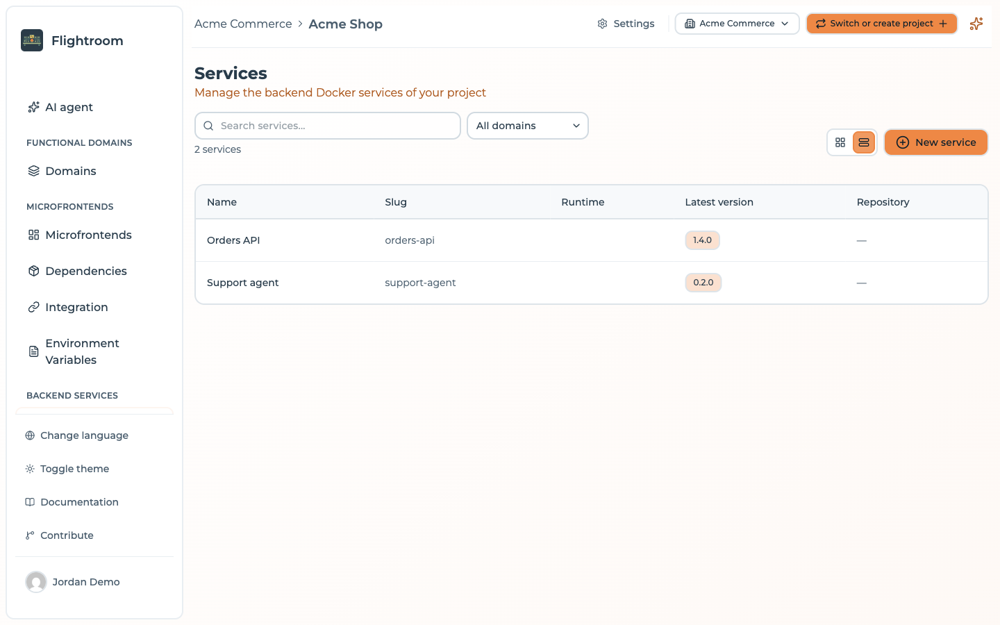
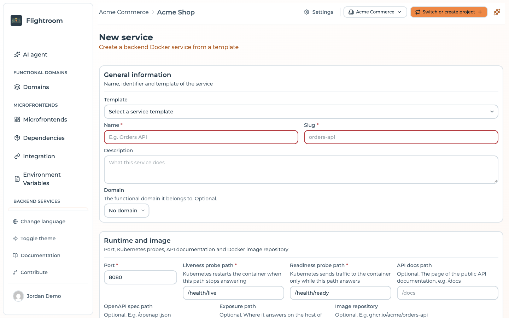
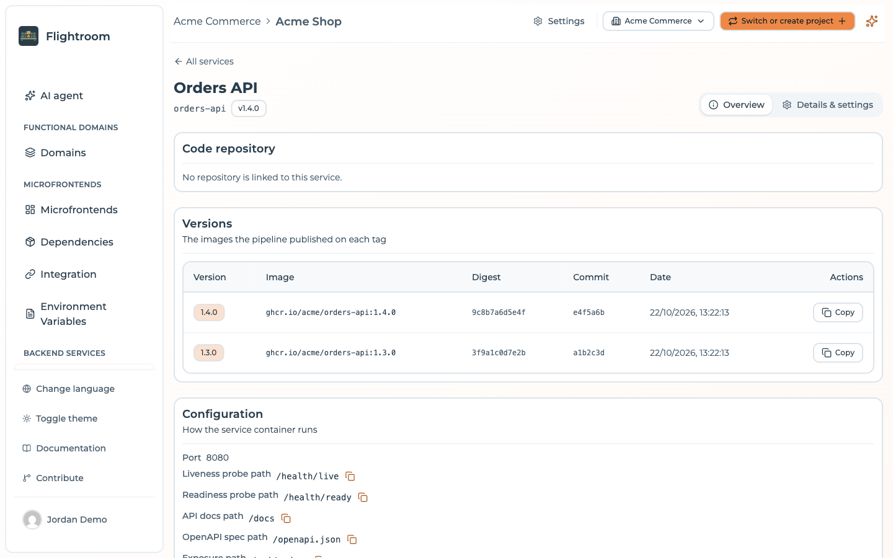

# Services

A **service** is a backend of the project that runs as a container in Kubernetes: an API, a worker,
or an agent that calls a model. The console holds its definition, the versions its CI pipeline
publishes and the configuration it receives, and the **Deploy** button ships it as described in
[Deploy to Kubernetes](./overview.md).

Services live under **Services**, in the **Backend services** section of the sidebar.

## The list of services

The list opens at `/services`. Switch between a **Grid view** and a **Table view** with the buttons
next to **New service**. Search by name or slug, and narrow the list to one functional domain with
the domain filter.

The table view shows, for each service:

| Column | Content |
| --- | --- |
| **Name** | The name of the service |
| **Slug** | Its identifier in URLs and in the CI registration |
| **Runtime** | Node.js, Python, Go, .NET, Java or Other |
| **Latest version** | The version the service is at, the one the next deploy ships |
| **Repository** | The linked code repository |



A project without services shows **Create from a template** instead.

## Creating a service

Press **New service**. The form opens at `/service/new`.



The form, and the **Settings** of the service later, has the same tabs as the settings of a
[Docker frontend](../frontends/create-a-frontend.md#bundle-or-docker): **General** (the general
information, then the **Domain** and **Release** cards), **AI context**, **Runtime** (runtime and
image, endpoints), **Variables** (environment variables, config maps and secrets, resources),
**Repository** and, once the service exists, **Danger Zone**.

### General information

| Field | Notes |
| --- | --- |
| **Template** | The [service template](../templates/service-templates.md) to start from, listed as *name (framework)*. Optional |
| **Name** | 3 to 100 characters. Typing it fills the slug |
| **Slug** | 2 to 50 lowercase letters, digits or dashes, not starting with a dash. Unique in the project, and fixed once the service exists: the CI registration URL is built on it |
| **Description** | What the service does |

### Domain and release

Two cards of their own, under the general information:

| Field | Notes |
| --- | --- |
| **Domain** | The functional domain it belongs to. Optional |
| **Version** | The tag of the image deployed. Set it here, or the pipeline sets it when it registers a newer image. Blank until then |

Choosing a template fills **Port**, the probe paths, **API docs path** and **OpenAPI spec path** with
the template's values. Only the fields you have not edited by hand are replaced, so picking another
template does not overwrite what you typed.

### Runtime and image

| Field | Notes |
| --- | --- |
| **Port** | The port the container listens on. `8080` by default |
| **Liveness probe path** | Kubernetes restarts the container when this path stops answering. `/health/live` by default |
| **Readiness probe path** | Kubernetes sends traffic to the container only while this path answers. `/health/ready` by default |
| **API docs path** | Optional. The page of the public API documentation, e.g. `/docs` |
| **OpenAPI spec path** | Optional. E.g. `/openapi.json` |
| **Exposure path** | Optional. Where the service answers on the host of every environment, e.g. `/api/orders`. See [Exposure](./exposure.md) |
| **Image repository** | Optional. E.g. `ghcr.io/acme/orders-api`. Left blank, the first version the CI registers fills it |

Paths start with `/`, hold no spaces and are at most 256 characters long.

### Endpoints

One base URL per environment of the project: where the service is reachable there, for example
`https://orders-api.dev.example.com`. Each one is an absolute `http` or `https` URL, without
credentials, query (`?`) or fragment (`#`). Leave it blank where the service is not exposed.

The **API docs path** and **OpenAPI spec path** are relative to these URLs: the overview of the
service links each environment's documentation from them.

:::info[Endpoints are not exposure]
The endpoints only record where the service answers, for people and for the documentation links. They
do not create any route. What puts a service on a URL in Kubernetes is its **Exposure path**, together
with the project's [exposure](./exposure.md) settings.
:::

### Code repository

When the project has a [code repository connection](../repositories/connect/github.md), the **Code
Repository** card creates a new repository for the service at the provider, from the selected
template when there is one: code, Dockerfile and pipeline ready. A new service always gets a new
repository; it cannot be linked to an existing one from this form.

### Environment variables

The variables the container expects, each with a **Name**, a **Description**, and the **Required**
and **Secret** switches. This list documents names only, never values: the values come from the
[config maps and secrets](./config-maps-and-secrets.md) attached below.

### Config maps and secrets

Tick the config maps and secrets of the project the service receives as environment variables. No key
may be set by two of the selected maps. See
[Config maps and secrets](./config-maps-and-secrets.md#attaching-them-to-a-service).

### AI context

Markdown notes for the AI agents working on the service: architecture, conventions, useful commands.
AI agents read them before changing the service's code.

## The pages of a service

A service has up to three tabs:

| Tab | Address | What it holds |
| --- | --- | --- |
| **Edit with AI** | `/service/:id` | The AI workspace on the service's repository. See [Change code with AI](../build-with-ai/ai-changes.md). Shown only when the project can use at least one [AI model](../build-with-ai/ai-models.md) and the service has a linked code repository; otherwise the service opens on its overview |
| **Overview** | `/service/:id/overview` | What the service is and runs, read-only |
| **Details & settings** | `/service/:id/settings` | The same form as creation, without the template, and the danger zone |

### Overview

- **Code repository**: the linked repository, if any.
- **Versions**: the images the pipeline published on each tag, newest first, with **Version**,
  **Image**, **Digest**, **Commit** and **Date**, and a button to copy the image reference.
- **Configuration**: the port, the paths and the image repository, the endpoint of each environment
  with links to its **API docs** and **OpenAPI spec**, and the environment variables the container
  expects.
- **Config maps and secrets**: the maps the service attaches, map by map.



With a linked code repository, the overview also offers **Create version**, which tags the repository
and starts the pipeline. See [Rolling back a Kubernetes deploy](./rollback.md#rolling-back-a-service)
for the dialog.

### Deleting a service

At the bottom of **Details & settings**, the **Danger zone** deletes the service. Confirm by typing its
name. The service goes with its registered versions and the deploys reported for it; its local working
copy and AI change requests are cleaned up too. The code repository is left untouched at the provider,
and nothing is removed from the cluster until the next deploy of each environment drops its values
file.

## Image versions

A service does not build itself: its CI pipeline builds the image, pushes it to your registry, then
tells the console about it. The [service templates](../templates/service-templates.md) ship pipelines
that do this for you.

```
POST <API_BASE>/services/by-slug/:serviceSlug/versions/:version
```

`:version` holds only letters, digits, `.`, `-` and `_`, at most 128 characters.

The call takes an [API key](../ci-cd/api-keys.md) with the `MANAGER` role, in the `api-key` header,
and a JSON body:

| Field | Notes |
| --- | --- |
| `image` | Required. The full image reference, e.g. `ghcr.io/acme/orders-api:1.2.0` |
| `digest` | Optional. The image digest |
| `commitSha` | Optional. The commit the image was built from |

```bash
curl -X POST \
  -H "api-key: $FLIGHTROOM_API_KEY" \
  -H "Content-Type: application/json" \
  -d '{"image": "ghcr.io/acme/orders-api:1.2.0", "commitSha": "3f2c1ab"}' \
  "<API_BASE>/services/by-slug/orders-api/versions/1.2.0"
```

- **Running the pipeline again on the same tag** replaces what was stored for that version.
- **The service moves to the new version** when it has none yet, or when the new one is a newer
  semantic version. A tag such as `latest` or a commit SHA is recorded but never moves the service.
  See [Rolling back a Kubernetes deploy](./rollback.md).
- **The first registration fills the Image repository** of a service that has none, from the image
  reference without its tag and digest.

:::info[What a deploy ships]
The Helm values file of the service uses its **Image repository** and its current version as the tag.
The `image` and `digest` you register are shown on the overview, but the deploy does not read them:
an image pushed to another repository than the one set on the service is not what Kubernetes pulls.
:::

## Reporting where a version runs

A deploy pipeline of your own can tell the console which version of a service now runs in an
environment:

```
POST <API_BASE>/services/by-slug/:serviceSlug/environments/:environmentSlug/deployments
```

With a `MANAGER` API key, and a JSON body with `version` (required: letters, digits, `.`, `-` and
`_`, at most 128 characters), and optionally `image` and `commitSha`. The version does not have to be
one the CI registered. Every report is kept, and the latest one per environment is the version shown
as running there in the [Deployed versions](../domains/overview.md#deployed-versions) matrix of a
domain.

A **Deploy** made through [GitOps](./gitops.md) does not write these reports: they come only from this
call.

## Where to go next

- [Config maps and secrets](./config-maps-and-secrets.md): the configuration a service receives
- [Exposure](./exposure.md): putting a service on a URL
- [Service and agent templates](../templates/service-templates.md): what a template gives a new service
