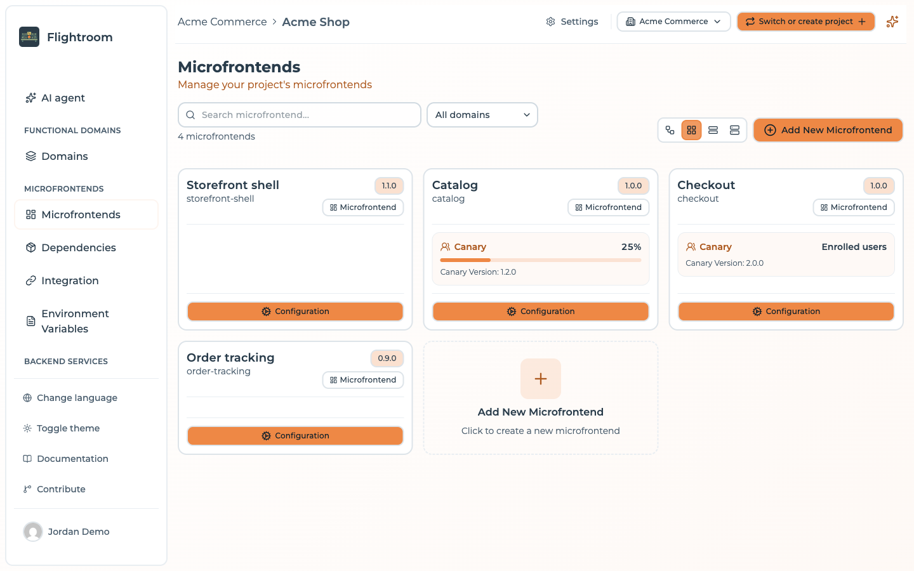
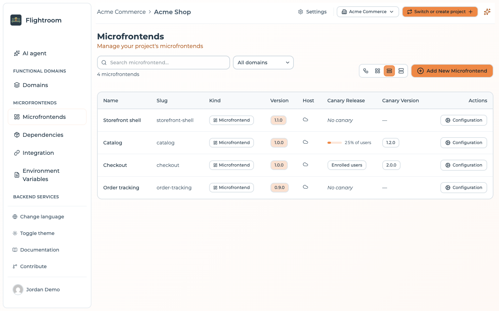
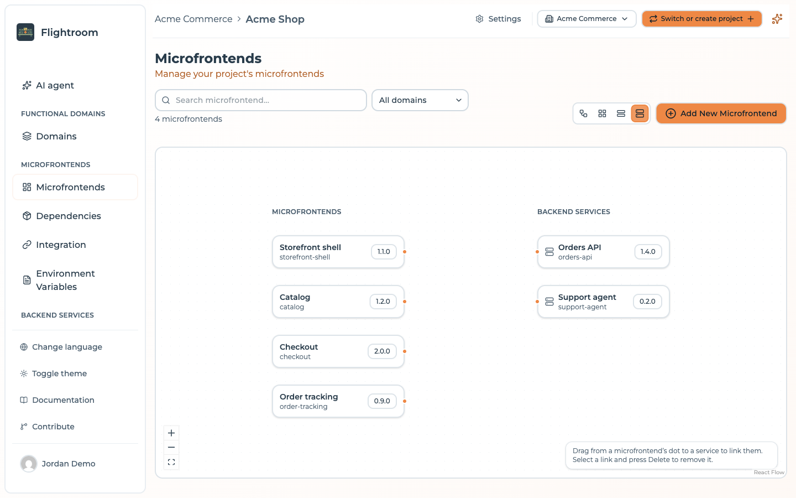

# Microfrontends overview

The **Microfrontends** page is where you spend most of your time in the console. It lists every
microfrontend registered in the current project with its version, and — depending on the view you
choose — its repository, its hosting type and its canary release.

When the project has an AI provider, the console opens on the AI agent; the Microfrontends page is
one click away in the sidebar. Without an AI provider, the console opens straight on it.

## Host and remote

A microfrontend is registered as one of two types:

| Type | Role |
| --- | --- |
| **Host** | The shell application. It boots the page, owns routing and layout, and loads remotes at runtime. |
| **Remote** | A microfrontend exposed to be consumed by a host. |

A project normally has one host per application and any number of remotes. A remote can itself
be a host of other remotes — the relations form a graph, not just a two-level tree.

Relations are what make the platform useful: once you declare that `checkout` and `catalog` are
children of `shell`, Flightroom can generate the exact `remotes` configuration `shell`
needs, pointing at the versions that are actually deployed in each environment. See
[Hosts and remotes](./host-and-remotes.md).

## Views

The dashboard offers four ways of looking at the same data, switchable from the top-right
corner:

- **Diagram view** — the microfrontend graph, showing which host loads which remotes. Nodes can
  be dragged; their position and size are saved per microfrontend. Drag from the bottom handle of
  a node to another node to make it a remote of the first; drop the link on empty canvas instead
  and the console starts a new microfrontend that is already a child of it. Select a link and press
  **Delete** to remove it. Double-clicking a node opens the microfrontend.

  

- **Grid view** — a card per microfrontend, showing its version, its linked repository and, when
  one is configured, the canary: the share of traffic it takes as a bar, or *Enrolled users* for a
  [*User* canary](./canary-releases.md#who--the-canary-type), and the canary version underneath.

  

- **Table view** — a dense list, best when a project has many microfrontends.

  

- **Backend links view** — microfrontends in one column and the project's backend services in the
  other. Drag from a microfrontend's dot to a service to link them; select a link and press
  **Delete** to remove it.

  

A free-text search above the views filters the list by name, a domain filter next to it narrows it
to one functional domain, and the counter underneath says how many of the total are showing.

## Opening a microfrontend

What a card opens depends on what the microfrontend can do:

- With an AI provider on the project and a linked repository, the card's main button is **Edit with
  AI**, which opens the AI workspace of the microfrontend. Its form is the **Details & settings**
  tab, next to it.
- Otherwise the button is **Configuration**, and it opens the form directly.

Either way the form is the one described in
[Editing a microfrontend](./create-a-microfrontend.md#editing-a-microfrontend).

## Anatomy of a microfrontend

| Field | Notes |
| --- | --- |
| **Kind** | **Microfrontend**, served by Flightroom, or **Frontend**, served by its own Docker container — see [Microfrontend or Frontend](./create-a-microfrontend.md#microfrontend-or-frontend) |
| **Name** | Display name |
| **Slug** | Lowercase, URL-friendly, **unique within the project**. It appears in serve URLs and becomes the Module Federation remote name, so treat it as permanent. |
| **Description** | Free text |
| **Version** | The version currently selected for this microfrontend. Only becomes live when you deploy. |
| **Continuous Deployment** | A flag published to consumers on the serve API. No longer in the form: set it through the API or an MCP client — see [Continuous deployment](./versions-and-builds.md#continuous-deployment) |
| **Hosting type** | Where the files live — see [Hosting options](./hosting-options.md) |
| **Entry Point** | The file a consumer loads. The form pre-fills `assets/remoteEntry.js`, or the entry point of the template you started from — see [Entry point](./hosting-options.md#entry-point) |
| **Code repository** | Optional link to a GitHub / GitLab / Azure DevOps repository, which enables the **Build** action |
| **Canary** | Optional progressive rollout configuration — see [Canary releases](./canary-releases.md) |

:::caution[The slug is fixed at creation]
The slug appears in your serve URLs and becomes the remote name in generated Module Federation
configs, so the console does not let you change it afterwards — the field is read-only when you
edit a microfrontend. Getting a different slug means creating a new microfrontend and re-pointing
its consumers. Pick one you can live with.
:::

## Where to go next

- [Create a microfrontend](./create-a-microfrontend.md) — from a template or from scratch
- [Hosting options](./hosting-options.md) — hub, your own bucket, or an external URL
- [Versions and builds](./versions-and-builds.md) — how a version gets created and uploaded
- [Hosts and remotes](./host-and-remotes.md) — wiring the graph
- [Canary releases](./canary-releases.md) — progressive rollout
