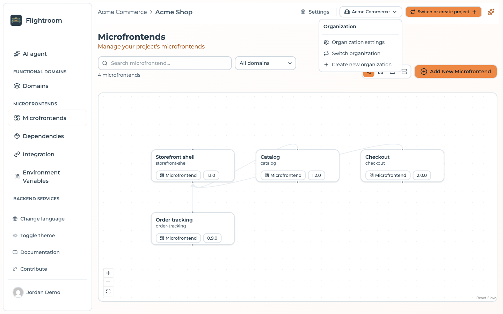
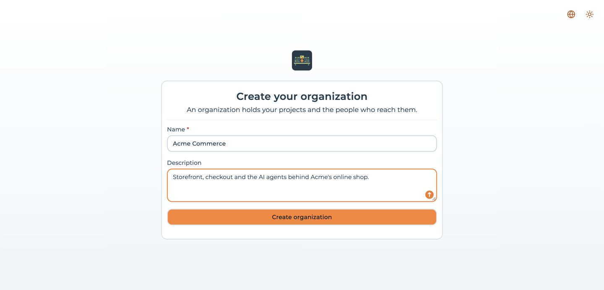

# Organizations overview

An **organization** is the tenant that owns your projects. It sits one level above the project and
answers a question the project alone could not: *which projects does this person get to see at all?*

Two rules follow from that, and everything else in this section is a consequence of them:

- A **project belongs to exactly one organization**, decided when the project is created and never
  changed afterwards.
- A **user can belong to any number of organizations**, with a different role in each.

Organizations were introduced in **4.0.0**. Installations that predate it are migrated automatically
— see [Upgrading to organizations](./upgrading-to-organizations.md).

## Where it sits in the object model

```
Organization
├── Members (Owner, Admin, Member)
└── Project
    ├── Environment (dev, uat, prod, …)
    ├── Frontend (host or remote, versioned)
    ├── Storage / Bucket, Code Repository, API Key
    └── Members (Admin, Editor, Viewer)
```

The project is still the boundary every other object belongs to — frontends, environments,
deployments, API keys are all project-scoped, and nothing about that changed. What the organization
adds is a boundary *above* the project: an authorization level that decides reachability rather than
ownership. See [Core concepts](../core-concepts.md#the-object-model).

## Why the level exists

Before 4.0.0 the only way to reach a project was to be an explicit member of it. That has two
consequences an installation notices sooner or later:

- **A project could be orphaned.** When the last member of a project left, nobody could open it any
  more — not even the person who administers the platform for that customer.
- **There was nothing to name a customer.** One installation serving several customers had no object
  to keep them apart, and no place to describe who administers what.

The organization solves both. Whoever administers it reaches every project inside it, invited or
not, which means a project cannot become unreachable while its organization has an owner. And each
customer, team or client gets a tenant of its own, with its own membership list.

## One organization at a time

The console works inside one organization at a time. The selected organization is what scopes the
project list underneath it: the project switcher only ever offers projects of the organization you
are in.



The header reads as a breadcrumb — *organization › project* — and the organization name is a link to
the [organization page](./managing-an-organization.md#the-organization-page). The button on the
right is the single door to the organization level: settings, switching and creation all start
there. Everything in the sidebar below it is about the project.

:::info[The selection is remembered per browser]
The organization and the project you are working in are stored in the browser, not on the server.
Signing in from another browser asks again. An account that belongs to exactly one organization is
never asked at all — it is selected automatically.
:::

## Your first organization

A project cannot exist outside an organization, so an account with none is asked to create one
before it reaches anything else. The first run therefore goes:

1. Register, and follow the activation link when the installation sends email — until then the
   account cannot be used. See [Registration and activation](../account/email-flows.md#registration-and-activation).
2. Sign in. An account that belongs to no organization lands on **Create your organization** —
   *"An organization holds your projects and the people who reach them."* — with two fields:
   **Name**, required and at least 2 characters, and an optional **Description**. There is no
   cancel button on this screen: it is the only way forward. **Create organization** makes you its
   owner.

   

3. The [project wizard](../project-settings/projects.md#creating-a-project) opens inside it. Its last
   screen offers **Start deploying your frontends**, which opens the console on the
   **AI agent** page, [Maestro](../build-with-ai/console-assistant.md) — or on **Frontends**
   when the project can use no AI yet.

If somebody invited you instead, the pending invitation is offered on that same screen, above the
creation form: accepting it puts you into their organization rather than opening one of your own.

:::caution[A plain member cannot create the first project]
Only an owner or an admin of an organization can create a project in it. Somebody invited to an
organization as a plain member, with nothing shared with them yet, sees an empty project picker and
the organization switcher — not the project wizard, which would fail on submit. See
[Roles and project visibility](./roles-and-visibility.md).
:::

## Where to go next

- [Roles and project visibility](./roles-and-visibility.md) — who reaches which project, and how
  organization roles interact with project roles
- [Managing an organization](./managing-an-organization.md) — switching, creating, members, settings
  and deletion
- [Upgrading to organizations](./upgrading-to-organizations.md) — what happens to projects created
  before 4.0.0
- [Project members and roles](../project-settings/users-and-roles.md) — the second, finer level of
  access control
