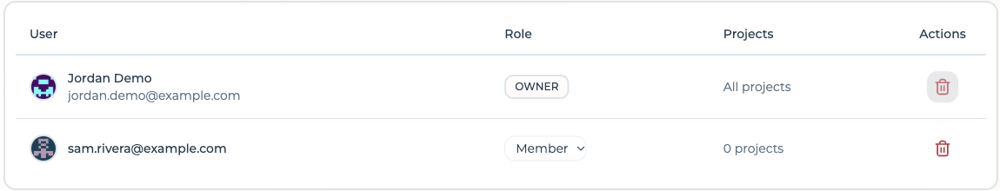

# Organization roles and project visibility

Access in Flightroom is decided at two levels. The **organization role** decides which projects
you can reach at all. The **project role** decides part of what you may change inside one: the
members list, the delivery settings, the AI and everything that writes to your Git provider or your
cloud. The rest of a project's configuration is open to every member. See
[Project members and roles](../project-settings/users-and-roles.md) for the detail.

## The three organization roles

| Role in the console | In the API | Reaches | Can also |
| --- | --- | --- | --- |
| **Owner** | `OWNER` | Every project of the organization | Everything an Admin can, plus granting and taking ownership, and deleting the organization |
| **Admin** | `ADMIN` | Every project of the organization | Rename the organization, invite and remove members, change roles, create projects |
| **Member** | `MEMBER` | Only the projects they were invited to | Nothing at organization level — the role grants no access on its own |

Owner and Admin administer the organization and are treated identically by every visibility check.
They differ in three places only:

- the **last owner** cannot be removed or demoted, because an organization with no owner could no
  longer be administered by anybody;
- **only an owner** can make somebody an owner, or take that role away — an admin cannot promote
  themselves;
- **only an owner** sees the [danger zone](./managing-an-organization.md#danger-zone) and can delete
  the organization.

## What a Member actually gets

Belonging to an organization as a plain member grants nothing by itself. It is a seat, not an
access: a member who has been invited to no project sees an empty project list, and the members
table records that honestly.

The **Projects** column is the visibility rule made visible. Owners and admins read *All projects*,
because that is literally what they reach; a member reads the number of projects of this
organization they were actually invited to.

A member also cannot create a project. Project creation is reserved to whoever administers the
organization — otherwise adding something to a tenant you only visit would be the one thing a member
could do that an admin never approved.

## How the two levels combine

For a given project, the question *can this user open it?* has exactly two ways to answer yes:

1. the user holds a **project membership** on it — an invitation they accepted, whatever the project
   role; or
2. the user **administers the organization** that owns the project.

If neither holds, the project is not returned in any listing and every endpoint touching it is
refused. The rule lives in a single gate shared by every backend service, so it applies uniformly to
frontends, environments, variables, storages, repositories, builds and deployments — there is
no endpoint where it was forgotten.

| Organization role | Project membership | Result |
| --- | --- | --- |
| Owner or Admin | none | Reaches the project, with full project rights |
| Owner or Admin | Admin / Editor / Viewer, whole project or specific domains | Reaches the project; neither the project role nor a domain scope restricts them |
| Member | Admin | Reaches that project only, with full rights on it, members included |
| Member | Editor | Reaches that project only; cannot manage its members or change its delivery settings |
| Member | Viewer | Reaches that project only; on top of the Editor's limits, cannot write to its Git provider or its cloud |
| Member | Editor / Viewer on **Specific domains** | As above, and confined to the frontends and services of the domains they were given |
| Member | none | Does not reach the project at all |
| none | any | Does not reach the project at all |

:::caution[A project role limits writes, but not all of them]
The project role is enforced on a defined set of actions. Managing the members of a project needs a
project **Admin** of the whole project, or an organization Owner or Admin. A **Viewer** is refused
committing to the GitOps repositories, creating, editing or deleting storages and databases, and
creating a code repository — including the one created with a new frontend or service. An
organization Owner or Admin is never refused any of these, whatever their project role.

Everything outside that set is still open to whoever reaches the project, Viewers included —
renaming it, editing frontends, environments and variables among others. So a Viewer is not
read-only. The full list is in
[What the role decides](../project-settings/users-and-roles.md#what-the-role-decides); keep somebody
out of the project, or out of the organization, if they must not change it at all.
:::

## Pending invitations are not memberships

At both levels, an invitation waiting for an answer grants nothing. The row exists — it is what the
pending invitations table lists, and what lets the invitation be resent or revoked — but until it is
accepted it does not make its holder a member. The consequences are worth spelling out:

- an invited user does not appear among the members, and is not counted in the member total;
- an invited user's organizations list does not contain the organization: the invitation is offered
  as accept-or-decline instead, on the organization selection screen and in the switcher dialog;
- an unanswered invitation to *own* an organization does not already hand over its projects.

Invitations expire **5 days** after they are sent. An expired invitation can no longer be accepted;
it can still be dismissed, and an admin can send a fresh one.

## Inviting to a project creates a membership in the organization

A project sits inside an organization, so somebody invited to a project has to belong to that
organization too — otherwise they would accept an invitation into a tenant they are not part of.

Inviting a collaborator to a project therefore also adds them to the owning organization, as a
**plain member, already accepted**. Creating it accepted is deliberate: it avoids keeping two
invitation tokens in sync, and a plain membership grants nothing on its own — the project invitation
they still have to answer is what actually gives them something.

Two safeguards apply:

- somebody who **already holds a role** in that organization keeps it. A project invitation never
  quietly demotes an admin to member.
- **declining** the project invitation takes the implicit membership back, provided the user has no
  other project in that organization and holds no role of their own there. The same clean-up runs
  when a project invitation that was never accepted is revoked, and the account itself is deleted if
  it only ever existed to be invited.

:::info[A removed member stays in the organization]
Removing somebody from a project after they accepted does **not** remove them from the organization:
they stay as a plain member with no project, which is what the members table shows as *0 projects*.
Take them out of the organization as well if you want them gone entirely.
:::

## Removing somebody from the organization

Removing a member of the organization also removes them from **every project of that organization**.
Leaving the project rows behind would keep granting access to data inside a tenant the person no
longer belongs to, so the two are done together and cannot be separated.

Their account, and their membership of projects in *other* organizations, are untouched.

## Relation to project roles

The project-level roles — Admin, Editor, Viewer — are documented in
[Project members and roles](../project-settings/users-and-roles.md). Read the two levels this way:

> The organization role answers *which projects*. The project role answers part of *what, inside
> it* — see [What the role decides](../project-settings/users-and-roles.md#what-the-role-decides).

For machine access, [API keys](../ci-cd/api-keys.md) are project-scoped and unaffected by
organization membership. Their role is checked by the MCP server and when a pipeline registers the
version of a service or a Docker frontend, and an expired or revoked key is refused — see
[API keys](../ci-cd/api-keys.md).
