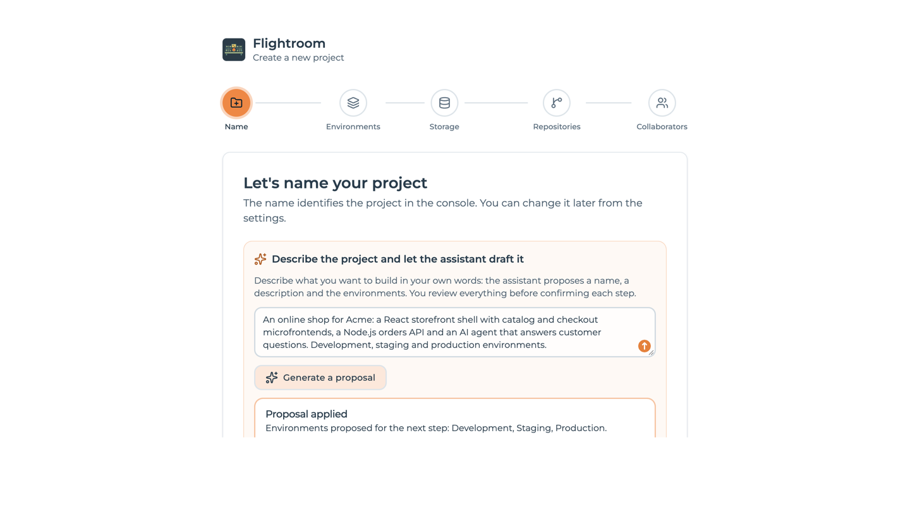
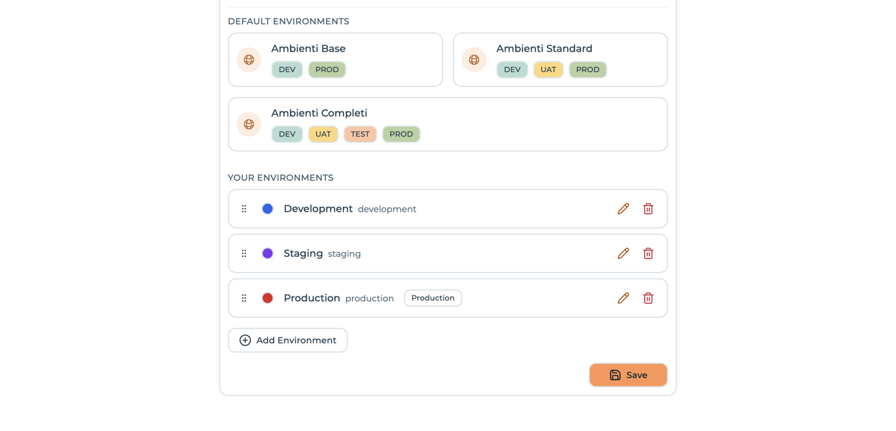
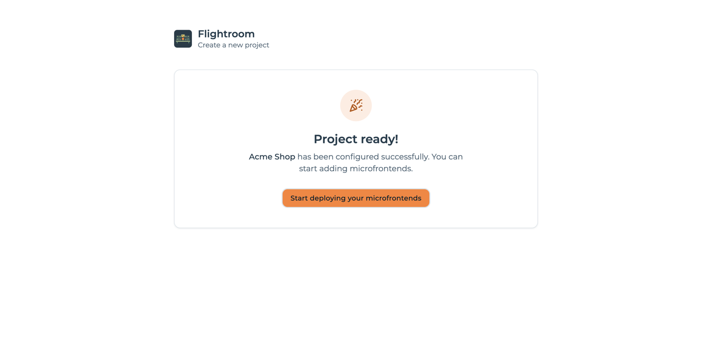
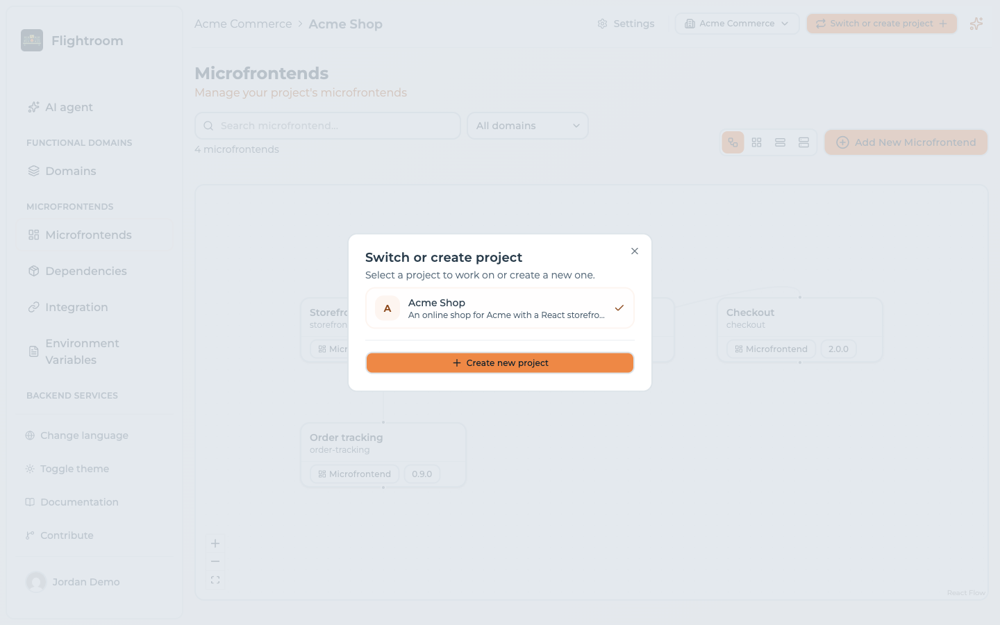
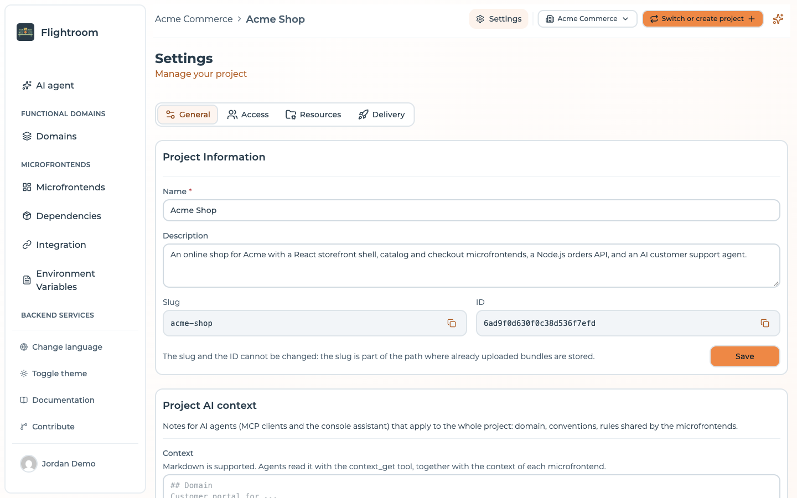
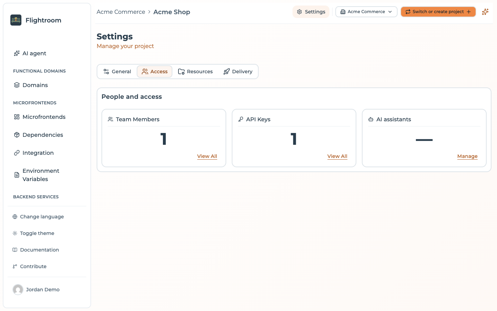
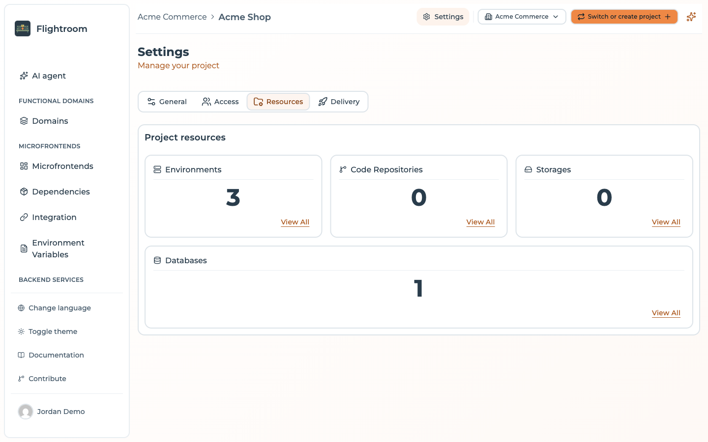
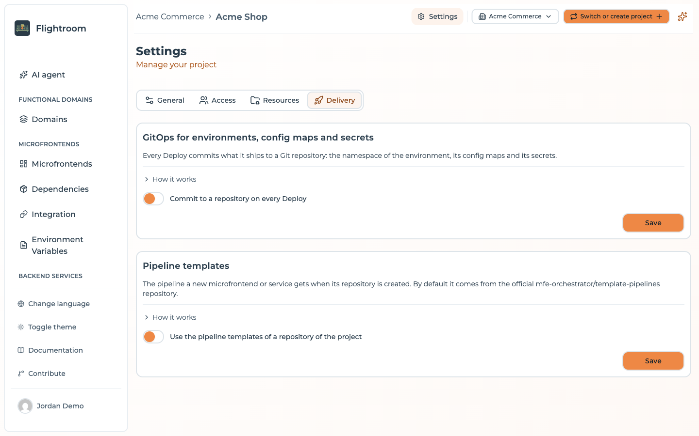

# Projects and access control

A **project** is the container every configuration object belongs to: frontends, environments,
storages, code repositories, API keys and members all belong to exactly one project.

The project in turn belongs to exactly one **organization**, which is the tenant that owns it and
the level deciding who reaches the project at all. See
[Organizations](../organizations/overview.md).

## What belongs in one project

A good rule of thumb: **one project per application**, where an application is a set of
frontends deployed together and sharing a host.

Signs you want a second project rather than a bigger one:

- The frontends are never deployed together
- Different teams should not see each other's configuration
- The release cadences are unrelated
- The environments genuinely differ (not just in values, but in which environments exist)

Signs you want one project:

- A shared host loads all of them
- They are promoted through the same stages
- The same people manage all of them

Bear in mind that frontends can only be wired into a host graph *within* a project, and API
keys are project-scoped. Splitting an application across projects means losing the relation graph
that generates your Module Federation configuration — usually not worth it.

## Creating a project

Your first project is created during onboarding: after signing in for the first time you are asked to
create an [organization](../organizations/overview.md#your-first-organization), and the project wizard
opens inside it.

Additional projects are created from the project switcher in the header, with **Create new project**,
which opens the wizard at `/project-wizard`. The wizard, titled *Create a new project*, has five
steps, shown in a stepper at the top: **Name → Environments → Storage → Repositories →
Collaborators**.

### 1. Name

*Let's name your project* asks for:

| Field | Notes |
| --- | --- |
| **Project name** | Required, at least 3 characters. The slug is derived from it and never changes afterwards |
| **Description (optional)** | Free text |

**Create project** creates the project and moves to the next step.

When the organization has at least one [AI](../build-with-ai/ai-models.md), a box above the fields
offers a shortcut: **Describe the project and let the assistant draft it**. Describe what you want to
build in your own words — up to 4,000 characters — and choose **Generate a proposal**. The assistant
fills in the name and the description, proposes the environments for the next step and, where your
description suggests them, a storage provider and a Git provider. A **Proposal applied** box sums up
what it did. Nothing is created from the proposal: you review every field, and still confirm each
step yourself. If the AI fails, the box says so and you fill in the fields by hand.



### 2. Environments

*Configure environments* offers **Default Environments** — presets of two (Development, Production),
three (Development, UAT, Production) or four (Development, UAT, Test, Production) environments — and
**Your Environments**, the list that will actually be created. Click a preset to fill the list, add,
edit or remove environments, drag them to reorder, then **Save**. When the assistant drafted the
project, the list starts with the environments it proposed. See
[Environments](../environments/overview.md).



### 3. Storage

*Where do we host your frontends?* shows the same form as a new
[storage](../buckets/overview.md), with **Save and continue**, or **Skip**.

:::note[This step is not essential]
Without a storage, the bundles of your frontends are hosted by Flightroom itself. You can
connect an external storage at any time from the project settings.
:::

### 4. Repositories

*Connect your source code* offers **Connect a repository**, which opens the same provider picker as
the [Code repositories](../repositories/connect/github.md) page — GitHub, GitLab or Azure DevOps — or
**Skip**.

### 5. Collaborators

*Invite collaborators* takes one row per person: an email address and a role, with **Add
collaborator** for more rows. The roles are the same as in the invite dialog of
[Members and roles](./users-and-roles.md#roles):

| Role in the wizard | Project role |
| --- | --- |
| **Admin** | `OWNER` |
| **Editor** | `MEMBER` |
| **Viewer** (the default) | `VIEWER` |

**Complete** sends the invitations — each person receives an email invitation, exactly as from
[Members and roles](./users-and-roles.md#inviting-a-member) — and **Skip and complete** finishes
without inviting anybody. An invalid or duplicated address, or your own, is flagged before anything
is sent.

### Project ready

The wizard ends on **Project ready!**, which offers **Go to dashboard** (the frontends of the new
project) and **Add frontend**. During onboarding it offers **Start deploying your
frontends** instead, which opens the console on the
[AI agent page](../build-with-ai/console-assistant.md), or on **Frontends** when the project can
use no AI.



The close button (**✕**) at the top right leaves the wizard for **Frontends** at any step. It is
not shown during onboarding.

Storage, repositories and collaborators are skippable, and every step can be done later from
**Settings**.

:::caution[Leaving the wizard halfway creates a half-configured project]
The project row is created the moment you complete step 1, before any environment exists. Nothing
remembers where you were: the step you are on is component state, with no draft saved anywhere, so
closing the wizard or reloading the page starts a fresh one — and completing that fresh one creates a
**second project**, leaving the first behind with whatever it had at the time.

If it happens, delete the abandoned project from its own
[Danger Zone](#deleting-a-project) rather than trying to resume it.
:::

The project is created inside the organization you are currently working in, and it stays there:
a project cannot be moved to another organization afterwards.

:::caution[Only organization owners and admins can create a project]
A plain member of an organization reaches the projects they were invited to and nothing else, so the
wizard is not offered to them at all. See
[Roles and project visibility](../organizations/roles-and-visibility.md).
:::

## Switching projects

The project selector sits in the console header, next to the
[organization selector](../organizations/managing-an-organization.md#the-header-menu). Everything
below it — frontends, deployments, settings — follows the selection.



The list only ever offers projects of the organization you are in. If a page looks empty, check the
selected project — and the selected organization — before anything else. It is the most common cause
of "my frontends disappeared".

## Project settings

**Settings** in the sidebar (`/settings`) is the project's control panel. It is split into four tabs,
and the tab in use is part of the address (`?tab=general`, `?tab=access`, `?tab=resources`,
`?tab=delivery`), so a link can point straight to one of them.

### General

The **General** tab holds the project's own data, top to bottom:

- **Project Information** — the name, the description and the identifiers, described below.
- **Project AI context** — free markdown notes for AI agents (MCP clients and the console assistant)
  that apply to the whole project: domain, conventions, rules shared by the frontends. Up to
  20,000 characters. See [Build with AI](../build-with-ai/overview.md).
- **Danger Zone** — [deleting the project](#deleting-a-project).

Under **Project Information** you will find:

| Field | Notes |
| --- | --- |
| **Name** | Editable display name. Required, at least two characters |
| **Description** | Editable free text |
| **Slug** | Read-only. URL-friendly identifier, part of storage paths. Copyable |
| **ID** | Read-only. The project id used in API calls and public serve URLs. Copyable |

The **ID** is what you need for the serve API and for `project-id` headers — this is where to copy
it from.



### Access

The **Access** tab, *People and access*, has one card per way into the project, each with a count and
a link to its page:

| Card | Leads to |
| --- | --- |
| Team Members | [Members and roles](./users-and-roles.md) |
| API Keys | [API keys](../ci-cd/api-keys.md) |
| AI assistants | The MCP clients connected to the project — see [MCP server](../build-with-ai/mcp-server.md). This card shows no count, only **Manage** |



### Resources

The **Resources** tab, *Project resources*, works the same way for what the project is built on:

| Card | Leads to |
| --- | --- |
| Environments | [Environments](../environments/overview.md) |
| Code Repositories | [Code repositories](../repositories/connect/github.md) |
| Storages | [Buckets](../buckets/overview.md) |
| Databases | [Databases](../kubernetes/databases.md) |



### Delivery

The **Delivery** tab configures how the project reaches your clusters, in the order the settings are
set up. Changing **GitOps**, **Argo CD** or **Pipeline templates** needs a project **Admin**, or an
organization Owner or Admin — see
[What the role decides](./users-and-roles.md#what-the-role-decides).

| Section | What it does |
| --- | --- |
| **GitOps** | Every deploy commits what it ships to a Git repository. See [GitOps](../kubernetes/gitops.md) |
| **Exposure** | The domain the environments are exposed on. See [Exposure](../kubernetes/exposure.md) |
| **Argo CD** | Argo CD deploys the environments from the GitOps repositories. See [Argo CD](../kubernetes/argo-cd.md) |
| **Pipeline templates** | Where the pipeline of a new frontend or service comes from, described below |

**Exposure** and **Argo CD** appear only once GitOps is on and saved with a repository: both work on
what GitOps commits.



**Pipeline templates** decides the CI pipeline a repository gets when it is created for a new
frontend or service. By default it comes from the official
[`template-pipelines`](https://github.com/mfe-orchestrator/template-pipelines) repository. Turn on
**Use the pipeline templates of a repository of the project** to pick one of your own instead,
reached through one of the project's code repository connections, with a **Branch or tag** (left
empty, the default branch). Your repository needs the same `<type>/<compiler>/<provider>/` layout;
the **How it works** section of the card spells it out. Repositories already created are left as they
are. See [What gets added on top](../templates/templates-library.md#what-gets-added-on-top).

### Renaming a project

Edit the **Name**, then **Save**. The name and the description are one form and are saved together,
so an edit to either writes both.

The **Slug** does not follow the name, and cannot be edited at all. It is baked into the storage path
of every bundle already uploaded — see the caution below — so re-deriving it from a new name would
leave those files where nothing looks for them. A renamed project keeps the slug it was created
with, which is worth knowing when you audit a bucket and find a path naming a project that no longer
goes by that name.

:::caution[The slug is part of your storage paths]
Artifacts are stored under `<projectSlug>-<projectId>/…`. The id keeps paths unique regardless, but
be aware the slug appears in bucket paths when auditing storage.
:::

## Deleting a project

**Settings → General → Danger Zone → Delete Project** removes the project and everything scoped to it, in one
transaction: frontends, environments, variables, deployments and their history, API keys, member
and invitation rows, **storage connections**, **code repository connections**, the record of every
built version uploaded for those frontends, and any
[canary user enrolment](../frontends/canary-releases.md) on those deployments.

You must type the project name to confirm. There is no undo and no soft delete.

What is *not* deleted:

- Files already stored in **your own buckets** — the storage connection goes away, the objects stay
- **Git repositories** created from templates — those live in your provider
- Secrets written into your Git provider — remove `FLIGHTROOM_API_KEY` yourself if
  you want it gone

:::caution[Deleting a project breaks live applications]
Every public serve endpoint for that project stops answering immediately. Any application currently
loading frontends through it will fail to load them. Make sure nothing is serving from the
project before you delete it.
:::

## API access

When calling the management API directly, the project is selected with a header:

```http
project-id: 68f1a2b3c4d5e6f7a8b9c0d1
```

Some endpoints also take an `environment-id` header for environment-scoped resources such as
variables. Requests authenticated with an [API key](../ci-cd/api-keys.md) derive the project from
the key and do not need the header.
