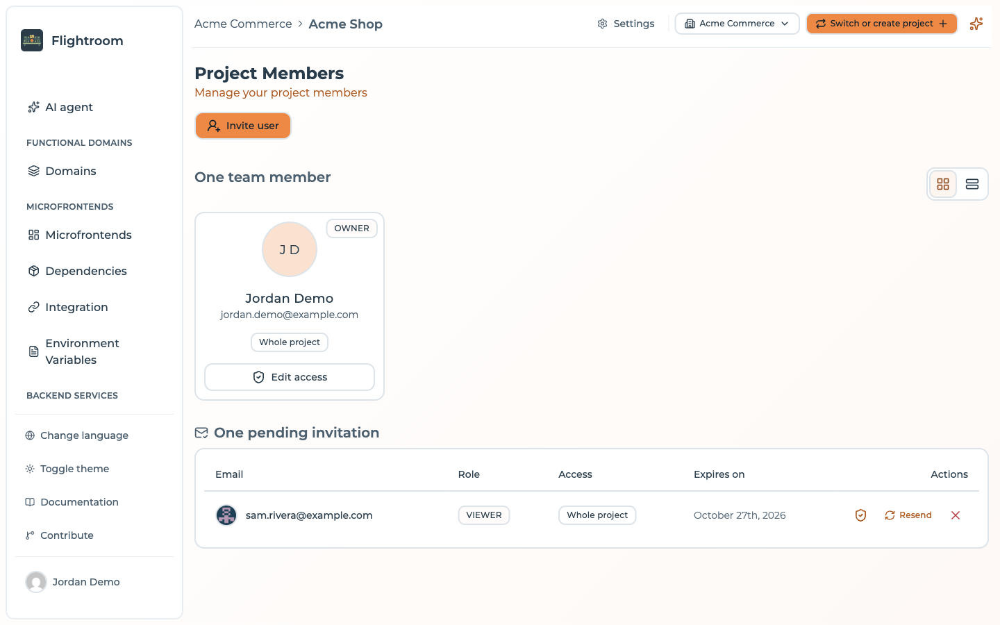
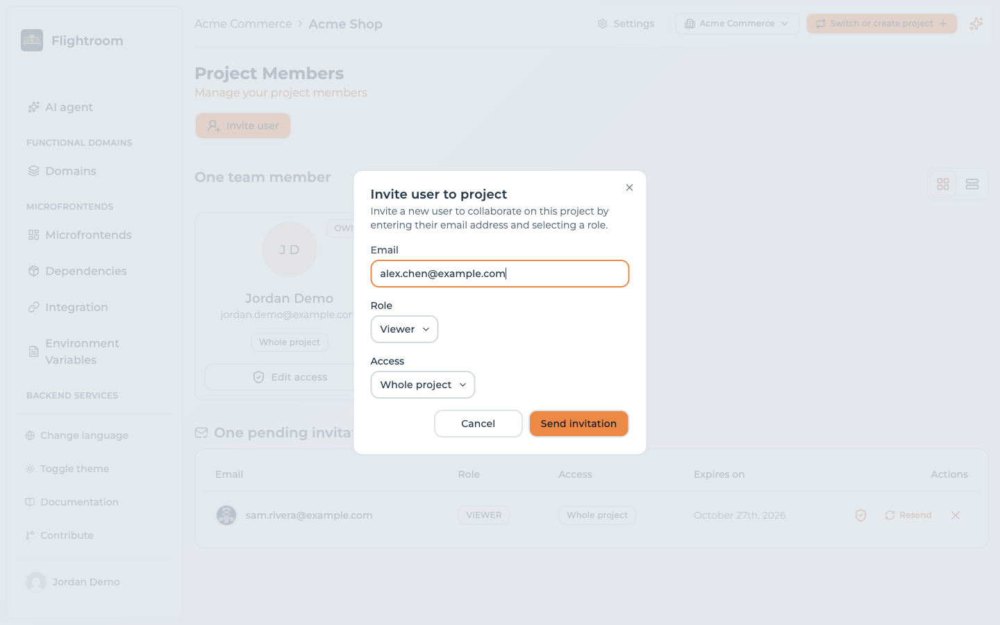

# Project members and roles

A user can be a member of several projects, and a role is recorded for them in each one. The role
decides some things and not others: it guards the members list, the delivery settings, the AI and
everything that writes to your Git provider or your cloud, but most of the day-to-day configuration
is open to every member. Read [Roles](#roles) before you invite anybody.

Which projects a person can reach at all is decided one level up, by the organization that owns
them:

> The [organization role](../organizations/roles-and-visibility.md) answers *which projects*.
> The project role answers *what they may change in one*.

Two consequences are worth keeping in mind while reading the rest of this page:

- **Whoever administers the organization reaches every project in it**, invited or not, and acts
  there as an Admin. Somebody who must be read-only cannot be an organization owner or admin.
- **Inviting somebody to a project also puts them into the owning organization**, as a plain member.
  See [Inviting a member](#inviting-a-member) below.

Members live under **Settings → Access → Team Members**.

## Roles

There are three roles:

| Role in the console | Stored and returned by the API as | Notes |
| --- | --- | --- |
| **Admin** | `OWNER` | The last Admin of a project cannot be removed |
| **Editor** | `MEMBER` | |
| **Viewer** | `VIEWER` | The value the invite dialog starts on |

The console is not consistent about which of the two names it shows. The **invite dialog** offers
*Admin*, *Editor* and *Viewer*; the badge on the members list prints the stored value — `OWNER`,
`MEMBER` or `VIEWER` — and so does the API. Invitation emails name the role as well.

### What the role decides

| Action | Who may do it |
| --- | --- |
| Invite and remove members, change their role | Project **Admin**, or an organization Owner or Admin |
| Change the GitOps, Argo CD and pipeline-template settings | Project **Admin**, or an organization Owner or Admin |
| Ask for an AI change, apply it, open its pull request, discard it | Anyone but a **Viewer** |
| Create a code repository, for a microfrontend or a service | Anyone but a **Viewer** |
| Create, edit, test or delete storages and databases | Anyone but a **Viewer** |
| Deploy, when the project has GitOps on | Anyone but a **Viewer** |
| Change anything through the [console assistant](../build-with-ai/console-assistant.md) or an [MCP client](../build-with-ai/mcp-server.md) | Anyone but a **Viewer**, within what their role allows |

Organization owners and admins are never refused any of these: they act in every project of their
organization as an Admin would.

:::warning[What the role does not decide]
Everything else is open to every member who reaches the whole project, Viewers included: renaming
and deleting the project, editing microfrontends, services, environments and variables, and
deploying a project that does not have GitOps on. The console may still show a button to a Viewer
that the backend then refuses. Invite somebody to a project only if you are comfortable with them
changing its configuration.
:::

Keep at least two Admins, so the protection of the last one cannot strand a project whose only
Admin has left.

### Restricting who can deploy to production

There is no per-environment permission split. With [GitOps](../kubernetes/gitops.md) on, Viewers
cannot deploy at all, but every Editor can deploy every environment, `prod` included. Without
GitOps, every member can. To keep production to a smaller group, give it a **separate project**
whose membership is that group. **Redeploy** is not restricted by role at all: it re-activates a
previous snapshot in Flightroom, and does not touch the cluster — see
[Rolling back on Kubernetes](../kubernetes/rollback.md).

## Inviting a member

1. Go to **Settings → Access → Team Members** and click **Invite user**.

   

2. Enter their **email address**.
3. Choose a **role**.
4. **Send invitation**.

   

An email goes out with an invitation link. The invitee follows it, signs in or registers, and joins
the project with the role you chose — see
[Accepting an invitation](../account/email-flows.md#accepting-an-invitation) for the screen they land
on and how long the link lives.

:::info[The invitation reaches the organization too]
A project sits inside an organization, so inviting somebody to a project also adds them to that
organization — as a plain **member**, created already accepted. That membership grants nothing on
its own: a plain member reaches only the projects they were invited to, which is exactly the project
you just invited them to. Somebody who already holds a role in the organization keeps it; a project
invitation never demotes an admin. Declining the invitation takes the implicit membership back
again, unless they have other projects there. See
[Roles and project visibility](../organizations/roles-and-visibility.md#inviting-to-a-project-creates-a-membership-in-the-organization).
:::

:::caution[Without SMTP an invitation becomes an unverified membership]
Invitations are delivered by email, so the installation needs SMTP configured. On a self-hosted
instance without `EMAIL_SMTP_HOST` set the invitation does not fail — it degrades. No email is sent,
no link is generated, and the address you typed is added to the project as an **already active
member**, with nothing having proved that the person owns that address. Resending an invitation is
the only action that errors in that state.

That means a typo hands the role you picked to whoever owns the address you mistyped. Configure SMTP before you invite anybody — see
[Environment Variables](../self-hosting/environment-variables.md).
:::

## Managing invitations

Accepted members and pending invitations are two separate sections of the page, not one list with a
status column:

| Section | Columns |
| --- | --- |
| Members — as cards, or as a table from the view switcher | User, Role, Actions |
| **N pending invitations** — the heading counts them, and appears only when there are any | Email, Role, Expires on, Actions |

An invitation expires five days after it is sent, which is the date under **Expires on**.

For a pending invitation you can:

- **Resend** — send the email again, for the classic case of it landing in spam. The only action with
  a visible label, and even that is hidden on a narrow window.
- **Revoke** — cancel it, so the link no longer works. An icon-only button: the **✕** at the end of
  the row, which names itself on hover.

## Changing a role

Choose **Edit access** on the member's row. The dialog changes the role and the **Access**: the
**Whole project**, or **Specific domains** only. An Admin always has the whole project. The last
Admin cannot be given another role.

Only a project Admin, or an organization Owner or Admin, can change a role. For an invitation that
is still pending, inviting the same address again also refreshes the role and sends a new link.

## Removing a member

Remove them from the row's actions — the trash icon in the table, the **Remove** button on the card.
The confirmation is a plain dialog naming the person ("Are you sure you want to remove … from this
project?"), not the type-the-name gesture that [deleting a project](./projects.md#deleting-a-project)
asks for. The button is disabled for the last Admin, and when the project would be left with no
members at all.

They lose access to this project immediately; their account and their membership of other projects
are unaffected.

:::caution[Removing them from the project does not remove them from the organization]
Somebody who accepted the invitation stays in the organization as a plain member with no project —
harmless, since that grants nothing, but they remain on the organization's members list. Take them
out from [the organization page](../organizations/managing-an-organization.md#members) if you want
them gone entirely; doing so also removes them from every other project of that organization. An
invitation that was never accepted is cleaned up on its own when you revoke it.
:::

:::tip[Removing a person is not enough]
People leaving is also the moment to audit [API keys](../ci-cd/api-keys.md). A key that person
created keeps working after they are removed — keys belong to the project, not to the user who
created one. **Delete** any key they were the only consumer of: deletion is the only thing that
stops a key authenticating, as [Machine access](#machine-access) explains.
:::

## Authentication

How members sign in depends on the installation:

| Method | Notes |
| --- | --- |
| Email and password | Available when embedded login is enabled |
| Google | Available when configured |
| Microsoft Entra ID (Azure) | Available when configured |
| Auth0 | Available when configured |

The hosted console offers email/password and Google. For self-hosted installations, the enabled
providers are whichever you configure — see
[Enable SSO](../self-hosting/enable-sso/Google.md).

Whichever method a user signs in with, their memberships are the same: authentication decides who
they are, project membership decides which projects they reach.

## Machine access

For CI pipelines and scripts, use [API keys](../ci-cd/api-keys.md) rather than a user account. A key
belongs to the project, so it survives any change to your own account.

The create dialog asks for two things, a **name** and an **expiration date**; the role is not among
them, and every key the console creates is stored as `MANAGER`.

:::info[Expired and revoked keys are refused]
A key past its expiration date, or revoked, is refused on the next request. Delete a key you no
longer need. See [API keys](../ci-cd/api-keys.md).
:::

Creating a "service user" with a shared password is the anti-pattern here: it cannot be rotated
without coordinating with everyone using it, and it muddies the audit trail.
